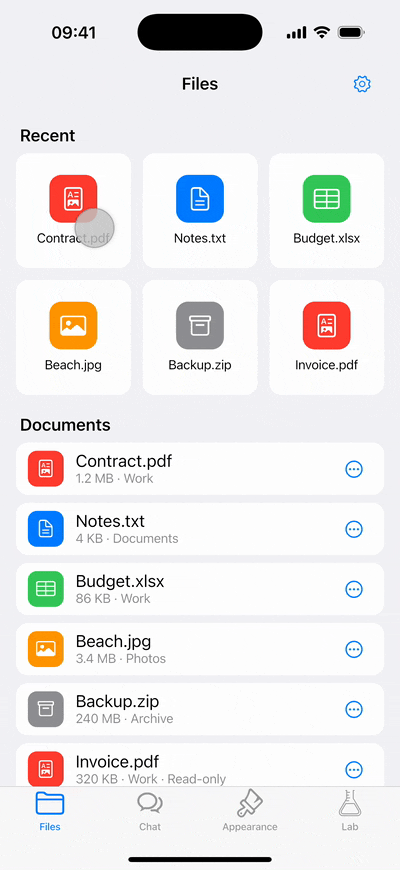
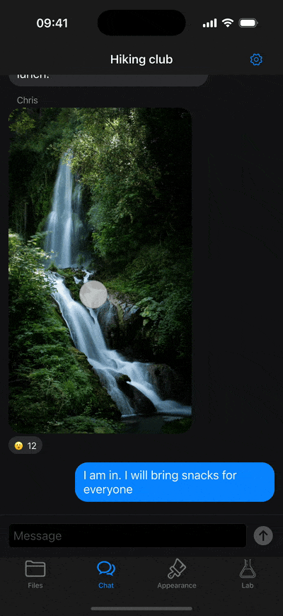
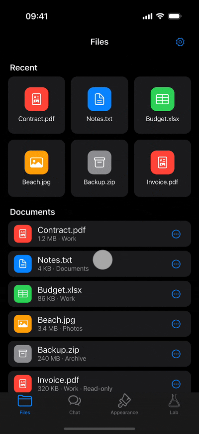
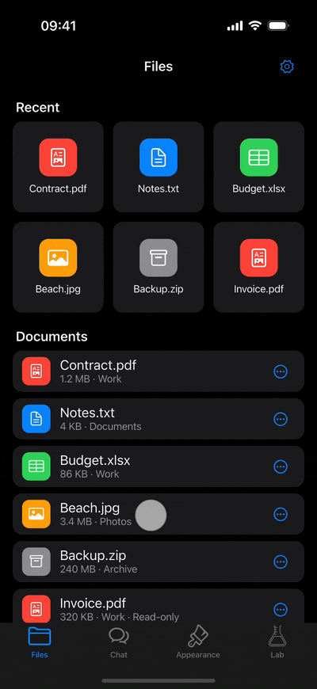
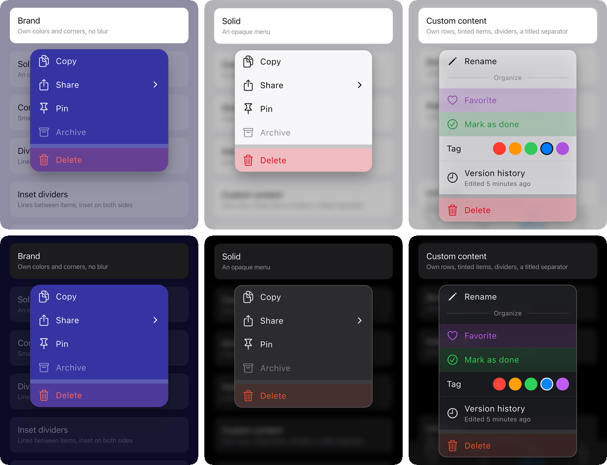

# smart_context_menu

An iOS-style context menu for Flutter with smart positioning, fluid animations,
drag-to-select and rich submenus.



## Features

- **Long press to open** with a lifted preview of the pressed widget; tap the preview
  to run the widget's main action.
- **Works with your `Hero` widgets**: the menu never wraps the pressed widget in a `Hero`
  of its own, so a photo that opens full screen keeps its `Hero`, and it flies from its place
  when the preview is tapped.
- **Smart positioning**: the pressed widget stays in place whenever there is room for the menu;
  very tall widgets can be scrolled, and long menus scroll inside themselves.
- **Drag-to-select**: slide a finger across the items and release on the one you want.
- **Custom slivers above the widget**, for example a reactions bar above a message,
  animated with the menu and optionally pinned to the top.
- **Submenus**: static, loaded asynchronously or paginated, with a back item and swipe back.
- **Lazy lists**: items are built only when they scroll into view, so long menus stay fast.
- **Loading states**: async items and submenus show loading, error and empty items, retry
  on failure, and keep one look across the menu that you can change in part or in full.
- **Listenable items** that rebuild from the state of your app while the menu is open,
  such as toggles, counters or actions that are already running.
- **Light and dark themes** out of the box, and your own styles for both: colors given
  as `CupertinoDynamicColor`s follow the theme of the app (see [Style](#style)).
- **Customizable**: size, colors, text, icons, blur, decoration, labels, dividers
  and custom item content, set once for the whole app with a theme or for each menu.
- **Programmatic control**: open and close the menu from code with `SmartContextMenuController`,
  or turn off the long press and open the menu only from code.

The [example app](example/) shows
every feature in a files app, a chat, a gallery of styles and a lab of edge cases.

## Getting started

Requires Flutter 3.32 or later (Dart 3.8).

```sh
flutter pub add smart_context_menu
```

```dart
import 'package:smart_context_menu/smart_context_menu.dart';
```

## Usage

Wrap a widget with `SmartContextMenu` and pass the items. The menu opens on long press.

```dart
SmartContextMenu(
  items: [
    SmartContextMenuItem.simple(
      title: 'Copy',
      leading: const Icon(CupertinoIcons.doc_on_doc),
      onTap: () => copy(),
    ),
    SmartContextMenuItem.simple(
      title: 'Delete',
      leading: const Icon(CupertinoIcons.delete),
      isDestructive: true,
      onTap: () => delete(),
    ),
  ],
  child: const MessageBubble(),
)
```

Only the long press is taken from the child: its taps, drags and other gestures keep working.

The preview above the open menu is a snapshot of the child, so its own buttons do not
work there. To run the main action of the child when the preview is tapped, for example
to open a message, pass `onPreviewTap`. The menu closes first, and `onPreviewTap` is called
once the preview is back in place:

```dart
SmartContextMenu(
  onPreviewTap: () => openMessage(message),
  items: items,
  child: MessageBubble(message),
)
```

### Header slivers



*A reactions bar above the message, in the dark theme: a tap on a reaction closes the menu.*

To show your own content above the widget while the menu is open, pass `headerSliversBuilder`.
It returns a list of slivers, which fade in and out with the menu and move with the widget
when it is dragged or the menu is stretched. The builder gets `SmartContextMenuHeaderDetails`:

- `alignment` tells how the widget and the menu are aligned horizontally. The slivers have
  the same horizontal padding as the widget, so `Align(alignment: header.alignment)` puts
  your content at the edge of the widget.
- `animation` runs from 0 to 1 as the slivers appear and back as they hide, to animate
  your content with the menu.
- `close()` closes the menu. It completes three quarters through the closing, as an item
  does, so the result of the action is seen as the menu closes.

A tap on your widgets in the slivers keeps the menu open; a tap on empty space next to them
closes it, as a tap anywhere outside the menu does.

```dart
SmartContextMenu(
  headerSliversBuilder: (context, header) => [
    SliverToBoxAdapter(
      child: Align(
        alignment: header.alignment,
        child: ReactionsBar(
          onSelected: (reaction) async {
            await header.close();
            react(message, reaction);
          },
        ),
      ),
    ),
    const SliverToBoxAdapter(child: SizedBox(height: 8)),
  ],
  items: items,
  child: MessageBubble(message),
)
```

For example, to scale the bar in from the edge of the widget, wrap it with a transition
driven by `header.animation`. Use `drive` rather than `CurvedAnimation`: the builder runs
on every rebuild, and a `CurvedAnimation` created there is never disposed.

```dart
ScaleTransition(
  scale: header.animation.drive(CurveTween(curve: Curves.easeOutBack)),
  // Grows from the bottom edge, next to the widget.
  alignment: Alignment(header.alignment.x, 1),
  child: ReactionsBar(onSelected: react),
)
```

The fade stays on top of your animation; set `fadeHeaderSlivers: false` to animate
the slivers only your way.

The slivers are direct children of the scroll view of the menu, so a `PinnedHeaderSliver`
stays at the top, right below the status bar, while a tall widget and the menu scroll
under it. It covers them there, so keep it small:

```dart
headerSliversBuilder: (context, header) => [
  PinnedHeaderSliver(
    child: Align(
      alignment: header.alignment,
      child: ReactionsBar(onSelected: react),
    ),
  ),
],
```

If the widget and the menu do not fit on the screen and the content scrolls as the menu
opens, the slivers appear once the widget is nearly in place, and hide at once when the menu
closes while the content is scrolled. The widget moves above everything as the menu opens
and closes, so it would cover a pinned sliver otherwise.

To show the slivers later, set `headerSliversDelay`. It counts from the start of the opening,
which takes 300 milliseconds: a shorter delay starts the slivers while the widget moves
into place, a longer one after that.

```dart
SmartContextMenu(
  headerSliversBuilder: (context, header) => [reactionsBar],
  // The bar appears a moment after the menu.
  headerSliversDelay: const Duration(milliseconds: 150),
  items: items,
  child: MessageBubble(message),
)
```

### Hero widgets


*A double tap next to the photo opens the menu from code; a tap on the preview opens the photo
with its own `Hero`.*

The widget can have its own `Hero`, for example a photo in a chat that opens full screen.
The menu flies the preview with a `Hero` too, but never puts it around your widget: it adds
it next to the widget, and only while the menu is open. So there is no `Hero` inside
a `Hero`, and while the menu is open, your widget stays in its place, hidden, with its
state kept.

Open the page from `onPreviewTap`: it is called once the menu has closed and the preview
is back in place, so your `Hero` flies from the place of the widget, as it does after a tap
on the widget itself:

```dart
SmartContextMenu(
  items: items,
  onPreviewTap: () => openPhoto(photo),
  child: GestureDetector(
    onTap: () => openPhoto(photo),
    child: Hero(
      tag: photo.id,
      child: Image.network(photo.url),
    ),
  ),
)
```

Here `openPhoto` pushes a page with a `Hero` of the same tag.

### Positioning

The menu opens right below the pressed widget, and the widget stays exactly where it was.
It moves up only when the widget and the menu together do not fit below it, and only as far
as needed. Horizontally, the menu lines up with the widget's left or right edge, or centers
under it, depending on where the widget is on the screen. If there is no room for the menu
at the widget's edge, it moves towards the middle of the screen; on a screen narrower than
the menu, it gets narrower. [Header slivers](#header-slivers)
are shown right above the widget; if there is no room for them, the widget and the menu
move down. If they do not fit on the screen together, the widget and the menu take priority:
the slivers scroll out at the top.

- **Shorter menus.** When the menu gets shorter, for example after returning from a submenu,
  it stays where it is, so it stays under the finger: the parent menu starts where the back
  item was. Set `moveBackDown: true` in `SmartContextMenuConfig` to move the widget back down
  instead; it never goes below its place.

- **Tall widgets.** If the widget and the menu do not fit on the screen even after moving,
  they can be scrolled together, so every part of the widget and the menu stays reachable.
- **Long menus.** The menu is never taller than a part of the screen set by
  `SmartContextMenuConfig.menuHeightFactor` (60% by default); items that do not fit scroll
  inside the menu and are built only when they scroll into view.

`screenPadding` in `SmartContextMenuConfig` sets the distance to the screen edges, on top
of the safe area such as the status bar or the notch in landscape. `menuGap` sets the distance
between the widget and the menu.

The place of the widget and its snapshot are taken when the menu opens. If the screen size
changes while it is open, for example when the device turns or a window is resized, the menu
closes without an action, as the system menu of iOS does.

### Item types

Create items with the method that matches what the item does:

| Method | What it does |
| --- | --- |
| `SmartContextMenuItem.simple` | Runs `onTap`. |
| `SmartContextMenuItem.submenu` | Opens a submenu with `children`. |
| `SmartContextMenuItem.asyncSubmenu` | Opens a submenu and loads its items. |
| `SmartContextMenuItem.pagingSubmenu` | Opens a submenu and loads its items page by page. |
| `SmartContextMenuItem.async` | Shows a placeholder and replaces it with a loaded item. |
| `SmartContextMenuItem.listenable` | Rebuilds from a `Listenable` while the menu is open. |
| `SmartContextMenuItem.loading` | Shows a loading state of an async item, a submenu or a listenable item. |
| `SmartContextMenuItem.error` | Shows a failed load; tapping it retries when it is the `error` of an async item or submenu. |
| `SmartContextMenuItem.empty` | Shows a submenu without items. |
| `SmartContextMenuItem.separator` | Separates groups of items. |

Each method returns its own subtype of `SmartContextMenuItem`, such as `SmartContextMenuSimpleItem`,
so you can `switch` on an item and read the fields of its type. New item types may be added in minor
versions, so keep a `_` case when you switch on items.

#### Submenu



*In the dark theme: Share is a submenu, and Messages inside it loads when it opens. The back
item and a swipe right go back.*

```dart
SmartContextMenuItem.submenu(
  title: 'Move to',
  leading: const Icon(CupertinoIcons.folder),
  children: [
    SmartContextMenuItem.simple(title: 'Documents', onTap: () => move('docs')),
    SmartContextMenuItem.simple(title: 'Archive', onTap: () => move('archive')),
  ],
)
```

Tap the back item at the top of the submenu or swipe right to return to the parent menu.
The submenu follows the finger and slides back in place if the swipe is short.
To turn the swipe off, set `enableSwipeBack: false` in `SmartContextMenuConfig`.

#### Async submenu

The items are loaded when the submenu opens and cached until the menu closes.
While loading, the submenu shows an activity indicator in the middle; pass a
[loading item](#loading-item) as `loading` to show a row with a title instead.
If loading fails or takes longer than `timeout` (10 seconds by default), the submenu
shows an [error item](#error-item) that retries on tap; pass your own as `error`.
If there are no items, it shows an [empty item](#empty-item); pass your own as `empty`.

```dart
SmartContextMenuItem.asyncSubmenu(
  title: 'Recent files',
  leading: const Icon(CupertinoIcons.clock),
  loading: SmartContextMenuItem.loading(title: 'Loading files'),
  empty: SmartContextMenuItem.empty(title: 'No recent files'),
  asyncChildren: () async {
    final files = await repository.recentFiles();
    return [
      for (final file in files)
        SmartContextMenuItem.simple(title: file.name, onTap: () => open(file)),
    ];
  },
)
```

#### Paginated submenu


*Reactions loads the first page of people when it opens and the next page when it scrolls
to the end.*

The first page is loaded with `initialMetadata`. The last item of each page, a `simple` item
or a separator, carries the metadata of the next page in `pagingMetadata`; the next page is loaded when the
user scrolls to the end. Leave it `null` on the last page. While a page loads, the submenu
shows `loading` after the loaded items, as an async submenu does. If a page fails to load
or takes longer than `timeout` (10 seconds by default), the submenu shows `error` after
the loaded items, and tapping it loads the page again. If the first page is empty, the submenu
shows `empty`; an empty next page just ends the list.

```dart
SmartContextMenuItem.pagingSubmenu(
  title: 'Contacts',
  initialMetadata: const SmartContextMenuPagingMetadata(limit: 20),
  asyncPagingChildren: (metadata) async {
    final page = await api.contacts(page: metadata.page, limit: metadata.limit);
    return [
      for (final (index, contact) in page.items.indexed)
        SmartContextMenuItem.simple(
          title: contact.name,
          pagingMetadata: index == page.items.length - 1 && page.hasMore
              ? metadata.copyWith(page: metadata.page + 1)
              : null,
        ),
    ];
  },
)
```

`SmartContextMenuPagingMetadata` also has `nextCursor` for cursor-based APIs and
`extra` for custom parameters.

#### Async item

The placeholder loads its item as soon as it appears. While loading, it shows `loading`,
a `SmartContextMenuItem.loading` with the loading label by default. If loading fails or takes
longer than `timeout` (10 seconds by default), it shows `error`, a `SmartContextMenuItem.error`,
and tapping it loads the item again, see [error item](#error-item).

```dart
SmartContextMenuItem.async(
  loading: SmartContextMenuItem.loading(title: 'Checking access'),
  error: SmartContextMenuItem.error(title: 'Could not check access'),
  asyncItem: () async {
    final canEdit = await permissions.canEdit();
    return SmartContextMenuItem.simple(
      title: 'Edit',
      isDisabled: !canEdit,
      onTap: () => edit(),
    );
  },
)
```

The loader decides what to show for its result: an item that runs an action or opens a submenu,
or a `loading`, `error` or `empty` item, for example `SmartContextMenuItem.empty` when there is
nothing to show. Its return type, `SmartContextMenuAsyncResult`, allows only these: returning
an async item, a listenable item or a separator does not compile. A helper that builds the result
needs the type of its item, such as `SmartContextMenuSimpleItem`, not `SmartContextMenuItem`.

#### Listenable item



*In the dark theme: after a tap, Download shows its progress in the open menu and turns
into Remove Download when it is done.*

Use it when the state of an item lives in your app and can change while the menu is open:
a toggle that keeps the menu open, a counter, or an action that is already running.
The builder runs again each time `listenable` notifies and returns the item to show.
While the item is loading, return `SmartContextMenuItem.loading`: it shows its title with
an activity indicator, as an async item does, and ignores taps.

```dart
SmartContextMenuItem.listenable(
  listenable: favorites,
  builder: () {
    if (favorites.isLoading) return SmartContextMenuItem.loading(title: 'Checking');
    final isFavorite = favorites.contains(post.id);
    return SmartContextMenuItem.simple(
      title: isFavorite ? 'Remove from Favorites' : 'Add to Favorites',
      leading: Icon(isFavorite ? CupertinoIcons.heart_fill : CupertinoIcons.heart),
      closeOnTap: false,
      onTap: () => favorites.toggle(post.id),
    );
  },
)
```

Unlike an async item, the state belongs to your app: the item is not loaded once but built
again on every notification. The builder returns a `SmartContextMenuItem.simple`, whose
`onTap` and `closeOnTap` are used, or a `loading`, `error` or `empty` item, which ignore taps.
Its return type, `SmartContextMenuListenableResult`, allows only these, so returning a submenu
or a separator does not compile; declare helpers with the type of their item, as for an async item.
To retry a failed load of your app from the item, return a `simple` item:

```dart
SmartContextMenuItem.listenable(
  listenable: views,
  builder: () => switch (views.state) {
    ViewsState.loading => SmartContextMenuItem.loading(title: 'Views'),
    ViewsState.failed => SmartContextMenuItem.simple(
      title: 'Try again',
      trailing: const Icon(SmartContextMenuDefaults.retryIcon),
      closeOnTap: false,
      onTap: views.reload,
    ),
    ViewsState.loaded => SmartContextMenuItem.simple(title: 'Views: ${views.count}'),
  },
)
```

The menu does not dispose `listenable`.

Any `Listenable` works: a `ChangeNotifier`, a `ValueNotifier`, several of them combined
with `Listenable.merge`, or a controller of a state management package that implements
`Listenable`, such as `GetxController`, which notifies on `update()` called without ids.
Widgets such as `Obx` or `BlocBuilder` do not help here: an item is data, not a widget,
and its builder runs outside of them. To rebuild the item from a `Stream`, for example
of a Bloc or of a GetX `Rx`, wrap the stream in a `ChangeNotifier`:

```dart
final class StreamListenable extends ChangeNotifier {
  StreamListenable(Stream<Object?> stream) {
    _subscription = stream.listen((_) => notifyListeners());
  }

  late final StreamSubscription<Object?> _subscription;

  @override
  void dispose() {
    _subscription.cancel();
    super.dispose();
  }
}
```

Create the adapter next to the state it listens to and dispose it there as well.

#### Loading item

A loading item shows its `title` (the loading label by default) with `leading` and an activity
indicator, and ignores taps. `trailing` replaces the indicator, and `child` replaces the whole
content; text and icons in it take the color of the item. The menu replaces the item once loading
finishes when it is the `loading` of an async item or an async or paginated submenu, or when
a listenable item returns it. Anywhere else it stays until the menu closes.

Loading, error and empty items look alike: the title in the middle, a sign of the state
after it, and `leading` free for your own icon. They do not respond to taps and are not dimmed.
The [style](#style) sets their alignment, icons and loading indicator for all menus.

| Item | Title | After the title |
| --- | --- | --- |
| `loading` | loading label | activity indicator |
| `error` | error label | error icon |
| `error` of an async item or submenu | retry label | retry icon |
| `empty` | empty label | empty icon |

Your own `title`, `leading` and `trailing` replace the defaults, and `child` replaces the row.

While a submenu loads, it shows an activity indicator in the middle by default. A `loading` item
you pass is shown as a row; to center your own indicator, pass it in `child`:

```dart
SmartContextMenuItem.asyncSubmenu(
  title: 'Recent files',
  loading: SmartContextMenuItem.loading(
    child: const Center(child: CircularProgressIndicator()),
  ),
  asyncChildren: () => loadRecentFiles(),
)
```

```dart
SmartContextMenuItem.listenable(
  listenable: sync,
  builder: () => switch (sync.state) {
    SyncState.checking => SmartContextMenuItem.loading(title: 'Checking'),
    SyncState.syncing => SmartContextMenuItem.loading(title: 'Syncing'),
    SyncState.idle => SmartContextMenuItem.simple(title: 'Sync now', onTap: sync.start),
  },
)
```

#### Error item

An error item shows a failed load: its `title` (the error label by default) with the error icon.
As the `error` of an async item, an async or a paginated submenu, it loads again on tap and shows
the retry label and icon unless it has its own `title` and `trailing`. Anywhere else,
for example from the builder of a listenable item, it ignores taps.

A button in `child` handles its own taps, while the rest of the row still retries:

```dart
SmartContextMenuItem.async(
  error: SmartContextMenuItem.error(
    child: Row(
      children: [
        const Expanded(child: Text('Could not sync')),
        CupertinoButton(onPressed: showSyncLog, child: const Text('Details')),
      ],
    ),
  ),
  asyncItem: () => loadSyncItem(),
)
```

An error item is shown for a load that throws. For an error your loader recognizes,
such as missing access, catch it and return an item yourself: an `error` item that ignores taps,
or a `simple` item with its own action.

#### Empty item

An async or a paginated submenu without items shows an empty item: its `title` (the empty label
by default) with the empty icon. Pass your own as `empty` and return no items from the loader.
A paginated submenu shows it only when the first page is empty, and a static submenu without
`children` shows the default one. A listenable item can return it too.

```dart
SmartContextMenuItem.asyncSubmenu(
  title: 'Drafts',
  empty: SmartContextMenuItem.empty(title: 'No drafts'),
  asyncChildren: () => loadDrafts(),
)
```

#### Separator

A separator splits the items into groups. It has no actions and no press highlight,
and drag-to-select passes over it. By default it is a band set by `separatorHeight`
and `separatorColor` in the style; `child` replaces it, for example with a section title.

Separators at the start or the end of a menu are not shown, and several separators
in a row show as one. So a menu whose items depend on the user or the content
needs no extra checks:

```dart
[
  if (canReply)
    SmartContextMenuItem.simple(title: 'Reply', onTap: () => reply()),
  SmartContextMenuItem.simple(title: 'Copy', onTap: () => copy()),
  if (isAdmin) SmartContextMenuItem.simple(title: 'Pin', onTap: () => pin()),
  SmartContextMenuItem.separator(),
  // Without Delete, the separator above is not shown.
  if (canDelete)
    SmartContextMenuItem.simple(
      title: 'Delete',
      isDestructive: true,
      onTap: () => delete(),
    ),
]
```

For a thin line instead of a band, set a small `separatorHeight` and the
`dividerColor` as `separatorColor`. To draw lines between all items, see
[Dividers](#dividers).

### Opening from code

Pass a `SmartContextMenuController` to open and close the menu from code.
To open the menu only from code, set the activation mode to `manual`.

```dart
final controller = SmartContextMenuController();

SmartContextMenu(
  controller: controller,
  config: const SmartContextMenuConfig(
    activationMode: SmartContextMenuActivationMode.manual,
  ),
  items: items,
  child: child,
);

IconButton(
  icon: const Icon(CupertinoIcons.ellipsis),
  onPressed: controller.open,
);
```

The controller notifies its listeners when the menu opens or closes, see `isOpen`.
Dispose it when it is no longer needed.

### Customization



*Three styles from the example, in the light and dark themes: brand colors with only dimming
behind the menu, an opaque menu, and items with their own content.*

All settings live in `SmartContextMenuConfig`, and the appearance in its `style`.
Every field has a default, so set only what you need.

```dart
const menuConfig = SmartContextMenuConfig(
  menuWidth: 250,
  enableHaptics: false,
  style: SmartContextMenuStyle(
    menuBlur: SmartContextMenuBlur.small,
    backgroundBlur: SmartContextMenuBlur(10),
    borderRadius: BorderRadius.all(Radius.circular(20)),
    menuShadows: [BoxShadow(color: Color(0x33000000), blurRadius: 20)],
  ),
);
```

`menuShadows` replaces the default shadows under the menu; pass an empty list to remove them.

#### Theme and config

A menu takes its config from the first of:

1. its own `config`;
2. the nearest `SmartContextMenuTheme` above it;
3. the defaults, `const SmartContextMenuConfig()`.

Both the theme and `config` are optional, so pick what fits your app.

**The whole app.** Set the config once with a theme in the `builder` of the app.
Menus need no `config` then:

```dart
MaterialApp(
  builder: (context, child) => SmartContextMenuTheme(
    config: menuConfig,
    child: child!,
  ),
  home: const HomePage(),
);

SmartContextMenu(
  items: items,
  child: child,
);
```

A theme in the `builder` can also pick the config by the screen size, for example
a shorter menu on tablets:

```dart
MaterialApp(
  builder: (context, child) {
    final isTablet = MediaQuery.sizeOf(context).shortestSide >= 600;
    return SmartContextMenuTheme(
      config: menuConfig.copyWith(menuHeightFactor: isTablet ? 0.45 : 0.6),
      child: child!,
    );
  },
  home: const HomePage(),
);
```

**A part of the app.** Wrap a screen, a list or any other subtree with its own theme.
The nearest theme wins and replaces the outer one as a whole, so start from the outer one
to keep its settings:

```dart
SmartContextMenuTheme(
  config: SmartContextMenuTheme.of(context).copyWith(enableSwipeBack: false),
  child: const ChatScreen(),
)
```

**One menu.** Pass `config` to the menu. It replaces the theme for this menu as a whole:

```dart
SmartContextMenu(
  config: const SmartContextMenuConfig(menuWidth: 220),
  items: items,
  child: child,
)
```

To change a few settings and keep the rest of the theme, start from it with `copyWith`.
`SmartContextMenuStyle` has it too:

```dart
final theme = SmartContextMenuTheme.of(context);

SmartContextMenu(
  config: theme.copyWith(
    activationMode: SmartContextMenuActivationMode.manual,
    style: theme.style.copyWith(menuBlur: SmartContextMenuBlur.small),
  ),
  controller: controller,
  items: items,
  child: child,
)
```

**Without a theme.** Keep a shared config in a constant and pass it to the menus,
with `copyWith` where a menu needs a change:

```dart
SmartContextMenu(
  config: menuConfig,
  items: items,
  child: child,
);

SmartContextMenu(
  config: menuConfig.copyWith(
    activationMode: SmartContextMenuActivationMode.manual,
  ),
  controller: controller,
  items: items,
  child: child,
);
```

#### Style

`SmartContextMenuStyle` also sets the text, colors, icons and spacing of items, so the menu
can match the app theme:

```dart
const menuStyle = SmartContextMenuStyle(
  titleStyle: TextStyle(
    fontFamily: 'Montserrat',
    fontSize: 17,
    color: Color(0xFFFFFFFF),
  ),
  disabledForegroundColor: Color(0x99FFFFFF),
  destructiveColor: Color(0xFFFF453A),
  highlightColor: Color(0x1FFFFFFF),
  dividerColor: Color(0x999E9E9E),
  backButtonColor: Color(0xFF0A84FF),
  submenuIcon: Icons.arrow_forward_ios,
  backIcon: Icons.arrow_back_ios_new,
  itemPadding: EdgeInsets.symmetric(horizontal: 16, vertical: 10),
  itemChildrenGap: 10,
);
```

The color of `titleStyle` is used for enabled items that are not destructive.
Disabled and destructive items use `disabledForegroundColor` and `destructiveColor`.
Disabled items have no background unless `disabledBackgroundColor` is set.
A pressed item is highlighted with a translucent `titleStyle` color; `highlightColor`
replaces it. Tinted and destructive items keep their own pressed tint.
Icons in `leading` and `trailing` take the title color unless they set their own;
text there takes the style and the color of the title, such as a count before the chevron.
The back item of a submenu merges `backButtonTitleStyle` (bold by default) over
`titleStyle`; `backButtonColor` sets the color of its title and icon.
Titles take up to `titleMaxLines` lines (2 by default) and are truncated with an ellipsis.
`itemPadding` and `itemChildrenGap` set the padding of items and the gap between
their icons and title.
Loading, error and empty items center their titles; `statusTitleAlign` changes this, and
`errorIcon`, `retryIcon` and `emptyIcon` change their icons, also for the items the menu
shows by itself, such as the empty item of a submenu without items. `loadingIndicator`
replaces the activity indicator, both in loading items and in the middle of a loading submenu.
It is used at its own size, so size it to fit an item row:

```dart
const style = SmartContextMenuStyle(
  loadingIndicator: SizedBox.square(
    dimension: 20,
    child: CircularProgressIndicator(strokeWidth: 2),
  ),
);
```

**Settings of an item take precedence over the style.** The style sets the look of
all items, and an item changes it only for itself:

```dart
// The style: padding and text of all items.
const style = SmartContextMenuStyle(
  itemPadding: EdgeInsets.symmetric(horizontal: 16, vertical: 10),
  titleStyle: TextStyle(fontSize: 17),
);

// This item uses its own padding and text style instead.
SmartContextMenuItem.simple(
  title: 'Open in new window',
  padding: const EdgeInsets.symmetric(horizontal: 16, vertical: 16),
  titleStyle: const TextStyle(fontSize: 15, fontWeight: FontWeight.w600),
  onTap: () => openInNewWindow(),
)
```

The same goes for `childrenGap` over `itemChildrenGap`, and `tintColor` over
`destructiveColor`.

To give one item its own color, set its `tintColor`. The item is tinted like a destructive
one: the title and icons take the color, and the background a translucent shade of it.
A disabled tinted item keeps only the dimmed color of the title and icons.
`tintColor` takes precedence over `destructiveColor` and the `titleStyle` color.

```dart
SmartContextMenuItem.simple(
  title: 'Approve',
  leading: const Icon(CupertinoIcons.checkmark),
  tintColor: CupertinoColors.systemGreen,
  onTap: () => approve(),
)
```

Colors may be `CupertinoDynamicColor`s: they follow the light and dark theme.
A plain `Color` is used as is in both themes. The default values are available
in `SmartContextMenuDefaults`.

#### Dividers

Dividers are thin lines between items, as in iOS. They are off by default; set
`dividersBetweenItems: true` in the style to draw a line between every two items.
No line is drawn next to a separator, so groups stay split by separators only.
The style also sets the look of the lines: `dividerColor`, `dividerThickness`, and
the space before and after them with `dividerIndent` and `dividerEndIndent`.

```dart
const style = SmartContextMenuStyle(
  dividersBetweenItems: true,
  dividerThickness: 1,
  // Lines up with the title after a leading icon.
  dividerIndent: 52,
);
```

To split items into groups, use a [separator](#separator).

#### Custom item content

`customBuilder` replaces the content of an item. The item padding and press highlight
are kept, and taps work as usual. Interactive widgets inside, such as
buttons, handle their own taps: the item is not triggered over them. The builder
receives the item state, including `foregroundColor`: the color of the title and icons
for the current state and theme.

```dart
SmartContextMenuItem.simple(
  onTap: () => reply(),
  customBuilder: (context, state) => Row(
    children: [
      Icon(CupertinoIcons.reply, color: state.foregroundColor),
      const SizedBox(width: 12),
      Text('Reply', style: TextStyle(color: state.foregroundColor)),
    ],
  ),
)
```

### Localization

The menu shows a few strings itself: the back item, the retry label and the titles of loading,
error and empty items without their own title. Override them with `SmartContextMenuLabels`,
for example in the config of a [theme](#theme-and-config) to localize all menus at once:

```dart
SmartContextMenuConfig(
  labels: SmartContextMenuLabels(
    back: l10n.back,
    retry: l10n.retry,
    loading: l10n.loading,
    error: l10n.couldNotLoad,
    empty: l10n.noItems,
  ),
)
```

## Additional information

Found a bug or have a feature request? Open an issue on
[GitHub](https://github.com/BinaryRift/smart_context_menu/issues).

Licensed under the [MIT License](LICENSE).
