# smart_context_menu

**English** | [Русский](README.ru.md)

[](https://pub.dev/packages/smart_context_menu)
[](https://pub.dev/packages/smart_context_menu/score)
[](https://pub.dev/packages/smart_context_menu/score)
[](https://github.com/BinaryRift/smart_context_menu/actions/workflows/ci.yml)
[](LICENSE)
[](https://thenothingworks.dev/demo/smart-context-menu/)

Right click on your desktop, long press on your phone, tap on your button: a single widget provides your Flutter app with a context menu that is styled and animated like the one in iOS. It takes your own widgets as menu items and above the preview (e.g. a reactions bar), and it has no third-party dependencies. You can build it in many ways: a simple list of items, a compact row of the most used actions, or a complex mix of rows, dynamic submenus and live items. Not into the iOS design? Make your own: customize colors, shapes, blur, items and more, and keep the sweet animations.
Requires Flutter 3.32 or later (Dart 3.8). **[Get started →](#getting-started)**

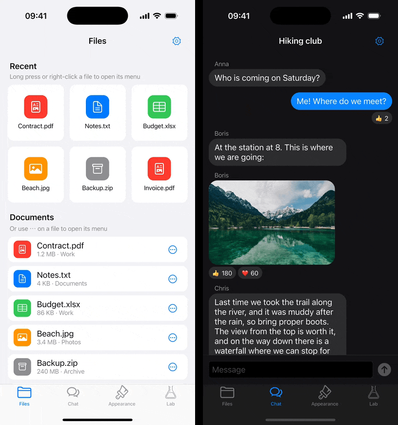

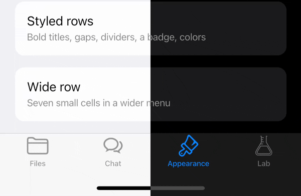

<br>

**[Try the live demo in your browser →](https://thenothingworks.dev/demo/smart-context-menu/)** 
**[Watch the 56-second overview →](https://youtube.com/shorts/NIzPK4mWpc8?feature=share)**

## Features

**On every platform**

- **Mobile, desktop and web**: a long press on a touch screen, a right click with a mouse
  or a two-finger click on a trackpad opens the same menu. No platform code needed.
- **Cursor hover**: on desktop and the web, items highlight under the pointer, as in
  native menus. Click to select.
- **Drag-to-select**: once the menu is open, put your finger on it and slide across the
  items, rows included. Lift it on the one you want.
- **Open from a button or from code**: any widget inside the wrapped one, such as
  a button, opens and closes its menu with `SmartContextMenu.of(context)`, no controller
  needed. A `SmartContextMenuController` does the same from anywhere else, and the
  gestures can be turned off.

**Motion**

- **Alive under the finger**: as you slide over the items, the menu stretches towards
  your finger and the preview follows. Both spring back when you lift it.
- **No jumps**: the menu smoothly changes its height as a submenu opens or items load.
  If there's not enough space, the preview and the menu glide up together to make room.
- **Swipe back** drags the submenu with your finger while the menu smoothly takes the
  height of the parent menu.

You can find all these effects in [Animations](#animations).

**Content**

- **Actions** with icons, destructive and tinted colors, disabled items, separators,
  section titles and dividers.
- **Rows** put the most used actions side by side, as the compact menus of iOS do: icons
  with titles or icons alone, mixed with the usual items. Drag-to-select glides across the
  cells and on into the list.
- **Custom items**: any widget can be the content of an item, for a look entirely your
  own. It knows whether the item is pressed or hovered, can have its own buttons, and the
  item still highlights and handles taps correctly.
- **Submenus** can be static, loaded asynchronously or paginated. They have a back item
  and support swipe back.
- **RTL submenus**: transitions, swipe back and the default navigation chevrons follow
  the reading direction. The example app has an RTL layout switch to try them.
- **Async items** can show loading, error and empty states and be retried on failure,
  with the same look throughout the menu.
- **Lazy lists**: items are built only as they scroll into view, and async items start
  loading only then, so long menus stay fast.
- **Listenable items** rebuild from app state while the menu is open: toggles, counters
  and actions in progress, such as a download.
- **Custom widgets above the preview**: slivers, such as a reactions bar, above the
  preview, animated with the menu and optionally pinned to the top.

**Preview**

- **Lifted preview**: the widget lifts over a blurred background. A tap on it runs the
  main action of the widget, for example opens a message.
- **`Hero` support**: a photo that opens full screen keeps its `Hero` and flies from its
  place after a tap on the preview.

**Positioning**

- **The widget stays in place**: if there is enough space, the preview stays put and
  moves only as much as needed. A widget that is too tall scrolls with the menu.
- **Long menus** scroll inside, up to the part of the screen you choose.

**Appearance**

- **Light and dark themes** out of the box. Colors given as `CupertinoDynamicColor`s
  adapt to the theme of the app (see [Item style](#item-style)).
- **Customizable**: size, colors, text, icons, blur, shadows and labels. Set them once
  for the whole app with a theme, for a single menu, or for a single item.

The [example app](example/) shows all of the above: a files app, a chat, a gallery of
styles and a lab of edge cases.

## Contents

- [Why not `CupertinoContextMenu`?](#why-not-cupertinocontextmenu)
- [Getting started](#getting-started)
- [Usage](#usage)
  - [Positioning](#positioning)
  - [Item types](#item-types)
    - [Submenu](#submenu)
    - [Async submenu](#async-submenu)
    - [Paginated submenu](#paginated-submenu)
    - [Async item](#async-item)
    - [Listenable item](#listenable-item)
    - [Loading item](#loading-item)
    - [Error item](#error-item)
    - [Empty item](#empty-item)
    - [Separator](#separator)
    - [Row](#row)
  - [Opening from code](#opening-from-code)
  - [Header slivers](#header-slivers)
  - [Hero widgets](#hero-widgets)
  - [Configuration](#configuration)
    - [Theme and config](#theme-and-config)
    - [Localization](#localization)
    - [Apps on `cupertino_ui`](#apps-on-cupertino_ui)
  - [Appearance](#appearance)
    - [Item style](#item-style)
    - [Dividers](#dividers)
    - [Back item style](#back-item-style)
    - [Status style](#status-style)
    - [Row style](#row-style)
    - [Custom item content](#custom-item-content)
  - [Design guidelines](#design-guidelines)
- [Animations](#animations)
- [Coming soon](#coming-soon)
- [Additional information](#additional-information)

## Why not `CupertinoContextMenu`?

`CupertinoContextMenu` from Flutter opens a list of actions on a long press only.
This package keeps the long press and adds what apps usually need:

- A right click, a two-finger click on a trackpad and cursor hover on desktop and the web.
- Submenus: static, async or paginated, with swipe back.
- Rows of compact actions side by side, as in the menus of iOS.
- Drag-to-select across the items.
- A liquid stretch that ties the menu to the preview under your finger.
- Smooth height changes, and the preview gliding up to make room as the menu opens.
- Your own slivers above the widget, such as a reactions bar.
- Opening from a button in the widget or from code.
- Full control over the look: one theme for all menus or a config per menu, a style for
  the colors, text, blur and shadows, styles for items and your own item content.
- Full control over the behavior: the width and height of the menu, its distance to the
  widget and the screen edges, haptics, and closing on a tap outside or with swipe back.

## Getting started

Add the package:

```sh
flutter pub add smart_context_menu
```

Or add it to `pubspec.yaml`:

```yaml
dependencies:
  smart_context_menu: ^1.0.4
```

Import it:

```dart
import 'package:smart_context_menu/smart_context_menu.dart';
```

Wrap your widget with `SmartContextMenu` and pass the items:

```dart
SmartContextMenu(
  items: [
    SmartContextMenuItem.simple(
      title: 'Copy',
      leading: const Icon(CupertinoIcons.doc_on_doc),
      onTap: () => copy(),
    ),
    SmartContextMenuItem.simple(
      title: 'Delete',
      leading: const Icon(CupertinoIcons.delete),
      isDestructive: true,
      onTap: () => delete(),
    ),
  ],
  child: const MessageBubble(),
)
```

That's it: a long press, a right click or a two-finger click on a trackpad opens the menu.
See [Usage](#usage) for everything else.

**Good to know**

- Requires Flutter 3.32 or later (Dart 3.8).
- On desktop and the web, a long press of the mouse opens the menu too, and haptics
  do nothing.
- On the web, the browser shows its own context menu on a right click as well. To hide
  it, call `BrowserContextMenu.disableContextMenu()` in your app. This affects the whole
  page, including text fields, so the package leaves that choice to the app:

  ```dart
  import 'package:flutter/foundation.dart' show kIsWeb;
  import 'package:flutter/services.dart' show BrowserContextMenu;

  Future<void> main() async {
    WidgetsFlutterBinding.ensureInitialized();
    if (kIsWeb) await BrowserContextMenu.disableContextMenu();
    runApp(const MyApp());
  }
  ```

- In debug builds, the first openings of the menu and its transitions may stutter while
  the code is compiled; release builds are smooth from the start. The iOS Simulator runs
  only debug builds, so check smoothness on a device or in a release build on macOS.

## Usage

Wrap a widget with `SmartContextMenu` and pass the items, as in [Getting started](#getting-started).
The menu takes only the long press from the child: its taps, drags and other gestures keep working.
The child's secondary pointer-down handler also runs. A secondary tap handler that
waits for release can be canceled as the menu opens. Use `manual` and open the menu
from the child's handler with `SmartContextMenu.of(context).open()` when you need to
coordinate them.

Menus can be nested, for example a photo with its own menu inside a card with a menu.
A long press or a right click on the photo opens only its menu, and anywhere else
on the card opens the menu of the card.

The preview above the open menu is a snapshot of the child, so its own buttons do not
work there. To run the main action of the child when the preview is tapped, for example
to open a message, pass `onPreviewTap`. The menu closes first, and `onPreviewTap` is called
once the preview is back in place:

```dart
SmartContextMenu(
  onPreviewTap: () => openMessage(message),
  items: items,
  child: MessageBubble(message),
)
```

`SmartContextMenu` takes:

| Parameter | What it does |
| --- | --- |
| `child` | The widget that opens the menu on long press and is shown as the preview. |
| `items` | The items of the menu, see [Item types](#item-types). |
| `config` | The settings of this menu, see [Configuration](#configuration). |
| `controller` | Opens and closes the menu from outside the child, see [Opening from code](#opening-from-code). |
| `onPreviewTap` | Runs the main action of the child once the menu has closed after a tap on the preview. |
| `headerSliversBuilder` | Builds your slivers above the widget, see [Header slivers](#header-slivers). |
| `fadeHeaderSlivers` | Whether the slivers fade in and out with the menu, `true` by default. |
| `headerSliversDelay` | Shows the slivers later than the menu, no delay by default. |

### Positioning

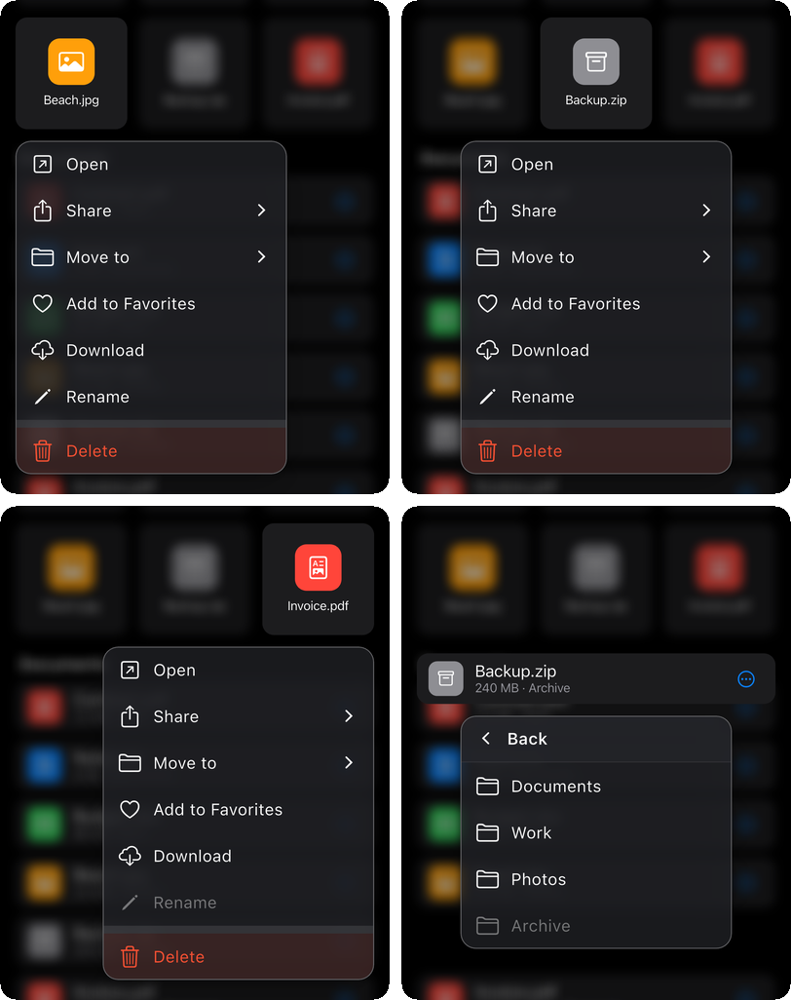

*In the dark theme: the menu is positioned to the left, center or right of the widget. If the widget is low on the screen, it will be moved up only as much as needed to fit the menu and the submenu.*

The menu will be shown directly below the pressed widget, which stays in place.
The widget moves up only if the menu and the widget together take up too much space. The widget is moved up by the smallest distance required to fit the menu. 
In the horizontal direction, the menu will be positioned to the left or right edge of the widget, or centered below the widget, depending on where the widget is on the screen. If there is no room for the menu to the left or right edge of the widget, the menu will be moved towards the middle of the screen.
If the screen is not wide enough to show the full menu, the menu will be made narrower. [Header slivers](#header-slivers) will be positioned directly above the widget preview. If there is no room for them, the widget (and its menu) is moved down. If the widget, the menu and the slivers together take up too much space, the widget and the menu have priority and the slivers scroll away at the top of the screen.


- **Shorter menus.** If the menu is shorter than before (for instance when leaving a
  submenu), it won't be moved upward but it will stay under the finger, with the parent
  menu starting where the back item was before. You can configure the menu to move back
  down, but not below the original position of the widget using `moveBackDown: true` in
  the [configuration](#configuration) `SmartContextMenuConfig`.

- **Tall widgets.** If the widget and the menu together, even after being moved, are 
  still too tall to fit on the screen, it is possible to scroll both of them together.
  That way, the full content of both the widget and the menu is always reachable.

- **Long menus.** The height of the menu is restricted to a certain fraction of the
  screen (`SmartContextMenuConfig.menuHeightFactor`, default value: 60%), look at [configuration](#configuration).
  The rest of the menu items that do not fit on the screen are scrolled inside the menu.
  Menu items are lazily created when they appear in the visible area.

The menu [configuration](#configuration) also takes two parameters specifying spacing:
- `screenPadding` specifies the distance to the edges of the screen. This adds to the
  safe area (like the status bar or landscape notch)
- `menuGap` specifies the distance between the widget and the menu.

When the menu is opened, the positions of the widget and the snapshot are stored. If the screen size changes while the menu is open (for instance because the phone is turned or the window is resized), the menu will close, without triggering an action. This is consistent with how the system menu in iOS works.

### Item types

Create items with the method that matches what the item does:

| Method | What it does |
| --- | --- |
| `SmartContextMenuItem.simple` | Runs `onTap`. |
| `SmartContextMenuItem.submenu` | Opens a submenu with `children`. |
| `SmartContextMenuItem.asyncSubmenu` | Opens a submenu and loads its items. |
| `SmartContextMenuItem.pagingSubmenu` | Opens a submenu and loads its items page by page. |
| `SmartContextMenuItem.async` | Shows a placeholder and replaces it with a loaded item. |
| `SmartContextMenuItem.listenable` | Rebuilds from a `Listenable` while the menu is open. |
| `SmartContextMenuItem.loading` | Shows a loading state of an async item, an async or paginated submenu, or a listenable item. |
| `SmartContextMenuItem.error` | Shows a failed load; tapping it retries when it is the `error` of an async item or an async or paginated submenu. |
| `SmartContextMenuItem.empty` | Shows a submenu without items. |
| `SmartContextMenuItem.separator` | Separates groups of items. |
| `SmartContextMenuItem.row` | Shows other items as compact cells side by side in one line. |

Async items and async or paginated submenus load their data themselves: the menu calls
the loader, shows the loading and error states, and keeps the result until it closes.
A listenable item shows state that your app owns and updates, and rebuilds whenever it changes.

Each method returns its own subtype of `SmartContextMenuItem`, such as `SmartContextMenuSimpleItem`,
so you can `switch` on an item and read the fields of its type. New item types may be added in minor
versions, so keep a `_` case when you switch on items.

Simple items and submenus share these settings:

| Field | What it does |
| --- | --- |
| `title` | The text of the item, in up to `titleMaxLines` lines of the style. |
| `leading` | A widget before the title, usually an icon. |
| `trailing` | A widget after the title; a submenu shows it before its chevron. Not shown in a [row](#row). |
| `isDestructive` | Tints the item with `destructiveColor` of the style. |
| `tintColor` | Tints the item with its own color, see [Item style](#item-style). |
| `isDisabled` | Dims the item; it ignores taps. |
| `titleStyle`, `padding`, `childrenGap` | Replace the settings of the style for this item, see [Item style](#item-style). |
| `customBuilder` | Replaces the content of the item, see [Custom item content](#custom-item-content). |
| `closeOnTap` | Only for simple items: whether the menu closes on tap, `true` by default. |

Icons in `leading` and `trailing` take the title color unless they set their own;
text there takes the style and the color of the title, such as a count before the chevron.

With `closeOnTap: false`, the menu stays open after `onTap`, for example for a toggle.
A simple item without `onTap` only closes the menu; with `closeOnTap: false` as well,
it does nothing: it is not highlighted and ignores taps, for example a row of your own
buttons in `customBuilder`.

Every item has an `id`, generated when none is given. Loaded submenus and items are cached
by it until the menu closes, so ids you set must be unique across the menu and its submenus.
A failed load is not cached: the item loads again when it shows up again, for example after
returning from a submenu, and the submenu loads again when it opens again.

#### Submenu

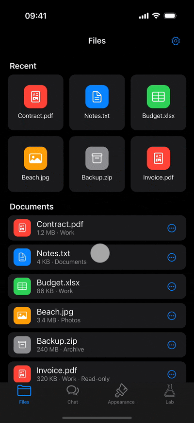

*In the dark theme: Share is a submenu, and Messages inside it loads when it opens. The back
item and a swipe right go back. [Code in the
example](https://github.com/BinaryRift/smart_context_menu/blob/v1.0.2/example/lib/pages/files/ui/files_page.dart#L197-L235).*

```dart
SmartContextMenuItem.submenu(
  title: 'Share',
  leading: const Icon(CupertinoIcons.share),
  children: [
    SmartContextMenuItem.simple(title: 'Copy link', onTap: () => copyLink(file)),
    SmartContextMenuItem.asyncSubmenu(
      title: 'Messages',
      asyncChildren: () => loadContacts(file),
    ),
  ],
)
```

Tap the back item at the top of the submenu or swipe right in LTR (left in RTL) to return
to the parent menu.
The submenu follows the finger and slides back in place if the swipe is short.
To turn the swipe off, set `enableSwipeBack: false` in `SmartContextMenuConfig`.

#### Async submenu

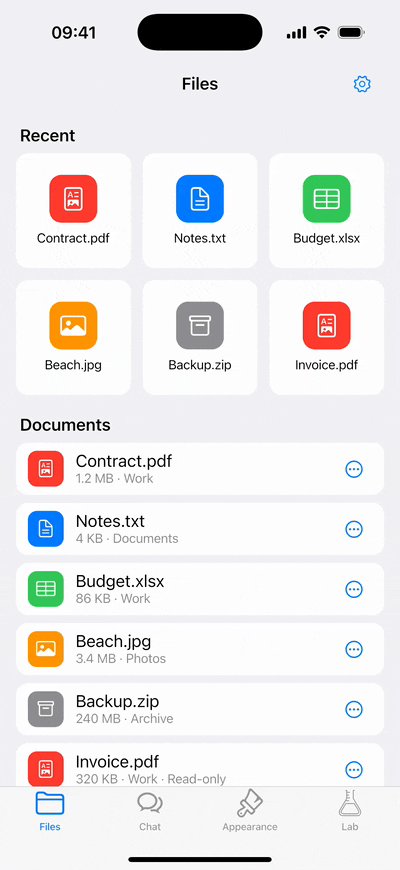

*In the light theme: Move to loads the folders when it opens; Work, the folder of the file, is
disabled. [Code in the example](https://github.com/BinaryRift/smart_context_menu/blob/v1.0.2/example/lib/pages/files/ui/files_page.dart#L237-L255).*

The items are loaded when the submenu opens and cached until the menu closes.
While loading, the submenu shows an activity indicator in the middle; pass a
[loading item](#loading-item) as `loading` to show a row with a title instead.
If loading fails or takes longer than `timeout` (10 seconds by default), the submenu
shows an [error item](#error-item) that retries on tap; pass your own as `error`.
If there are no items, it shows an [empty item](#empty-item); pass your own as `empty`.

```dart
SmartContextMenuItem.asyncSubmenu(
  title: 'Move to',
  leading: const Icon(CupertinoIcons.folder),
  asyncChildren: () async {
    final folders = await repository.folders();
    return [
      for (final folder in folders)
        SmartContextMenuItem.simple(
          title: folder.name,
          isDisabled: folder == file.folder,
          onTap: () => move(file, folder),
        ),
    ];
  },
)
```

#### Paginated submenu


*In the light theme: Reactions loads the first page of people when it opens and the next page
when it scrolls to the end. [Code in the example](https://github.com/BinaryRift/smart_context_menu/blob/v1.0.2/example/lib/pages/chat/ui/chat_page.dart#L290-L321).*

The first page is loaded with `initialMetadata`. The last item of each page, a `simple` item,
a separator or a [row](#row), carries the metadata of the next page in `pagingMetadata`; the next
page is loaded when the user scrolls to the end. Leave it `null` on the last page. A row carries
its own `pagingMetadata`: the metadata of its cells does not describe the next page. While a page loads, the
submenu shows `loading` after the loaded items, as an async submenu does. If a page fails to
load or takes longer than `timeout` (10 seconds by default), the submenu shows `error` after
the loaded items, and tapping it loads the page again. If the first page is empty, the submenu
shows `empty`; an empty next page just ends the list.

```dart
SmartContextMenuItem.pagingSubmenu(
  title: 'Reactions',
  initialMetadata: const SmartContextMenuPagingMetadata(limit: 20),
  asyncPagingChildren: (metadata) async {
    final page = await api.reactions(message.id, metadata.page, metadata.limit);
    return [
      for (final (index, reaction) in page.items.indexed)
        SmartContextMenuItem.simple(
          title: reaction.person.name,
          trailing: Text(reaction.emoji),
          pagingMetadata: index == page.items.length - 1 && page.hasMore
              ? metadata.copyWith(page: metadata.page + 1)
              : null,
        ),
    ];
  },
)
```

`SmartContextMenuPagingMetadata` also has `nextCursor` for cursor-based APIs and
`extra` for custom parameters.

#### Async item

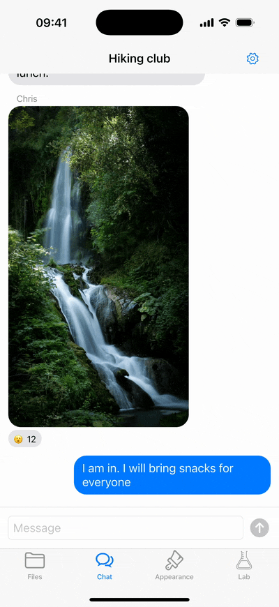

*In the light theme: Seen by is an async item whose loader returns a regular submenu. Unlike an
async submenu, it loads as the menu opens, before a tap, so the count is seen at once; after
going back, the loaded item stays. [Code in the
example](https://github.com/BinaryRift/smart_context_menu/blob/v1.0.2/example/lib/pages/chat/ui/chat_page.dart#L323-L347).*

The placeholder loads its item as soon as it appears. While loading, it shows `loading`,
a `SmartContextMenuItem.loading` with the loading label by default. If loading fails or takes
longer than `timeout` (10 seconds by default), it shows `error`, a `SmartContextMenuItem.error`,
and tapping it loads the item again, see [error item](#error-item).

The loader returns an item that runs an action or opens a submenu, or a `loading`, `error`
or `empty` item, for example `SmartContextMenuItem.empty` when there is nothing to show.
A loader that returns a regular submenu, as Seen by does, loads a value with the menu
and shows the details on tap:

```dart
SmartContextMenuItem.async(
  loading: SmartContextMenuItem.loading(title: 'Seen by'),
  asyncItem: () async {
    final readers = await api.readers(message.id);
    // A regular submenu, loaded as the menu opens.
    return SmartContextMenuItem.submenu(
      title: 'Seen by',
      trailing: Text('${readers.length}'),
      children: [
        for (final reader in readers)
          SmartContextMenuItem.simple(title: reader.name),
      ],
    );
  },
)
```

A loader can also return a simple item, for example once it has checked access:

```dart
SmartContextMenuItem.async(
  loading: SmartContextMenuItem.loading(title: 'Checking access'),
  error: SmartContextMenuItem.error(title: 'Could not check access'),
  asyncItem: () async {
    final canEdit = await permissions.canEdit();
    return SmartContextMenuItem.simple(
      title: 'Edit',
      isDisabled: !canEdit,
      onTap: () => edit(),
    );
  },
)
```

#### Listenable item

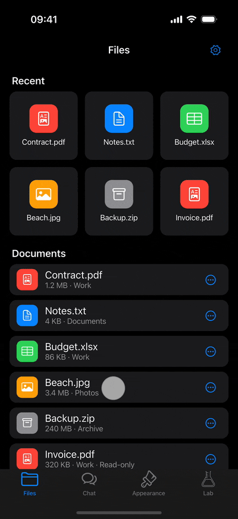

*In the dark theme: after a tap, Download shows its progress in the open menu and turns into
Remove Download when it is done. [Code in the
example](https://github.com/BinaryRift/smart_context_menu/blob/v1.0.2/example/lib/pages/files/ui/files_page.dart#L279-L307).*

Use it when the state of an item lives in your app and can change while the menu is open:
a toggle that keeps the menu open, a counter, or an action that is already running.
The builder runs again each time `listenable` notifies and returns the item to show.
While the item is loading, return `SmartContextMenuItem.loading`: it shows its title with
an activity indicator, as an async item does, and ignores taps.

```dart
SmartContextMenuItem.listenable(
  listenable: downloads,
  builder: () => switch (downloads.stateOf(file)) {
    DownloadState.running => SmartContextMenuItem.loading(
      title: 'Downloading ${downloads.percentOf(file)}%',
    ),
    DownloadState.done => SmartContextMenuItem.simple(
      title: 'Remove Download',
      isDestructive: true,
      closeOnTap: false,
      onTap: () => downloads.remove(file),
    ),
    DownloadState.none => SmartContextMenuItem.simple(
      title: 'Download',
      closeOnTap: false,
      onTap: () => downloads.start(file),
    ),
  },
)
```

Unlike an async item, the state belongs to your app: the item is not loaded once but built
again on every notification. The builder returns a `SmartContextMenuItem.simple`, whose
`onTap` and `closeOnTap` are used, or a `loading`, `error` or `empty` item, which ignore taps.
To retry a failed load of your app from the item, return a `simple` item:

```dart
SmartContextMenuItem.listenable(
  listenable: views,
  builder: () => switch (views.state) {
    ViewsState.loading => SmartContextMenuItem.loading(title: 'Views'),
    ViewsState.failed => SmartContextMenuItem.simple(
      title: 'Try again',
      trailing: const Icon(SmartContextMenuDefaults.retryIcon),
      closeOnTap: false,
      onTap: views.reload,
    ),
    ViewsState.loaded => SmartContextMenuItem.simple(title: 'Views: ${views.count}'),
  },
)
```

The menu does not dispose `listenable`.

Any `Listenable` works: a `ChangeNotifier`, a `ValueNotifier`, several of them combined
with `Listenable.merge`, or a controller of a state management package that implements
`Listenable`, such as `GetxController`, which notifies on `update()` called without ids.
Widgets such as `Obx` or `BlocBuilder` do not help here: an item is data, not a widget,
and its builder runs outside of them. To rebuild the item from a `Stream`, for example
of a Bloc or of a GetX `Rx`, wrap the stream in a `ChangeNotifier`:

```dart
final class StreamListenable extends ChangeNotifier {
  StreamListenable(Stream<Object?> stream) {
    _subscription = stream.listen((_) => notifyListeners());
  }

  late final StreamSubscription<Object?> _subscription;

  @override
  void dispose() {
    _subscription.cancel();
    super.dispose();
  }
}
```

Create the adapter next to the state it listens to and dispose it there as well.

#### Loading item

A loading item shows its `title` (the loading label by default) with `leading` and an activity
indicator, and ignores taps. `trailing` replaces the indicator, and `child` replaces the whole
content; text and icons in it take the color of the item. The menu replaces the item once loading
finishes when it is the `loading` of an async item or an async or paginated submenu, or when
a listenable item returns it. Anywhere else it stays until the menu closes.

Loading, error and empty items look alike: the title in the middle, a sign of the state
after it, and `leading` free for your own icon. They do not respond to taps and are not dimmed.
The [style](#item-style) sets their alignment, icons and loading indicator for all menus.

| Item | Title | After the title |
| --- | --- | --- |
| `loading` | loading label | activity indicator |
| `error` | error label | error icon |
| `error` of an async item or submenu | retry label | retry icon |
| `empty` | empty label | empty icon |

Your own `title`, `leading` and `trailing` replace the defaults, and `child` replaces the row.

While a submenu loads, it shows an activity indicator in the middle by default. A `loading` item
you pass is shown as a row; to center your own indicator, pass it in `child`:

```dart
SmartContextMenuItem.asyncSubmenu(
  title: 'Recent files',
  loading: SmartContextMenuItem.loading(
    child: const Center(child: CircularProgressIndicator()),
  ),
  asyncChildren: () => loadRecentFiles(),
)
```

A listenable item can show a loading item for each step of its own work:

```dart
SmartContextMenuItem.listenable(
  listenable: sync,
  builder: () => switch (sync.state) {
    SyncState.checking => SmartContextMenuItem.loading(title: 'Checking'),
    SyncState.syncing => SmartContextMenuItem.loading(title: 'Syncing'),
    SyncState.idle => SmartContextMenuItem.simple(title: 'Sync now', onTap: sync.start),
  },
)
```

#### Error item

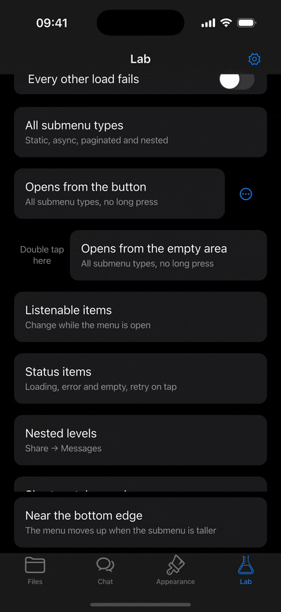

*In the dark theme: Shared files fails to load, and a tap on the row loads it again; Archive
has no items. [Code in the example](https://github.com/BinaryRift/smart_context_menu/blob/v1.0.2/example/lib/pages/lab/domain/lab_items.dart#L131-L186).*

An error item shows a failed load: its `title` (the error label by default) with the error icon.
As the `error` of an async item, an async or a paginated submenu, it loads again on tap and shows
the retry label and icon unless it has its own `title` and `trailing`. Anywhere else,
for example from the builder of a listenable item, it ignores taps.

A button in `child` handles its own taps, while the rest of the row still retries:

```dart
SmartContextMenuItem.asyncSubmenu(
  title: 'Shared files',
  error: SmartContextMenuItem.error(
    child: Row(
      children: [
        const Expanded(child: Text('Could not load files')),
        CupertinoButton(onPressed: showDetails, child: const Text('Details')),
        // The child replaces the whole row, so add the retry icon yourself.
        const Icon(SmartContextMenuDefaults.retryIcon),
      ],
    ),
  ),
  asyncChildren: () => loadSharedFiles(),
)
```

An error item is shown for a load that throws. For an error your loader recognizes,
such as missing access, catch it and return an item yourself: an `error` item that ignores taps,
or a `simple` item with its own action.

#### Empty item

The GIF in [Error item](#error-item) ends with Archive, a submenu without items.

An async or a paginated submenu without items shows an empty item: its `title` (the empty label
by default) with the empty icon. Pass your own as `empty` and return no items from the loader.
A paginated submenu shows it only when the first page is empty, and a static submenu without
`children` shows the default one. A listenable item can return it too.

```dart
SmartContextMenuItem.asyncSubmenu(
  title: 'Archive',
  // Without it, the submenu shows the empty label, "No items".
  empty: SmartContextMenuItem.empty(title: 'Archive is empty'),
  asyncChildren: () => loadArchive(),
)
```

#### Separator

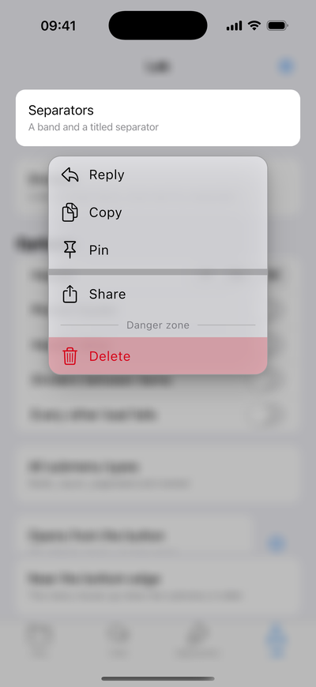

*In the light theme: a band separates Pin from Share, and a separator with its own `child`
titles the last group.*

A separator splits the items into groups. It has no actions and no press highlight,
and drag-to-select passes over it. By default it is a band set by `separatorThickness`
and `separatorColor` in the style; `child` replaces it, for example with a section title.
The old name `separatorHeight` is deprecated; use `separatorThickness` instead.

A band is shown only between items: not at the start or the end of a menu, and several
bands in a row show as one. A separator with a `child` titles the items after it, so it is
also shown at the start of a menu or a submenu, but not at the end. Of several separators
next to each other, the last one with a `child` is shown, or else the first band. So a menu
whose items depend on the user or the content needs no extra checks:

```dart
[
  if (canReply)
    SmartContextMenuItem.simple(title: 'Reply', onTap: () => reply()),
  SmartContextMenuItem.simple(title: 'Copy', onTap: () => copy()),
  if (isAdmin) SmartContextMenuItem.simple(title: 'Pin', onTap: () => pin()),
  SmartContextMenuItem.separator(),
  // Without Delete, the separator above is not shown.
  if (canDelete)
    SmartContextMenuItem.simple(
      title: 'Delete',
      isDestructive: true,
      onTap: () => delete(),
    ),
]
```

For a thin line instead of a band, set a small `separatorThickness` and the
`dividerColor` as `separatorColor`. To draw lines between all items, see
[Dividers](#dividers).

#### Row

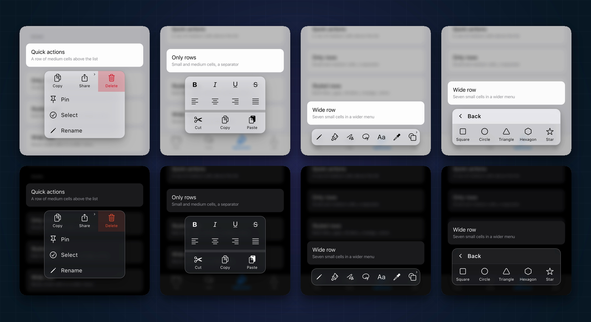

*Menus from the example, in the light and dark themes: a row above the list, a menu of rows
only, seven tools in a wider menu, and its Shapes submenu of one row. [Code in the example](https://github.com/BinaryRift/smart_context_menu/blob/v1.1.0/example/lib/pages/appearance/domain/appearance_items.dart#L148-L344).*

A row puts the most used actions side by side, as the compact menus of iOS do. Its cells
are items of the other types: actions, submenus, async and listenable items, loading, error
and empty items, and separators. They keep their actions, colors, ids and rules of closing
the menu; the row only makes them compact. Rows and other items can be mixed, and a menu
can consist of rows only.

```dart
[
  SmartContextMenuItem.row(
    children: [
      SmartContextMenuItem.simple(
        title: 'Copy',
        leading: const Icon(CupertinoIcons.doc_on_doc),
        onTap: () => copy(),
      ),
      SmartContextMenuItem.submenu(
        title: 'Share',
        leading: const Icon(CupertinoIcons.share),
        children: shareItems,
      ),
      SmartContextMenuItem.simple(
        title: 'Delete',
        leading: const Icon(CupertinoIcons.delete),
        isDestructive: true,
        onTap: () => delete(),
      ),
    ],
  ),
  SmartContextMenuItem.simple(
    title: 'Pin',
    leading: const Icon(CupertinoIcons.pin),
    onTap: () => pin(),
  ),
]
```

`size` sets the look of the cells:

- `SmartContextMenuRowSize.medium`, the default, shows the `leading` above the `title`.
- `SmartContextMenuRowSize.small` shows only the `leading`, and the `title` is what a screen
  reader says. A cell without a `leading` shows its `title`, for example `0.5×`, `1×`, `2×`.

A row is one line and does not wrap: for six cells in two lines, make two rows of three.
The Only rows menu of the example has eight small cells in two rows and a row of medium cells:

```dart
[
  SmartContextMenuItem.row(
    size: SmartContextMenuRowSize.small,
    children: [bold, italic, underline, strikethrough],
  ),
  SmartContextMenuItem.row(
    size: SmartContextMenuRowSize.small,
    children: [alignLeft, center, alignRight, justify],
  ),
  SmartContextMenuItem.separator(),
  SmartContextMenuItem.row(children: [cut, copy, paste]),
]
```

Every kind of item works as a cell:

- A cell that opens a submenu shows a small submenu icon in its top corner. The submenu shows
  its items as usual, and it can have rows of its own.
- Async and listenable cells stay compact while they load and after. Loading, error and empty
  cells show the sign of their state, with short titles from the
  [labels](#localization).
- Disabled, destructive and tinted cells look as they do in the list.
- The `trailing` of a cell is not shown; a [`customBuilder`](#custom-item-content) can draw it.

The width of the row is divided between its cells, equally by default.
`SmartContextMenuRowFlex` gives a cell a larger share, and the id and the action stay on its
`child`. The width of a cell does not change with its content. The row is as tall as its
tallest cell, and each cell is pressed and highlighted over its full share of the width and
the full height of the row. Content wider than its cell is clipped, text gets an ellipsis,
and in RTL the cells go from right to left.

```dart
SmartContextMenuItem.row(
  children: [
    inbox,
    flag,
    // Twice as wide as the other cells.
    SmartContextMenuRowFlex(flex: 2, child: markAsRead),
  ],
)
```

A row with fewer cells than the row above it still divides its whole width, so a single cell
takes the full width of the menu. To keep the cells as wide as in the other row, fill the rest
with empty cells: a simple item without `title`, `leading` and `onTap`, and with
`closeOnTap: false`, is not highlighted and ignores taps. Add one empty cell for each missing
cell rather than one `SmartContextMenuRowFlex`, so that the gaps match too, and turn off the
dividers of the row. If the other row draws dividers, the widths differ by their thickness.
A separator does not work as a spacer: it is not shown at the end of a row.

```dart
[
  SmartContextMenuItem.row(
    size: SmartContextMenuRowSize.small,
    children: [undo, redo, cut, copy],
  ),
  SmartContextMenuItem.row(
    size: SmartContextMenuRowSize.small,
    dividersBetweenChildren: false,
    children: [
      paste,
      for (var i = 0; i < 3; i++)
        SmartContextMenuItem.simple(closeOnTap: false),
    ],
  ),
]
```

As in the list, a separator in a row is a band, vertical here, and the same rules apply: a band
is shown only between cells, a separator with a `child` also at the start of the row, for
example as a label before the cells, and of several separators next to each other only one is
shown. A row without cells, or with separators only, is not shown, so cells shown on condition
need no extra checks.
`dividersBetweenChildren` draws vertical lines between the cells; if it is `null`, it follows
`dividersBetweenItems` of the style. `padding` and `childrenGap` set the space around and between
the cells of this row; the gap belongs to no cell, so a finger over it removes the highlight.
The look of all rows is set by the [row style](#row-style).

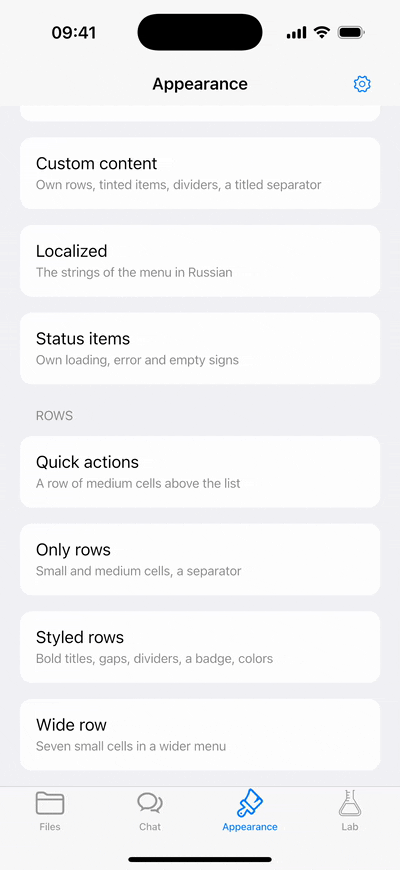

*In the light theme: the highlight follows the finger from cell to cell and on into the list.*

Drag-to-select works across the cells as over other items, and a release selects the cell
under the finger. In a submenu, a horizontal drag that starts on a row selects its cells
instead of going back; with `enableSwipeBack: true`, the drag goes back, as on other items.
Outside the row and on the back item, swipe back always works.

`children` takes `SmartContextMenuRowEntry`: every item type and `SmartContextMenuRowFlex`,
but not a row, so a row cannot contain another row. A helper that returns a cell should
return its own item type, such as `SmartContextMenuSimpleItem` or
`SmartContextMenuAsyncSubmenuItem`, rather than `SmartContextMenuItem`, and a list of cells
built in advance needs its type: `<SmartContextMenuRowEntry>[...]`.

Keep cells wide enough to tap, see [Design guidelines](#design-guidelines).

### Opening from code

A button inside the child opens the menu with `SmartContextMenu.of(context)`. It returns
the controller of the nearest menu around `context`, so the button needs no setup:

```dart
SmartContextMenu(
  items: items,
  child: Row(
    children: [
      const Expanded(child: Text('Report.pdf')),
      Builder(
        builder: (context) => CupertinoButton(
          onPressed: () => SmartContextMenu.of(context).open(),
          child: const Icon(CupertinoIcons.ellipsis_circle),
        ),
      ),
    ],
  ),
)
```

The `Builder` gives the button a `context` inside the menu. A button in a widget of its
own, such as a list row, uses the `context` of that widget. The items of the open menu
are not inside the child, so `of` does not find the menu from them.
`SmartContextMenu.maybeOf(context)` returns `null` where there is no menu.

To open the menu from outside the child, for example on a double tap next to a message,
create a `SmartContextMenuController()` and pass it to the menu:

```dart
final controller = SmartContextMenuController();

SmartContextMenu(
  controller: controller,
  items: items,
  child: child,
);

GestureDetector(
  onDoubleTap: controller.open,
  child: background,
);
```

To open the menu only from code, set the activation mode to `manual`: the long press and
the right click then stay with the child. The menu opens from `SmartContextMenu.of` in the
child or from its controller, so without either of them it never opens.

`SmartContextMenu.of` returns the controller passed to the menu, or the menu's own one.
A controller notifies its listeners when the menu opens or closes, see `isOpen`.
`open()` completes when the menu has closed, so `await controller.open()` waits for it.
Dispose a controller you create when it is no longer needed; the menu disposes its own.

### Header slivers

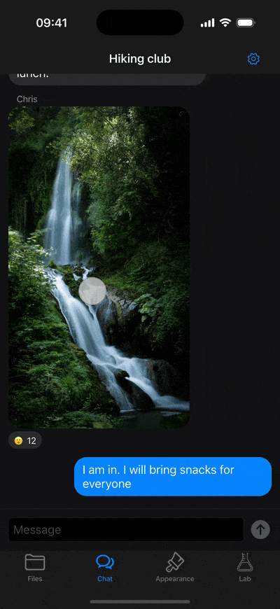

*In the dark theme: a reactions bar above the message; a tap on a reaction closes the menu.
[Code in the example](https://github.com/BinaryRift/smart_context_menu/blob/v1.0.2/example/lib/pages/chat/ui/chat_page.dart#L216-L241).*

To show your own content above the widget while the menu is open, pass `headerSliversBuilder`.
It returns a list of slivers, which fade in and out with the menu and move with the widget
when it is dragged or the menu is stretched. The builder gets `SmartContextMenuHeaderDetails`:

- `alignment` tells how the widget and the menu are aligned horizontally. The slivers have
  the same horizontal padding as the widget, so `Align(alignment: header.alignment)` puts
  your content at the edge of the widget.
- `animation` runs from 0 to 1 as the slivers appear and back as they hide, to animate
  your content with the menu.
- `close()` closes the menu. It completes three quarters through the closing, as an item
  does, so the result of the action is seen as the menu closes.

A tap on your widgets in the slivers keeps the menu open; a tap on empty space next to them
closes it, as a tap anywhere outside the menu does.

```dart
SmartContextMenu(
  headerSliversBuilder: (context, header) => [
    SliverToBoxAdapter(
      child: Align(
        alignment: header.alignment,
        child: ReactionsBar(
          onSelected: (reaction) async {
            await header.close();
            react(message, reaction);
          },
        ),
      ),
    ),
    const SliverToBoxAdapter(child: SizedBox(height: 8)),
  ],
  items: items,
  child: MessageBubble(message),
)
```

For example, to scale the bar in from the edge of the widget, wrap it with a transition
driven by `header.animation`. Use `drive` rather than `CurvedAnimation`: the builder runs
on every rebuild, and a `CurvedAnimation` created there is never disposed.

```dart
ScaleTransition(
  scale: header.animation.drive(CurveTween(curve: Curves.easeOutBack)),
  // Grows from the bottom edge, next to the widget.
  alignment: Alignment(header.alignment.x, 1),
  child: ReactionsBar(onSelected: react),
)
```

The fade stays on top of your animation; set `fadeHeaderSlivers: false` to animate
the slivers only your way.

The slivers are direct children of the scroll view of the menu, so a `PinnedHeaderSliver`
stays at the top, right below the status bar, while a tall widget and the menu scroll
under it. It covers them there, so keep it small:

```dart
headerSliversBuilder: (context, header) => [
  PinnedHeaderSliver(
    child: Align(
      alignment: header.alignment,
      child: ReactionsBar(onSelected: react),
    ),
  ),
],
```

When the content scrolls as the menu opens, the slivers wait until the widget is nearly
in place, so the moving widget does not cover a pinned sliver.

To show the slivers later, set `headerSliversDelay`. It counts from the start of the opening,
which takes 300 milliseconds: a shorter delay starts the slivers while the widget moves
into place, a longer one after that.

```dart
SmartContextMenu(
  headerSliversBuilder: (context, header) => [reactionsBar],
  // The bar appears a moment after the menu.
  headerSliversDelay: const Duration(milliseconds: 150),
  items: items,
  child: MessageBubble(message),
)
```

### Hero widgets


*In the light theme: a double tap next to the photo opens the menu from code; a tap on the
preview opens the photo with its own `Hero`. [Code in the
example](https://github.com/BinaryRift/smart_context_menu/blob/v1.0.2/example/lib/pages/chat/ui/chat_page.dart#L149-L214).*

The widget can have its own `Hero`, for example a photo in a chat that opens full screen.
The menu flies the preview with a `Hero` too, but never puts it around your widget: it adds
it next to the widget, and only while the menu is open. So there is no `Hero` inside
a `Hero`, and while the menu is open, your widget stays in its place, hidden, with its
state kept.

Open the page from `onPreviewTap`: it is called once the menu has closed and the preview
is back in place, so your `Hero` flies from the place of the widget, as it does after a tap
on the widget itself:

```dart
SmartContextMenu(
  items: items,
  onPreviewTap: () => openPhoto(photo),
  child: GestureDetector(
    onTap: () => openPhoto(photo),
    child: Hero(
      tag: photo.id,
      child: Image.network(photo.url),
    ),
  ),
)
```

Here `openPhoto` pushes a page with a `Hero` of the same tag.

### Configuration

Settings shared by menus live in `SmartContextMenuConfig`. Every field has a default, so set only
what you need:

```dart
const menuConfig = SmartContextMenuConfig(
  menuWidth: 220,
  enableHaptics: false,
  style: menuStyle,
);
```

| Field | What it sets | Default |
| --- | --- | --- |
| `activationMode` | Opens the menu on long press or right click, or only from code, see [Opening from code](#opening-from-code). | `longPress` |
| `enableHaptics` | Plays haptic feedback when the menu opens on long press, an item is highlighted or tapped, the preview is tapped, and a submenu opens or closes. | `true` |
| `barrierDismissible` | Closes the menu on a tap outside the menu, the widget and the [header slivers](#header-slivers). When `false`, the menu closes only from an item, the preview, the header slivers or the controller. | `true` |
| `enableSwipeBack` | Returns from a submenu on a swipe right in LTR or left in RTL, see [Submenu](#submenu). | `true` |
| `menuWidth` | The width of the menu. On a narrower screen, the menu gets narrower. | 250 |
| `menuHeightFactor` | The maximum height of the menu as a part of the screen height, see [Positioning](#positioning). | 0.6 |
| `screenPadding` | The distance to the screen edges, on top of the safe area. | 16 |
| `menuGap` | The distance between the widget and the menu. | 12 |
| `moveBackDown` | Moves the widget back down when the menu gets shorter. | `false` |
| `labels` | The strings the menu shows itself, see [Localization](#localization). | English |
| `style` | The look of the menu, see [Appearance](#appearance). | |

#### Theme and config

A menu takes its config from the first of:

1. its own `config`;
2. the nearest `SmartContextMenuTheme` above it;
3. the defaults, `const SmartContextMenuConfig()`.

Both the theme and `config` are optional, so pick what fits your app.

**The whole app.** Set the config once with a theme in the `builder` of the app.
Menus need no `config` then:

```dart
MaterialApp(
  builder: (context, child) => SmartContextMenuTheme(
    config: menuConfig,
    child: child!,
  ),
  home: const HomePage(),
);

SmartContextMenu(
  items: items,
  child: child,
);
```

**A part of the app.** Wrap a screen, a list or any other subtree with its own theme.
The nearest theme wins and replaces the outer one as a whole, so start from the outer one
to keep its settings:

```dart
SmartContextMenuTheme(
  config: SmartContextMenuTheme.of(context).copyWith(enableSwipeBack: false),
  child: const ChatScreen(),
)
```

**One menu.** Pass `config` to the menu. It replaces the theme for this menu as a whole:

```dart
SmartContextMenu(
  config: const SmartContextMenuConfig(menuWidth: 220),
  items: items,
  child: child,
)
```

To change a few settings and keep the rest of the theme, start from it with `copyWith`.
`SmartContextMenuStyle` has it too:

```dart
final theme = SmartContextMenuTheme.of(context);

SmartContextMenu(
  config: theme.copyWith(
    activationMode: SmartContextMenuActivationMode.manual,
    style: theme.style.copyWith(menuBlur: SmartContextMenuBlur.small),
  ),
  controller: controller,
  items: items,
  child: child,
)
```

`SmartContextMenuTheme.of(context)` reads the theme above `context`. If the theme is created
in the same `build` method, wrap the menu in a `Builder` to read it.

#### Localization

The menu shows a few strings itself: the back item, the retry label and the titles of loading,
error and empty items without their own title. Override them with `SmartContextMenuLabels`,
for example in the config of a [theme](#theme-and-config) to localize all menus at once:

```dart
SmartContextMenuConfig(
  labels: SmartContextMenuLabels(
    back: l10n.back,
    retry: l10n.retry,
    loading: l10n.loading,
    error: l10n.couldNotLoad,
    empty: l10n.noItems,
    rowLoading: l10n.loadingShort,
    rowError: l10n.error,
    rowRetry: l10n.retryShort,
    rowEmpty: l10n.noItems,
  ),
)
```

Cells of a [row](#row) are narrow, so loading, error and empty cells use short titles of their
own: `rowLoading`, `rowError`, `rowRetry` and `rowEmpty`.

#### Apps on `cupertino_ui`

Since Flutter 3.50, `flutter/cupertino.dart` is deprecated in favor of the
[`cupertino_ui`](https://pub.dev/packages/cupertino_ui) package. Until 2.0.0, the menu uses
`flutter/cupertino.dart`, so it does not see the theme and the localizations of a
`CupertinoApp` from `cupertino_ui`: it follows the system brightness, and the screen reader
label of its barrier is in English. Put `CupertinoUiCompatibilityBridge` of `cupertino_ui` in
the `builder` of the app. The menu opens over the whole app, so a bridge around one screen or
widget does not change its theme.

```dart
CupertinoApp(
  theme: const CupertinoThemeData(brightness: Brightness.dark),
  builder: (context, child) => CupertinoUiCompatibilityBridge(child: child!),
  home: const HomePage(),
)
```

The menu resolves only the `CupertinoDynamicColor`s of `flutter/cupertino.dart`, such as its
defaults. A `CupertinoDynamicColor` of `cupertino_ui` in the style keeps its light color, so
resolve it in the `builder`, where the theme of the app is known:

```dart
builder: (context, child) => CupertinoUiCompatibilityBridge(
  child: SmartContextMenuTheme(
    config: SmartContextMenuConfig(
      style: SmartContextMenuStyle(
        menuColor: CupertinoDynamicColor.resolve(brandMenuColor, context),
      ),
    ),
    child: child!,
  ),
),
```

The bridge is marked deprecated as a temporary migration utility, so the analyzer reports its
use. Version 2.0.0 of this package moves to `cupertino_ui`, and the bridge will not be needed.

### Appearance

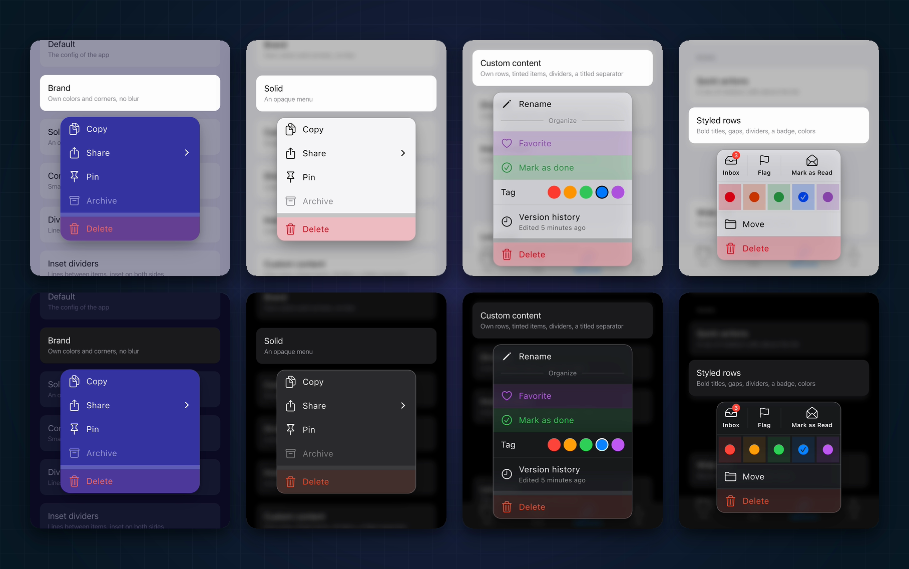

*Four styles from the example, in the light and dark themes: brand colors with only dimming
behind the menu, an opaque menu, items with their own content, and rows in their own style
with a badge and colors to pick.*

The look of the menu is set by `SmartContextMenuStyle`, the `style` of the config.
The Back item, the loading, error and empty items, and rows have their own parts of it:
[`backButtonStyle`](#back-item-style), [`statusStyle`](#status-style) and
[`rowStyle`](#row-style). All fields have defaults:

```dart
const menuStyle = SmartContextMenuStyle(
  menuBlur: SmartContextMenuBlur.small,
  backgroundBlur: SmartContextMenuBlur(10),
  borderRadius: BorderRadius.all(Radius.circular(20)),
  menuShadows: [BoxShadow(color: Color(0x33000000), blurRadius: 20)],
);
```

`menuShadows` replaces the default shadows under the menu; pass an empty list to remove them.

`menuDecoration` replaces the menu's default background and border. The pinned Back item does
not inherit it: by default, that item uses `menuColor` and the `borderRadius` of
`backButtonStyle`. Its `decoration` gives the Back item its own background. The decoration's
shape also clips the blur of the Back item; a transparent decoration lets the menu gradient and
blurred scrolling items show through:

```dart
const style = SmartContextMenuStyle(
  menuDecoration: BoxDecoration(
    borderRadius: BorderRadius.all(Radius.circular(16)),
    gradient: LinearGradient(
      begin: Alignment.topCenter,
      end: Alignment.bottomCenter,
      colors: [Color(0xFF3634A3), Color(0xFF18165F)],
    ),
  ),
  backButtonStyle: SmartContextMenuBackButtonStyle(
    decoration: BoxDecoration(
      color: Color(0x00000000),
      borderRadius: BorderRadius.vertical(top: Radius.circular(16)),
    ),
  ),
);
```

The Back item does not copy the gradient; it shows the menu behind it. Give the decoration a
translucent color if the scrolling items show through too strongly. Its border radius controls
the clip; the `borderRadius` of `backButtonStyle` applies only without a `decoration`.

#### Item style

`SmartContextMenuStyle` also sets the text, colors, icons and spacing of items, so the menu
can match the app theme:

```dart
const style = SmartContextMenuStyle(
  titleStyle: TextStyle(
    fontFamily: 'Montserrat',
    fontSize: 17,
    color: Color(0xFFFFFFFF),
  ),
  disabledForegroundColor: Color(0x99FFFFFF),
  destructiveColor: Color(0xFFFF453A),
  highlightColor: Color(0x1FFFFFFF),
  dividerColor: Color(0x999E9E9E),
  submenuIcon: Icons.arrow_forward_ios,
  itemPadding: EdgeInsets.symmetric(horizontal: 16, vertical: 10),
  itemChildrenGap: 10,
);
```

The color of `titleStyle` is used for enabled items that are not destructive; disabled
and destructive items use `disabledForegroundColor` and `destructiveColor`. A pressed item
is highlighted with a translucent title color, or with `highlightColor` if it is set.
The style also sets the number of title lines; the Back item and the loading, error and empty
items have their own [Back item style](#back-item-style) and [Status style](#status-style). See
[`SmartContextMenuStyle`](https://pub.dev/documentation/smart_context_menu/latest/smart_context_menu/SmartContextMenuStyle-class.html)
for all fields.

**Settings of an item take precedence over the style.** The style sets the look of
all items, and an item changes it only for itself:

```dart
// The style: padding and text of all items.
const style = SmartContextMenuStyle(
  itemPadding: EdgeInsets.symmetric(horizontal: 16, vertical: 10),
  titleStyle: TextStyle(fontSize: 17),
);

// This item uses its own padding and text style instead.
SmartContextMenuItem.simple(
  title: 'Open in new window',
  padding: const EdgeInsets.symmetric(horizontal: 16, vertical: 16),
  titleStyle: const TextStyle(fontSize: 15, fontWeight: FontWeight.w600),
  onTap: () => openInNewWindow(),
)
```

The same goes for `childrenGap` over `itemChildrenGap`.

To give one item its own color, set its `tintColor`. The item is tinted like a destructive
one: the title and icons take the color, and the background a translucent shade of it.
A disabled tinted item keeps only the dimmed color of the title and icons.
`tintColor` takes precedence over `destructiveColor` and the `titleStyle` color.

```dart
SmartContextMenuItem.simple(
  title: 'Approve',
  leading: const Icon(CupertinoIcons.checkmark),
  tintColor: CupertinoColors.systemGreen,
  onTap: () => approve(),
)
```

Color fields may be `CupertinoDynamicColor`s: they follow the light and dark theme.
A plain `Color` is used as is in both themes. The default values are available
in `SmartContextMenuDefaults`.

#### Dividers

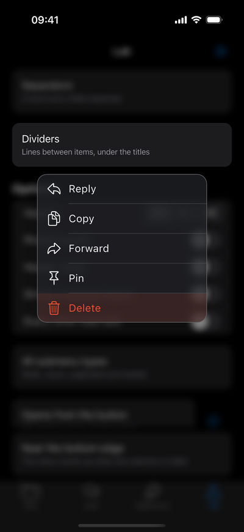

*In the dark theme: lines between items, with `dividerIndent: 52` to start under the titles, as
in the example below.*

Dividers are thin lines between items, as in iOS. They are off by default; set
`dividersBetweenItems: true` in the style to draw a line between every two items.
No line is drawn next to a separator, so groups stay split by separators only.
The style also sets the look of the lines: `dividerColor`, `dividerThickness`, and
the space before and after them with `dividerIndent` and `dividerEndIndent`.

```dart
const style = SmartContextMenuStyle(
  dividersBetweenItems: true,
  dividerThickness: 1,
  // Lines up with the title after a leading icon.
  dividerIndent: 52,
);
```

To split items into groups, use a [separator](#separator).

#### Back item style

`SmartContextMenuBackButtonStyle`, the `backButtonStyle` of the style, sets the look of the
Back item pinned to the top of a submenu:

| Field | What it does | Default |
| --- | --- | --- |
| `decoration` | The background of the Back item. Its shape also clips the blur. | `null`: `menuColor` with `borderRadius` |
| `blur` | The blur of the submenu items that scroll under the Back item; `null` turns it off. | `SmartContextMenuBlur.strong` |
| `borderRadius` | The corners of the default background; ignored with a `decoration`. | 16 px at the top |
| `foregroundColor` | The color of the title and the icon. | `null`: the colors of the menu |
| `titleStyle` | The style of the title, merged over the `titleStyle` of the menu. | semibold |
| `icon` | The icon before the title. The default one points the other way in right-to-left text. | `CupertinoIcons.chevron_back` |

The padding, the press highlight and the icon size come from the menu style, and a line is
always drawn below the Back item.

```dart
const style = SmartContextMenuStyle(
  backButtonStyle: SmartContextMenuBackButtonStyle(
    foregroundColor: Color(0xFF0A84FF),
    icon: Icons.arrow_back_ios_new,
  ),
);
```

Before 1.1.0, these fields were in the style itself: `backButtonBlur`, `backButtonColor`,
`backIcon` and others. The old names still work until 2.0.0 and are deprecated; pass either
`backButtonStyle` or the old names, not both.

#### Status style

`SmartContextMenuStatusStyle`, the `statusStyle` of the style, sets the look of the
[loading](#loading-item), [error](#error-item) and [empty](#empty-item) items, and of the
indicator of a loading submenu or page:

| Field | What it does | Default |
| --- | --- | --- |
| `titleAlign` | The alignment of the title between the leading and the trailing. | `TextAlign.center` |
| `errorIcon` | The icon after the title of an error item. | `CupertinoIcons.exclamationmark_triangle` |
| `retryIcon` | The icon of an error item that retries a failed load. | `CupertinoIcons.refresh` |
| `emptyIcon` | The icon after the title of an empty item. | `CupertinoIcons.tray` |
| `loadingIndicator` | The indicator of loading items and of a loading submenu or page, shown at its own size. | `null`: `CupertinoActivityIndicator` |
| `loaderVerticalPadding` | The space above and below the indicator of a loading submenu or page. | `12` |

The own `trailing` of an item replaces its icon or indicator. Size `loadingIndicator` to fit an
item row. The Status items menu of the example puts the titles at the start and uses a Material
indicator and other icons ([code in the
example](https://github.com/BinaryRift/smart_context_menu/blob/v1.1.0/example/lib/pages/appearance/ui/appearance_styles.dart#L64-L78)):

```dart
const style = SmartContextMenuStyle(
  statusStyle: SmartContextMenuStatusStyle(
    loadingIndicator: SizedBox.square(
      dimension: 18,
      child: CircularProgressIndicator(
        strokeWidth: 2,
        color: CupertinoColors.systemOrange,
      ),
    ),
    errorIcon: CupertinoIcons.wifi_exclamationmark,
    retryIcon: CupertinoIcons.arrow_clockwise,
    emptyIcon: CupertinoIcons.tray,
    titleAlign: TextAlign.start,
  ),
);
```

Before 1.1.0, these fields were in the style itself, and `titleAlign` was called
`statusTitleAlign`. The old names still work until 2.0.0 and are deprecated; pass either
`statusStyle` or the old names, not both.

#### Row style

`SmartContextMenuRowStyle`, the `rowStyle` of the style, sets the look of all [rows](#row):

| Field | What it does | Default |
| --- | --- | --- |
| `padding` | The padding around the cells of a row. | `EdgeInsets.zero` |
| `childrenGap` | The gap between the cells; it belongs to no cell. | `0` |
| `smallItemPadding` | The padding of small cells. The whole cell is pressed and highlighted. | 4 horizontal, 14 vertical |
| `mediumItemPadding` | The padding of medium cells. | 4 horizontal, 10 vertical |
| `itemChildrenGap` | The gap between the leading and the title of medium cells. | `4` |
| `titleStyle` | The style of the titles of the cells, merged over the title style of the item or of the menu. | 12 px |
| `dividerIndent` | The space above the vertical dividers between the cells. | `0` |
| `dividerEndIndent` | The space below the vertical dividers. | `0` |

The own `padding` and `childrenGap` of a row, and the `padding` and `childrenGap` of an item
in a cell, take precedence. Colors, icons, `titleMaxLines`, separators and dividers of rows
come from the menu style. The Styled rows menu of the example sets bolder titles, gaps between
the cells and dividers that stop short of the edges ([code in the
example](https://github.com/BinaryRift/smart_context_menu/blob/v1.1.0/example/lib/pages/appearance/ui/appearance_styles.dart#L82-L87)):

```dart
const style = SmartContextMenuStyle(
  dividersBetweenItems: true,
  rowStyle: SmartContextMenuRowStyle(
    // Replaces the default, so it sets the size too.
    titleStyle: TextStyle(fontSize: 12, fontWeight: FontWeight.w600),
    childrenGap: 4,
    dividerIndent: 12,
    dividerEndIndent: 12,
  ),
);
```

#### Custom item content

`customBuilder` replaces the content of an item. The item padding and press highlight
are kept, and taps work as usual. Interactive widgets inside, such as
buttons, handle their own taps: the item is not triggered over them. The builder
receives the item state, including `foregroundColor`: the color of the title and icons
for the current state and theme. `isPressed` and `isHovered` tell a press from cursor
hover, so the content can react to each in its own way.

```dart
SmartContextMenuItem.simple(
  onTap: () => reply(),
  customBuilder: (context, state) => Row(
    children: [
      Icon(CupertinoIcons.reply, color: state.foregroundColor),
      const SizedBox(width: 12),
      Text('Reply', style: TextStyle(color: state.foregroundColor)),
    ],
  ),
)
```

In a [row](#row), `state.rowSize` is the size of the cell, and `null` in the list, so one
builder can fit both. The cell keeps its padding and highlight, but only the built-in content
is centered in it: align your own content yourself. In a small cell, also label it with
`Semantics`, as the built-in content is labeled with the `title`. For example, an icon with
a badge, as Inbox in the Styled rows menu of the example ([code in the
example](https://github.com/BinaryRift/smart_context_menu/blob/v1.1.0/example/lib/pages/appearance/domain/appearance_items.dart#L251-L313)):

```dart
SmartContextMenuItem.simple(
  title: 'Inbox',
  onTap: () => openInbox(),
  customBuilder: (context, state) {
    final color = state.foregroundColor;
    final icon = Stack(
      clipBehavior: Clip.none,
      children: [
        Icon(CupertinoIcons.tray, color: color),
        const PositionedDirectional(
          top: -6,
          start: 14,
          child: CountBadge(count: 3),
        ),
      ],
    );
    return switch (state.rowSize) {
      null => Row(
        children: [
          icon,
          const SizedBox(width: 12),
          Text('Inbox', style: TextStyle(color: color)),
        ],
      ),
      SmartContextMenuRowSize.small => Align(
        alignment: Alignment.topCenter,
        heightFactor: 1,
        child: Semantics(label: 'Inbox', child: icon),
      ),
      SmartContextMenuRowSize.medium => Align(
        alignment: Alignment.topCenter,
        heightFactor: 1,
        child: Column(
          mainAxisSize: MainAxisSize.min,
          children: [
            icon,
            const SizedBox(height: 4),
            Text('Inbox', style: TextStyle(fontSize: 12, color: color)),
          ],
        ),
      ),
    };
  },
)
```

### Design guidelines

The defaults follow the menus of iOS, such as the menu width of 250. A few choices stay
with you:

- **Cells wide enough to tap.** The Apple Human Interface Guidelines ask for touch targets of
  at least 44 × 44 points, and Material Design for 48 × 48. A [row](#row) divides the width of
  the menu between its cells, so at the default width use up to five cells, 50 points each.
  For more, widen the menu with `menuWidth`: the Wide row menu of the example fits seven cells
  of 48 into 336. On a screen narrower than the menu and its `screenPadding`, the menu gets
  narrower, so check it on the narrowest phone you support. With a mouse, narrower cells are
  easy to hit too.
- **A title for every cell.** Give each cell a `title` and a `leading`: a small cell shows only
  the icon, and its title is what a screen reader says. Keep small cells for icons people know
  without a label, such as text formatting, and use medium cells for the rest.
- **The most used actions first.** A row at the top of the menu keeps them a short reach away,
  and the rest of the actions stay in the list below.

## Animations

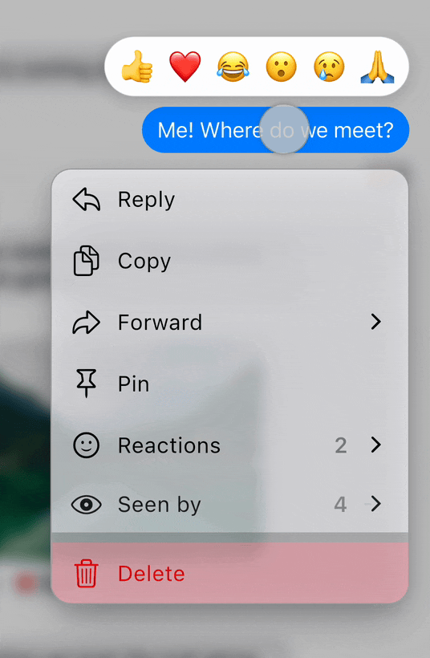

*In the light theme, close up: as the finger slides over the items and past the edges,
the menu stretches towards it, and the message and the reactions bar drift after it. [Code
in the example](https://github.com/BinaryRift/smart_context_menu/blob/v1.0.2/example/lib/pages/chat/ui/chat_page.dart#L149-L214).*

The menu and the preview move as one. Nothing appears, resizes or moves without an animation,
and while a finger is on the menu, both respond to every movement of it.

- **Lift.** On a long press, the background blurs and dims, the preview lifts above it,
  and the menu scales in; on closing, everything plays back.
- **Liquid stretch.** Slide a finger over the items, and the menu stretches towards it like
  liquid while the preview and the [header slivers](#header-slivers) drift after it. Release,
  and everything settles back. With a mouse, it works while the button is held.
- **Smooth height.** Submenus, loading, errors and listenable items change the height
  of the menu, and it always animates instead of jumping.
- **A preview that makes room.** When the menu grows past the bottom of the screen,
  the preview and the menu glide up together, only as far as needed; with `moveBackDown`,
  they glide back down as the menu gets shorter (see [Positioning](#positioning)).
- **Layered submenus.** A submenu slides in over the menu while the menu moves half its width
  aside and fades; the back item plays it in reverse.
- **Swipe back.** Drag a submenu to the right, and it follows the finger, revealing the parent
  menu under it. The height of the menu flows from the submenu to the parent with every step
  of the finger, so there is no jump at the end. Let go past the middle or with a flick,
  and the swipe finishes smoothly from where it is; let go early, and it slides back in place.

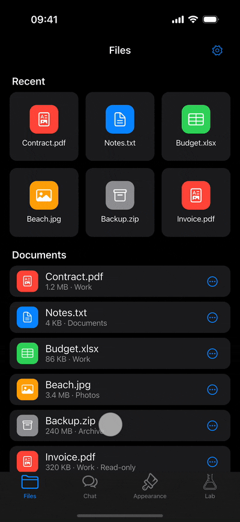

*In the dark theme: Backup.zip is low on the screen, so it glides up together with the menu
just enough to fit it; Share and the back item change the height of the menu smoothly. [Code
in the example](https://github.com/BinaryRift/smart_context_menu/blob/v1.0.2/example/lib/pages/files/ui/files_page.dart#L152-L169).*

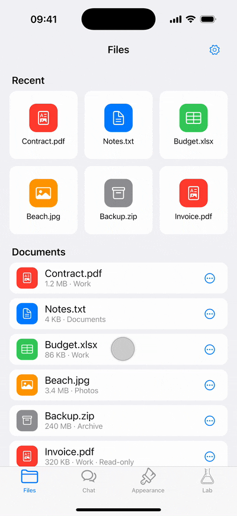

*In the light theme: a slow swipe right from Messages drags it after the finger while
the height of the menu flows towards Share; after a short swipe, Messages slides back,
and a long one finishes on its own. [Code in the example](https://github.com/BinaryRift/smart_context_menu/blob/v1.0.2/example/lib/pages/files/ui/files_page.dart#L197-L235).*

## Coming soon

Planned for the next versions:

- A full accessibility pass with VoiceOver and TalkBack: opening the menu, every item type,
  rows and submenus, and announcements of loading and errors.
- `SmartContextMenuItem.listenableSubmenu`: a submenu that rebuilds from the state of your app
  while it is open, for example the people who liked a post, updated as new likes come in.

`listenableSubmenu` is a new item type, so keep a `_` case when you switch on items, see
[Item types](#item-types).

## Additional information

**[Try the live demo in your browser →](https://thenothingworks.dev/demo/smart-context-menu/)**: every feature of the example app, built for the web.

See the [changelog](CHANGELOG.md) for the changes in each version and the
[API reference](https://pub.dev/documentation/smart_context_menu/latest/) for all classes
and their settings.

Found a bug or have a feature request? Open an issue on
[GitHub](https://github.com/BinaryRift/smart_context_menu/issues).

❤️ If the package helps you, a 👍 like on pub.dev and a ⭐ star on GitHub help others find it:

[](https://pub.dev/packages/smart_context_menu)
[](https://github.com/BinaryRift/smart_context_menu)

Licensed under the [MIT License](LICENSE).

Made by [The NothingWorks](https://thenothingworks.dev).
