# smart_context_menu

[English](README.md) | **Русский**

[](https://pub.dev/packages/smart_context_menu)
[](https://pub.dev/packages/smart_context_menu/score)
[](https://pub.dev/packages/smart_context_menu/score)
[](https://github.com/BinaryRift/smart_context_menu/actions/workflows/ci.yml)
[](LICENSE)
[](https://thenothingworks.dev/demo/smart-context-menu/)

Правый клик на компьютере, долгое нажатие на телефоне, тап по вашей кнопке — и один виджет даёт Flutter-приложению контекстное меню, которое выглядит и двигается как в iOS. В пункты и над превью можно положить свои виджеты (например, панель реакций), без сторонних зависимостей у пакета. Собирайте меню как удобно: простой список пунктов, компактный ряд самых частых действий или сложная смесь рядов, динамических подменю и живых пунктов. Стиль iOS не по душе? Сделайте свой: меняйте цвета, формы, размытие, пункты и не только, а приятные анимации останутся.
Нужен Flutter 3.32 или новее (Dart 3.8). **[Начать →](#начало-работы)**

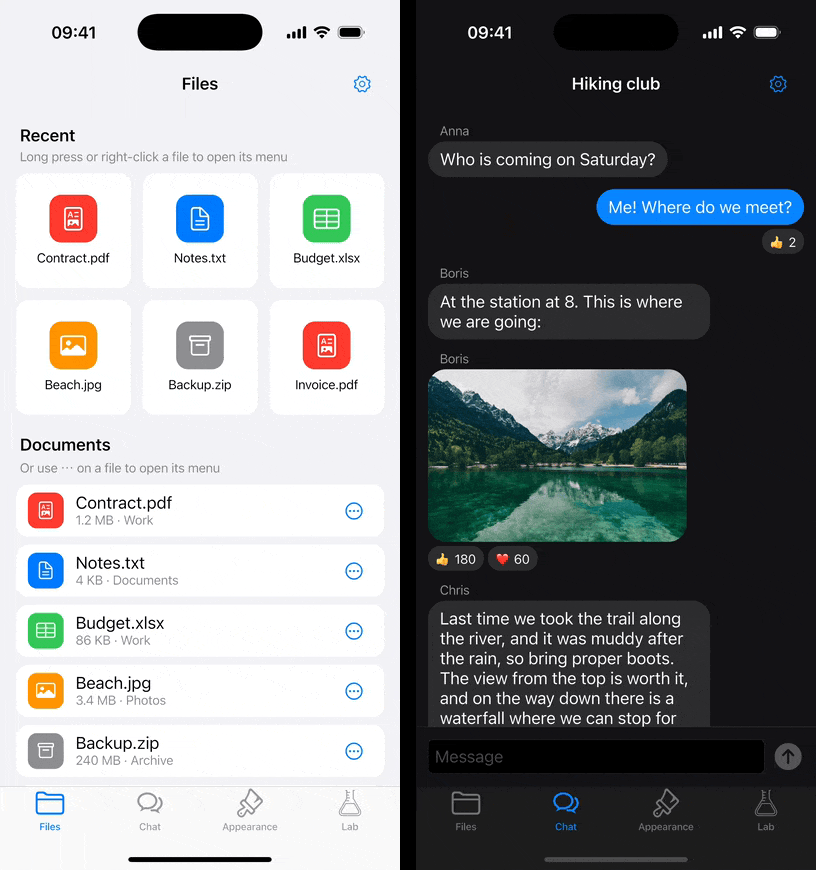

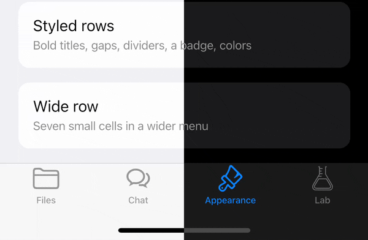

<br>

**[Попробовать демо в браузере →](https://thenothingworks.dev/demo/smart-context-menu/)** **[Посмотреть 56 секундный обзор →](https://youtube.com/shorts/NIzPK4mWpc8?feature=share)**

## Возможности

**На любой платформе**

- **Телефоны, desktop и web**: долгое нажатие на сенсорном экране, правый клик мышью или клик
  двумя пальцами по трекпаду открывают одно и то же меню. Писать код под каждую платформу
  не нужно.
- **Наведение курсора**: на desktop и в web пункты подсвечиваются под указателем, как
  в системных меню. Для выбора нажмите на пункт.
- **Drag-to-select**: когда меню открыто, приложите к нему палец и проведите по пунктам,
  включая ряды, а затем отпустите на нужном.
- **Открытие по кнопке или из кода**: любой виджет внутри обёрнутого, например кнопка,
  открывает и закрывает его меню через `SmartContextMenu.of(context)`, без контроллера.
  `SmartContextMenuController` делает то же самое откуда угодно ещё, а жесты можно отключить.

**Анимации**

- **Живое меню**: пока палец скользит по пунктам, меню тянется к нему, как жидкость,
  а превью плывёт следом; после отпускания всё мягко встаёт на место.
- **Без рывков**: меню плавно меняет высоту, когда открывается подменю или загружаются
  пункты, а если перестаёт помещаться, превью и меню вместе поднимаются, освобождая место.
- **Свайп назад** тянет подменю прямо за пальцем, а меню плавно подстраивает высоту
  под открывающееся родительское меню.

Все эффекты — в разделе [Анимации](#анимации).

**Пункты**

- **Обычные действия**: со значками, destructive и своим цветом, неактивные, с разделителями,
  заголовками секций и линиями между пунктами.
- **Ряды** ставят самые частые действия рядом, как в компактных меню iOS: значки с подписями
  или одни значки вперемешку с обычными пунктами. Drag-to-select скользит по ячейкам и дальше
  по списку.
- **Свои пункты**: в пункт можно положить любой виджет и сделать ему полностью свой вид.
  Виджет знает, нажат ли пункт и наведён ли на него курсор, может иметь свои кнопки, а подсветка
  и тапы при этом работают.
- **Подменю**: обычные, с асинхронной загрузкой и с пагинацией, с пунктом «Назад»
  и свайпом назад.
- **Подменю в RTL**: анимация перехода, свайп назад и стандартные шевроны следуют
  направлению текста. В приложении-примере есть переключатель RTL для проверки.
- **Асинхронные пункты** с загрузкой, ошибкой, пустым состоянием и повтором после ошибки —
  в едином стиле для всего меню.
- **Ленивая отрисовка**: пункты строятся, только когда попадают на экран, и асинхронные
  пункты начинают загрузку тоже только тогда, поэтому даже длинные меню не тормозят.
- **Пункты на `Listenable`**, которые обновляются из состояния приложения прямо в открытом
  меню: переключатели, счётчики, уже запущенные действия, например загрузка.
- **Контент над виджетом** (header slivers), например панель реакций: появляется вместе
  с меню и при желании закрепляется сверху.

**Превью**

- **Приподнятое превью**: нажатый виджет приподнимается над размытым фоном, а тап по нему
  выполняет основное действие виджета, например открывает сообщение.
- **Совместимость с `Hero`**: фото, которое открывается на весь экран, сохраняет свой `Hero`
  и после тапа по превью летит со своего места.

**Позиционирование**

- **Виджет не прыгает**: если меню помещается, виджет остаётся на месте, а если нет —
  сдвигается ровно настолько, насколько нужно. Очень высокие виджеты прокручиваются вместе
  с меню.
- **Длинные меню** прокручиваются внутри и не выходят за заданную долю экрана.

**Внешний вид**

- **Светлая и тёмная темы** из коробки; цвета-`CupertinoDynamicColor` сами подстраиваются
  под тему приложения (см. [Стиль пунктов](#стиль-пунктов)).
- **Гибкая настройка**: размеры, цвета, текст, значки, размытие, тени и подписи — один раз
  для всего приложения через тему, для отдельного меню или для отдельного пункта.

В [приложении-примере](example/) все возможности собраны в файловый менеджер, чат, галерею
стилей и «лабораторию» с пограничными случаями.

## Содержание

- [Почему не `CupertinoContextMenu`?](#почему-не-cupertinocontextmenu)
- [Начало работы](#начало-работы)
- [Использование](#использование)
  - [Позиционирование](#позиционирование)
  - [Виды пунктов](#виды-пунктов)
    - [Подменю](#подменю)
    - [Подменю с асинхронной загрузкой](#подменю-с-асинхронной-загрузкой)
    - [Подменю с пагинацией](#подменю-с-пагинацией)
    - [Асинхронный пункт](#асинхронный-пункт)
    - [Пункт на Listenable](#пункт-на-listenable)
    - [Загрузка](#загрузка)
    - [Ошибка](#ошибка)
    - [Пустое состояние](#пустое-состояние)
    - [Разделитель](#разделитель)
    - [Ряд](#ряд)
  - [Открытие из кода](#открытие-из-кода)
  - [Контент над виджетом](#контент-над-виджетом)
  - [Hero](#hero)
  - [Настройки](#настройки)
    - [Тема и конфиг](#тема-и-конфиг)
    - [Локализация](#локализация)
    - [Приложения на `cupertino_ui`](#приложения-на-cupertino_ui)
  - [Внешний вид](#внешний-вид)
    - [Стиль пунктов](#стиль-пунктов)
    - [Линии между пунктами](#линии-между-пунктами)
    - [Стиль пункта «Назад»](#стиль-пункта-назад)
    - [Стиль состояний](#стиль-состояний)
    - [Стиль рядов](#стиль-рядов)
    - [Свой контент в пункте](#свой-контент-в-пункте)
  - [Рекомендации по дизайну](#рекомендации-по-дизайну)
- [Анимации](#анимации)
- [В планах](#в-планах)
- [Дополнительно](#дополнительно)

## Почему не `CupertinoContextMenu`?

`CupertinoContextMenu` из Flutter открывает список действий только по долгому нажатию.
Этот пакет сохраняет долгое нажатие и добавляет то, чего обычно не хватает в реальных
приложениях:

- правый клик, клик двумя пальцами по трекпаду и наведение курсора на desktop и в web;
- подменю: обычные, с асинхронной загрузкой и с пагинацией, со свайпом назад;
- ряды компактных действий в одну строку, как в меню iOS;
- drag-to-select по пунктам;
- liquid-эффект под пальцем, который связывает меню и превью в одно целое;
- плавная смена высоты и превью, которое поднимается, освобождая место для меню;
- свой контент над виджетом, например панель реакций;
- открытие по кнопке в виджете или из кода;
- полный контроль над внешним видом: одна тема для всех меню или настройки отдельного меню,
  стиль для цветов, текста, размытия и теней, стили пунктов и своё содержимое пунктов;
- полный контроль над поведением: ширина и высота меню, отступы до виджета и краёв экрана,
  haptics, закрытие по тапу снаружи или свайпом назад.

## Начало работы

Добавьте пакет:

```sh
flutter pub add smart_context_menu
```

Или добавьте зависимость в `pubspec.yaml`:

```yaml
dependencies:
  smart_context_menu: ^1.0.4
```

Импортируйте его:

```dart
import 'package:smart_context_menu/smart_context_menu.dart';
```

Оберните свой виджет в `SmartContextMenu` и передайте пункты:

```dart
SmartContextMenu(
  items: [
    SmartContextMenuItem.simple(
      title: 'Copy',
      leading: const Icon(CupertinoIcons.doc_on_doc),
      onTap: () => copy(),
    ),
    SmartContextMenuItem.simple(
      title: 'Delete',
      leading: const Icon(CupertinoIcons.delete),
      isDestructive: true,
      onTap: () => delete(),
    ),
  ],
  child: const MessageBubble(),
)
```

Готово: меню открывается долгим нажатием, правым кликом или кликом двумя пальцами по трекпаду.
Всё остальное — в разделе [Использование](#использование).

**Полезно знать**

- Нужен Flutter 3.32 или новее (Dart 3.8).
- На desktop и в web меню открывается и долгим нажатием мыши, а haptics там ничего
  не делают.
- В web браузер тоже показывает своё контекстное меню по правому клику. Чтобы скрыть его,
  вызовите `BrowserContextMenu.disableContextMenu()` в приложении. Это действует на всю
  страницу, включая текстовые поля, поэтому пакет оставляет решение приложению:

  ```dart
  import 'package:flutter/foundation.dart' show kIsWeb;
  import 'package:flutter/services.dart' show BrowserContextMenu;

  Future<void> main() async {
    WidgetsFlutterBinding.ensureInitialized();
    if (kIsWeb) await BrowserContextMenu.disableContextMenu();
    runApp(const MyApp());
  }
  ```

- В debug-сборке первые открытия меню и переходы могут подтормаживать, пока код
  компилируется; в release всё плавно сразу. Симулятор iOS запускает только debug, поэтому
  плавность лучше смотреть на устройстве или в release-сборке на macOS.

## Использование

Оберните виджет в `SmartContextMenu` и передайте пункты, как в [Начале работы](#начало-работы).
Меню перехватывает у виджета только долгое нажатие: тапы, перетаскивания и остальные жесты
работают как раньше. Обработчик нажатия правой кнопки (`PointerDown`) у виджета тоже сработает.
Обработчик тапа, ожидающий отпускания кнопки, может быть отменён при открытии меню. Чтобы
согласовать их поведение, используйте `manual` и открывайте меню из обработчика виджета
через `SmartContextMenu.of(context).open()`.

Меню можно вкладывать друг в друга, например фото со своим меню в карточке с меню.
Долгое нажатие или правый клик по фото открывает только его меню, а в остальной части
карточки — меню карточки.

Превью над открытым меню — это снимок виджета, поэтому его кнопки там не нажимаются.
Чтобы по тапу на превью выполнялось основное действие виджета, например открывалось
сообщение, передайте `onPreviewTap`. Сначала меню закроется, а `onPreviewTap` вызовется,
когда превью вернётся на место:

```dart
SmartContextMenu(
  onPreviewTap: () => openMessage(message),
  items: items,
  child: MessageBubble(message),
)
```

Параметры `SmartContextMenu`:

| Параметр | Зачем нужен |
| --- | --- |
| `child` | Виджет, по долгому нажатию на который открывается меню; он же показывается в превью. |
| `items` | Пункты меню, см. [Виды пунктов](#виды-пунктов). |
| `config` | Настройки этого меню, см. [Настройки](#настройки). |
| `controller` | Открывает и закрывает меню снаружи виджета, см. [Открытие из кода](#открытие-из-кода). |
| `onPreviewTap` | Основное действие виджета по тапу на превью; вызывается после закрытия меню. |
| `headerSliversBuilder` | Строит контент над виджетом, см. [Контент над виджетом](#контент-над-виджетом). |
| `fadeHeaderSlivers` | Плавно ли контент над виджетом появляется и исчезает вместе с меню, по умолчанию `true`. |
| `headerSliversDelay` | Задержка появления контента над виджетом, по умолчанию без задержки. |

### Позиционирование

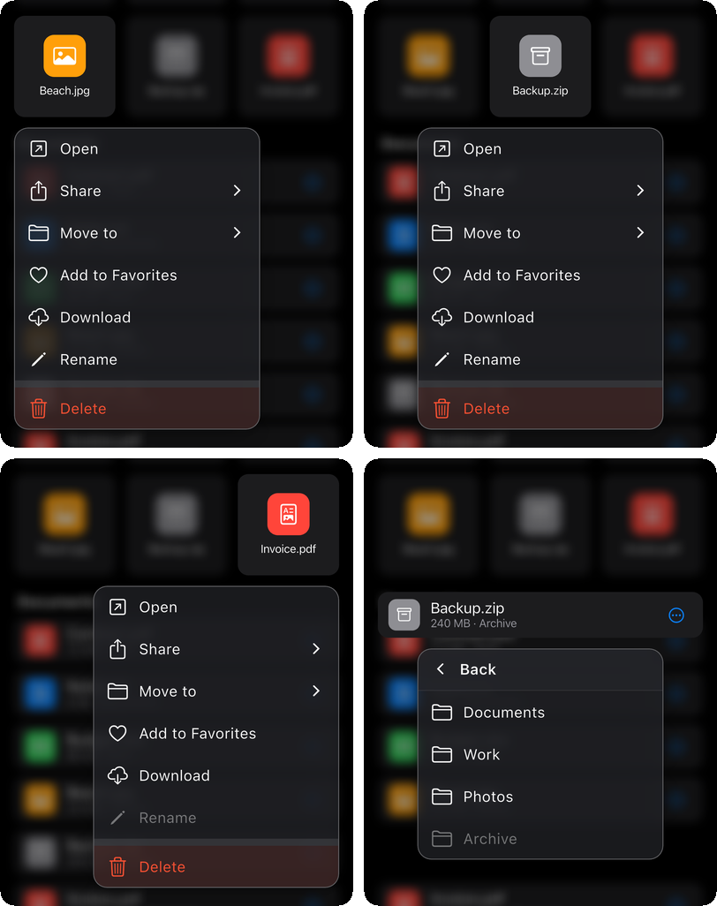

*В тёмной теме: меню выравнивается по левому краю виджета, по центру или по правому краю, а
виджет у нижнего края экрана поднимается ровно настолько, чтобы влезло меню, — здесь подменю.*

Меню открывается прямо под нажатым виджетом, а сам виджет остаётся на месте. Он поднимается,
только если вместе с меню не помещается ниже, и ровно настолько, насколько нужно.
По горизонтали меню выравнивается по левому или правому краю виджета либо по центру —
смотря где виджет на экране. Если у края виджета меню не помещается, оно сдвигается к
середине экрана, а на экране уже меню — сужается. [Контент над виджетом](#контент-над-виджетом)
показывается прямо над ним; если места не хватает, виджет и меню сдвигаются вниз. Если всё
вместе не помещается на экран, приоритет у виджета и меню, а контент над ними уезжает вверх.

- **Меню стало короче.** Например, после возврата из подменю меню остаётся на месте,
  то есть под пальцем: родительское меню начинается там, где был пункт «Назад». Чтобы виджет
  в таких случаях возвращался вниз, задайте `moveBackDown: true` в `SmartContextMenuConfig`;
  ниже своего исходного места он не опустится.
- **Высокие виджеты.** Если виджет с меню не помещаются на экран даже после сдвига,
  их можно прокручивать вместе, так что до любой части виджета и меню можно добраться.
- **Длинные меню.** Меню не бывает выше доли экрана из `SmartContextMenuConfig.menuHeightFactor`
  (по умолчанию 60%); остальные пункты прокручиваются внутри и строятся, только когда
  попадают на экран.

`screenPadding` в `SmartContextMenuConfig` задаёт отступ от краёв экрана поверх safe area,
то есть статус-бара или выреза в горизонтальной ориентации. `menuGap` — расстояние между
виджетом и меню.

Положение виджета и его снимок фиксируются в момент открытия. Если размер экрана меняется
при открытом меню, например при повороте устройства или изменении размера окна, меню
закрывается без действия — так же ведёт себя системное меню в iOS.

### Виды пунктов

Каждый вид пункта создаётся своим методом:

| Метод | Что делает |
| --- | --- |
| `SmartContextMenuItem.simple` | Вызывает `onTap`. |
| `SmartContextMenuItem.submenu` | Открывает подменю с `children`. |
| `SmartContextMenuItem.asyncSubmenu` | Открывает подменю и загружает его пункты. |
| `SmartContextMenuItem.pagingSubmenu` | Открывает подменю и загружает пункты постранично. |
| `SmartContextMenuItem.async` | Показывает заглушку и заменяет её загруженным пунктом. |
| `SmartContextMenuItem.listenable` | Обновляется по `Listenable`, пока меню открыто. |
| `SmartContextMenuItem.loading` | Показывает загрузку асинхронного пункта или подменю либо пункта на `Listenable`. |
| `SmartContextMenuItem.error` | Показывает ошибку загрузки; если это `error` асинхронного пункта или подменю, тап повторяет загрузку. |
| `SmartContextMenuItem.empty` | Показывает, что в подменю нет пунктов. |
| `SmartContextMenuItem.separator` | Отделяет группы пунктов. |
| `SmartContextMenuItem.row` | Показывает другие пункты компактными ячейками в одну строку. |

Асинхронные пункты и подменю загружают данные сами: меню вызывает загрузчик, показывает
загрузку и ошибку и хранит результат, пока не закроется. Пункт на `Listenable`, наоборот,
показывает состояние, которое хранит и обновляет ваше приложение, и перестраивается при
каждом его изменении.

Каждый метод возвращает свой подтип `SmartContextMenuItem`, например `SmartContextMenuSimpleItem`,
так что по пункту можно сделать `switch` и читать поля конкретного типа. В минорных версиях
могут появляться новые виды пунктов, поэтому в `switch` по пунктам оставляйте ветку `_`.

Общие настройки обычных пунктов и подменю:

| Поле | Что делает |
| --- | --- |
| `title` | Текст пункта, не больше `titleMaxLines` строк из стиля. |
| `leading` | Виджет перед текстом, обычно значок. |
| `trailing` | Виджет после текста; у подменю — перед стрелкой. В [ряду](#ряд) не показывается. |
| `isDestructive` | Красит пункт в `destructiveColor` из стиля. |
| `tintColor` | Красит пункт в свой цвет, см. [Стиль пунктов](#стиль-пунктов). |
| `isDisabled` | Делает пункт неактивным: он приглушён и не нажимается. |
| `titleStyle`, `padding`, `childrenGap` | Переопределяют стиль для этого пункта, см. [Стиль пунктов](#стиль-пунктов). |
| `customBuilder` | Заменяет содержимое пункта, см. [Свой контент в пункте](#свой-контент-в-пункте). |
| `closeOnTap` | Только у обычных пунктов: закрывать ли меню по тапу, по умолчанию `true`. |

Значки в `leading` и `trailing` берут цвет текста, если у них нет своего, а текст там — его
стиль и цвет, как у счётчика перед стрелкой.

С `closeOnTap: false` меню после `onTap` остаётся открытым — например, для переключателя.
Обычный пункт без `onTap` просто закрывает меню, а если вдобавок `closeOnTap: false`, он
вообще ничего не делает: не подсвечивается и не нажимается. Так удобно делать, например,
строку со своими кнопками в `customBuilder`.

У каждого пункта есть `id`; если его не задать, он сгенерируется. По `id` загруженные подменю
и пункты кешируются до закрытия меню, поэтому свои `id` должны быть уникальными во всём меню
вместе с подменю. Ошибки не кешируются: пункт загрузится заново, когда снова появится,
например после возврата из подменю, а подменю — когда его снова откроют.

#### Подменю

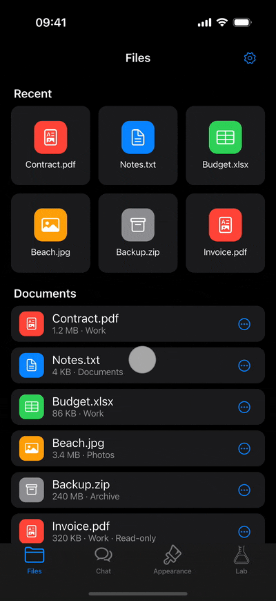

*В тёмной теме: Share — подменю, а Messages внутри него подгружается при открытии. Вернуться
можно пунктом «Назад» или свайпом вправо. [Код в
примере](https://github.com/BinaryRift/smart_context_menu/blob/v1.0.2/example/lib/pages/files/ui/files_page.dart#L197-L235).*

```dart
SmartContextMenuItem.submenu(
  title: 'Share',
  leading: const Icon(CupertinoIcons.share),
  children: [
    SmartContextMenuItem.simple(title: 'Copy link', onTap: () => copyLink(file)),
    SmartContextMenuItem.asyncSubmenu(
      title: 'Messages',
      asyncChildren: () => loadContacts(file),
    ),
  ],
)
```

Вернуться в родительское меню можно пунктом «Назад» вверху подменю или свайпом вправо
при LTR и влево при RTL.
Подменю едет за пальцем и возвращается на место, если свайп короткий.
Чтобы отключить свайп, задайте `enableSwipeBack: false` в `SmartContextMenuConfig`.

#### Подменю с асинхронной загрузкой

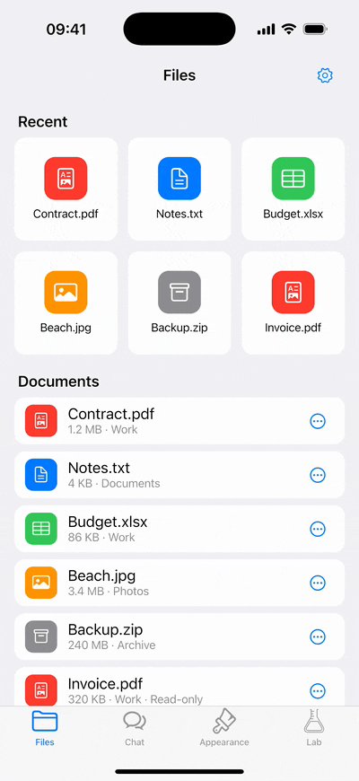

*В светлой теме: Move to загружает папки при открытии; Work — папка этого файла, поэтому она
неактивна. [Код в примере](https://github.com/BinaryRift/smart_context_menu/blob/v1.0.2/example/lib/pages/files/ui/files_page.dart#L237-L255).*

Пункты загружаются при открытии подменю и кешируются до закрытия меню. Во время загрузки
посередине подменю крутится индикатор; чтобы вместо него была строка с текстом, передайте
[пункт загрузки](#загрузка) в `loading`. Если загрузка упала или заняла дольше `timeout`
(по умолчанию 10 секунд), подменю показывает [ошибку](#ошибка), которая по тапу повторяет
загрузку; свою можно передать в `error`. Если пунктов нет, показывается
[пустое состояние](#пустое-состояние); своё можно передать в `empty`.

```dart
SmartContextMenuItem.asyncSubmenu(
  title: 'Move to',
  leading: const Icon(CupertinoIcons.folder),
  asyncChildren: () async {
    final folders = await repository.folders();
    return [
      for (final folder in folders)
        SmartContextMenuItem.simple(
          title: folder.name,
          isDisabled: folder == file.folder,
          onTap: () => move(file, folder),
        ),
    ];
  },
)
```

#### Подменю с пагинацией


*В светлой теме: Reactions загружает первую страницу людей при открытии, а следующую — когда
список докрутили до конца. [Код в примере](https://github.com/BinaryRift/smart_context_menu/blob/v1.0.2/example/lib/pages/chat/ui/chat_page.dart#L290-L321).*

Первая страница загружается с `initialMetadata`. Последний пункт каждой страницы — обычный
пункт, разделитель или [ряд](#ряд) — несёт в `pagingMetadata` метаданные следующей страницы,
и она загружается, когда пользователь докрутит до конца. На последней странице оставьте `null`.
У ряда свой `pagingMetadata`: метаданные его ячеек следующую страницу не описывают.
Пока страница грузится, после загруженных пунктов показывается `loading`, как в подменю
с асинхронной загрузкой. Если страница не загрузилась или загрузка заняла дольше `timeout`
(по умолчанию 10 секунд), после загруженных пунктов показывается `error`, и тап загружает
страницу заново. Если пустая первая страница, подменю показывает `empty`, а пустая следующая
просто заканчивает список.

```dart
SmartContextMenuItem.pagingSubmenu(
  title: 'Reactions',
  initialMetadata: const SmartContextMenuPagingMetadata(limit: 20),
  asyncPagingChildren: (metadata) async {
    final page = await api.reactions(message.id, metadata.page, metadata.limit);
    return [
      for (final (index, reaction) in page.items.indexed)
        SmartContextMenuItem.simple(
          title: reaction.person.name,
          trailing: Text(reaction.emoji),
          pagingMetadata: index == page.items.length - 1 && page.hasMore
              ? metadata.copyWith(page: metadata.page + 1)
              : null,
        ),
    ];
  },
)
```

Для API с курсорами у `SmartContextMenuPagingMetadata` есть `nextCursor`, а для своих
параметров — `extra`.

#### Асинхронный пункт

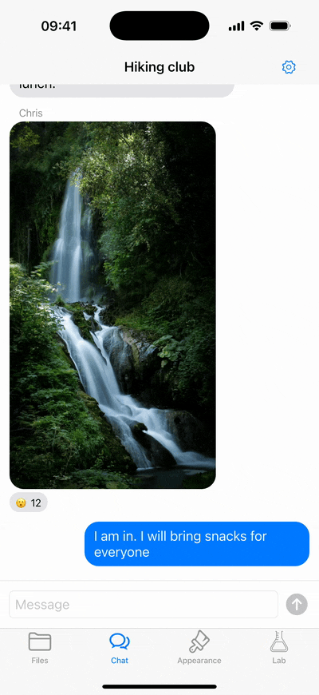

*В светлой теме: Seen by — асинхронный пункт, загрузчик которого возвращает обычное подменю. В
отличие от подменю с асинхронной загрузкой, он грузится сразу при открытии меню, ещё до тапа,
поэтому счётчик виден сразу; после возврата загруженный пункт остаётся. [Код в
примере](https://github.com/BinaryRift/smart_context_menu/blob/v1.0.2/example/lib/pages/chat/ui/chat_page.dart#L323-L347).*

Заглушка начинает загрузку, как только появляется на экране. Пока идёт загрузка, она
показывает `loading` — по умолчанию `SmartContextMenuItem.loading` со стандартной подписью.
Если загрузка упала или заняла дольше `timeout` (по умолчанию 10 секунд), показывается
`error` — `SmartContextMenuItem.error`, и тап загружает пункт заново, см. [Ошибка](#ошибка).

Загрузчик возвращает пункт, который выполняет действие или открывает подменю, либо
`loading`, `error` или `empty` — например, `SmartContextMenuItem.empty`, если показывать
нечего. Если вернуть обычное подменю, как в Seen by, данные загрузятся вместе с меню,
а подробности откроются по тапу:

```dart
SmartContextMenuItem.async(
  loading: SmartContextMenuItem.loading(title: 'Seen by'),
  asyncItem: () async {
    final readers = await api.readers(message.id);
    // A regular submenu, loaded as the menu opens.
    return SmartContextMenuItem.submenu(
      title: 'Seen by',
      trailing: Text('${readers.length}'),
      children: [
        for (final reader in readers)
          SmartContextMenuItem.simple(title: reader.name),
      ],
    );
  },
)
```

Загрузчик может вернуть и обычный пункт, например после проверки прав:

```dart
SmartContextMenuItem.async(
  loading: SmartContextMenuItem.loading(title: 'Checking access'),
  error: SmartContextMenuItem.error(title: 'Could not check access'),
  asyncItem: () async {
    final canEdit = await permissions.canEdit();
    return SmartContextMenuItem.simple(
      title: 'Edit',
      isDisabled: !canEdit,
      onTap: () => edit(),
    );
  },
)
```

#### Пункт на Listenable

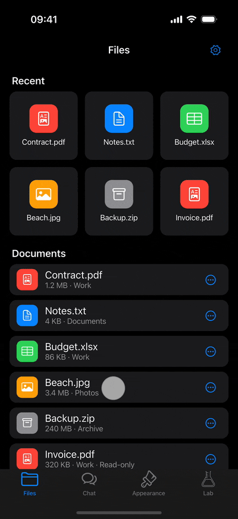

*В тёмной теме: после тапа Download показывает прогресс прямо в открытом меню, а когда загрузка
заканчивается, превращается в Remove Download. [Код в
примере](https://github.com/BinaryRift/smart_context_menu/blob/v1.0.2/example/lib/pages/files/ui/files_page.dart#L279-L307).*

Подходит, когда состояние пункта хранится в приложении и может поменяться, пока меню
открыто: переключатель, после которого меню не закрывается, счётчик или уже запущенное
действие. Builder вызывается заново при каждом уведомлении `listenable` и возвращает пункт,
который нужно показать. Пока что-то грузится, возвращайте `SmartContextMenuItem.loading`:
он показывает текст с индикатором, как асинхронный пункт, и не нажимается.

```dart
SmartContextMenuItem.listenable(
  listenable: downloads,
  builder: () => switch (downloads.stateOf(file)) {
    DownloadState.running => SmartContextMenuItem.loading(
      title: 'Downloading ${downloads.percentOf(file)}%',
    ),
    DownloadState.done => SmartContextMenuItem.simple(
      title: 'Remove Download',
      isDestructive: true,
      closeOnTap: false,
      onTap: () => downloads.remove(file),
    ),
    DownloadState.none => SmartContextMenuItem.simple(
      title: 'Download',
      closeOnTap: false,
      onTap: () => downloads.start(file),
    ),
  },
)
```

В отличие от асинхронного пункта, состоянием владеет приложение: пункт не загружается один
раз, а перестраивается при каждом уведомлении. Builder возвращает `SmartContextMenuItem.simple`
(у него работают `onTap` и `closeOnTap`) или `loading`, `error`, `empty`, которые не нажимаются.
Чтобы из пункта можно было повторить упавшую загрузку в вашем приложении, верните обычный пункт:

```dart
SmartContextMenuItem.listenable(
  listenable: views,
  builder: () => switch (views.state) {
    ViewsState.loading => SmartContextMenuItem.loading(title: 'Views'),
    ViewsState.failed => SmartContextMenuItem.simple(
      title: 'Try again',
      trailing: const Icon(SmartContextMenuDefaults.retryIcon),
      closeOnTap: false,
      onTap: views.reload,
    ),
    ViewsState.loaded => SmartContextMenuItem.simple(title: 'Views: ${views.count}'),
  },
)
```

Меню не вызывает `dispose` у `listenable`.

Подойдёт любой `Listenable`: `ChangeNotifier`, `ValueNotifier`, несколько штук через
`Listenable.merge` или контроллер стейт-менеджера, который реализует `Listenable`, например
`GetxController` (он уведомляет при вызове `update()` без id). А вот `Obx` или `BlocBuilder`
здесь не помогут: пункт — это данные, а не виджет, и его builder вызывается вне них. Чтобы
пункт обновлялся по `Stream`, например из Bloc или GetX `Rx`, оберните поток в `ChangeNotifier`:

```dart
final class StreamListenable extends ChangeNotifier {
  StreamListenable(Stream<Object?> stream) {
    _subscription = stream.listen((_) => notifyListeners());
  }

  late final StreamSubscription<Object?> _subscription;

  @override
  void dispose() {
    _subscription.cancel();
    super.dispose();
  }
}
```

Создавайте такой адаптер рядом с состоянием, которое он слушает, и там же вызывайте `dispose`.

#### Загрузка

Пункт `loading` показывает `title` (по умолчанию стандартную подпись загрузки) с `leading`
и индикатором и не нажимается. `trailing` заменяет индикатор, а `child` — всё содержимое;
текст и значки в нём берут цвет пункта. Если это `loading` асинхронного пункта или подменю
либо его вернул пункт на `Listenable`, меню заменит его, когда загрузка закончится. В любом
другом месте он остаётся до закрытия меню.

Пункты загрузки, ошибки и пустого состояния выглядят одинаково: текст посередине, после
него знак состояния, а `leading` свободен под ваш значок. Они не нажимаются и не приглушаются.
Их выравнивание, значки и индикатор для всех меню задаёт [стиль](#стиль-пунктов).

| Пункт | Текст | После текста |
| --- | --- | --- |
| `loading` | подпись загрузки | индикатор |
| `error` | подпись ошибки | значок ошибки |
| `error` асинхронного пункта или подменю | подпись повтора | значок повтора |
| `empty` | подпись пустого списка | значок пустого списка |

Свои `title`, `leading` и `trailing` заменяют стандартные, а `child` — всю строку.

По умолчанию подменю во время загрузки показывает индикатор посередине, а переданный пункт
`loading` показывается строкой. Чтобы показать свой индикатор по центру, передайте его в `child`:

```dart
SmartContextMenuItem.asyncSubmenu(
  title: 'Recent files',
  loading: SmartContextMenuItem.loading(
    child: const Center(child: CircularProgressIndicator()),
  ),
  asyncChildren: () => loadRecentFiles(),
)
```

Пункт на `Listenable` может показывать свою загрузку на каждом шаге работы:

```dart
SmartContextMenuItem.listenable(
  listenable: sync,
  builder: () => switch (sync.state) {
    SyncState.checking => SmartContextMenuItem.loading(title: 'Checking'),
    SyncState.syncing => SmartContextMenuItem.loading(title: 'Syncing'),
    SyncState.idle => SmartContextMenuItem.simple(title: 'Sync now', onTap: sync.start),
  },
)
```

#### Ошибка

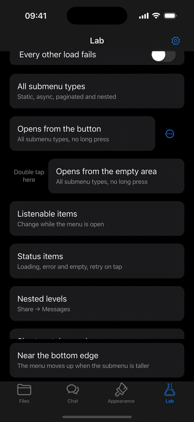

*В тёмной теме: Shared files не загрузился, и тап по строке загружает его заново; в Archive
пусто. [Код в примере](https://github.com/BinaryRift/smart_context_menu/blob/v1.0.2/example/lib/pages/lab/domain/lab_items.dart#L131-L186).*

Пункт `error` показывает, что загрузка не удалась: `title` (по умолчанию стандартная подпись
ошибки) со значком ошибки. Если это `error` асинхронного пункта или подменю, тап повторяет
загрузку, а вместо подписи и значка ошибки показываются подпись и значок повтора — если
у пункта нет своих `title` и `trailing`. В остальных местах, например в builder пункта
на `Listenable`, он не нажимается.

Кнопка в `child` обрабатывает свой тап сама, а тап по остальной строке повторяет загрузку:

```dart
SmartContextMenuItem.asyncSubmenu(
  title: 'Shared files',
  error: SmartContextMenuItem.error(
    child: Row(
      children: [
        const Expanded(child: Text('Could not load files')),
        CupertinoButton(onPressed: showDetails, child: const Text('Details')),
        // The child replaces the whole row, so add the retry icon yourself.
        const Icon(SmartContextMenuDefaults.retryIcon),
      ],
    ),
  ),
  asyncChildren: () => loadSharedFiles(),
)
```

Пункт ошибки показывается, когда загрузчик бросает исключение. Если ошибку можно обработать,
например нет прав доступа, перехватите её и верните пункт сами: `error`, который не нажимается,
или обычный пункт со своим действием.

#### Пустое состояние

GIF в разделе [Ошибка](#ошибка) заканчивается подменю Archive, в котором нет пунктов.

Подменю с асинхронной загрузкой или пагинацией без пунктов показывает пункт `empty`: `title`
(по умолчанию стандартная подпись) со значком пустого списка. Чтобы показать свой, передайте
его в `empty` и верните из загрузчика пустой список. Подменю с пагинацией показывает его,
только если пустая первая страница, а обычное подменю без `children` — стандартный.
Пункт на `Listenable` тоже может его вернуть.

```dart
SmartContextMenuItem.asyncSubmenu(
  title: 'Archive',
  // Without it, the submenu shows the empty label, "No items".
  empty: SmartContextMenuItem.empty(title: 'Archive is empty'),
  asyncChildren: () => loadArchive(),
)
```

#### Разделитель

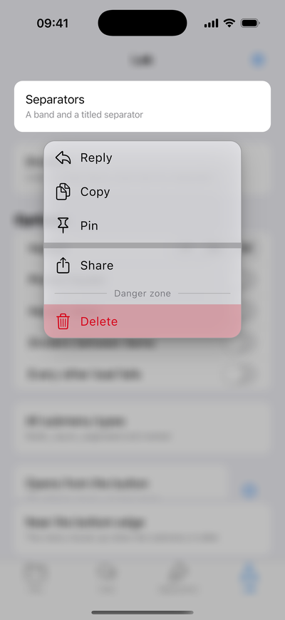

*В светлой теме: полоса отделяет Pin от Share, а разделитель со своим `child` подписывает
последнюю группу.*

Разделитель делит пункты на группы. У него нет действий и подсветки, и drag-to-select
его пропускает. По умолчанию это полоса, которую задают `separatorThickness` и `separatorColor`
в стиле; `child` заменяет её, например, на заголовок секции. Старое имя `separatorHeight`
помечено как устаревшее; используйте `separatorThickness`.

Полоса показывается только между пунктами: не в начале и не в конце меню, а несколько полос
подряд схлопываются в одну. Разделитель с `child` подписывает пункты после себя, поэтому он
показывается и в начале меню или подменю, но не в конце. Из нескольких разделителей подряд
показывается последний с `child`, а если таких нет — первая полоса. Поэтому, если пункты зависят
от пользователя или контента, ничего дополнительно проверять не нужно:

```dart
[
  if (canReply)
    SmartContextMenuItem.simple(title: 'Reply', onTap: () => reply()),
  SmartContextMenuItem.simple(title: 'Copy', onTap: () => copy()),
  if (isAdmin) SmartContextMenuItem.simple(title: 'Pin', onTap: () => pin()),
  SmartContextMenuItem.separator(),
  // Without Delete, the separator above is not shown.
  if (canDelete)
    SmartContextMenuItem.simple(
      title: 'Delete',
      isDestructive: true,
      onTap: () => delete(),
    ),
]
```

Чтобы вместо полосы была тонкая линия, задайте маленький `separatorThickness`, а в
`separatorColor` — цвет `dividerColor`. Линии между всеми пунктами описаны в разделе
[Линии между пунктами](#линии-между-пунктами).

#### Ряд

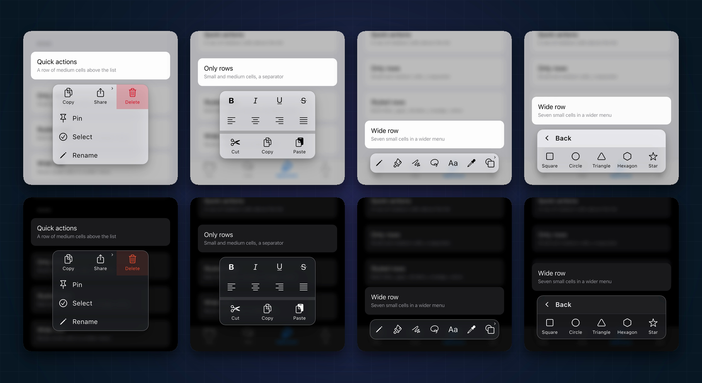

*Меню из примера в светлой и тёмной темах: ряд над списком, меню только из рядов, семь
инструментов в широком меню и его подменю Shapes из одного ряда. [Код в
примере](https://github.com/BinaryRift/smart_context_menu/blob/v1.1.0/example/lib/pages/appearance/domain/appearance_items.dart#L148-L344).*

Ряд ставит самые частые действия рядом, как компактные меню iOS. Его ячейки — пункты других
видов: действия, подменю, асинхронные пункты и пункты на `Listenable`, загрузка, ошибка, пустое
состояние и разделители. Они сохраняют свои действия, цвета, `id` и правила закрытия меню,
а ряд только делает их компактными. Ряды и обычные пункты можно чередовать, а меню может
состоять из одних рядов.

```dart
[
  SmartContextMenuItem.row(
    children: [
      SmartContextMenuItem.simple(
        title: 'Copy',
        leading: const Icon(CupertinoIcons.doc_on_doc),
        onTap: () => copy(),
      ),
      SmartContextMenuItem.submenu(
        title: 'Share',
        leading: const Icon(CupertinoIcons.share),
        children: shareItems,
      ),
      SmartContextMenuItem.simple(
        title: 'Delete',
        leading: const Icon(CupertinoIcons.delete),
        isDestructive: true,
        onTap: () => delete(),
      ),
    ],
  ),
  SmartContextMenuItem.simple(
    title: 'Pin',
    leading: const Icon(CupertinoIcons.pin),
    onTap: () => pin(),
  ),
]
```

`size` задаёт вид ячеек:

- `SmartContextMenuRowSize.medium`, по умолчанию, — `leading` над `title`.
- `SmartContextMenuRowSize.small` — только `leading`, а `title` читает диктор. Ячейка без
  `leading` показывает `title`, например `0.5×`, `1×`, `2×`.

Ряд — одна строка без переноса: шесть ячеек в две строки — это два ряда по три. В меню Only
rows из примера восемь маленьких ячеек в двух рядах и ряд средних:

```dart
[
  SmartContextMenuItem.row(
    size: SmartContextMenuRowSize.small,
    children: [bold, italic, underline, strikethrough],
  ),
  SmartContextMenuItem.row(
    size: SmartContextMenuRowSize.small,
    children: [alignLeft, center, alignRight, justify],
  ),
  SmartContextMenuItem.separator(),
  SmartContextMenuItem.row(children: [cut, copy, paste]),
]
```

Ячейкой может быть пункт любого вида:

- Ячейка, которая открывает подменю, показывает маленький значок подменю в верхнем углу.
  Подменю показывает свои пункты как обычно, и в нём могут быть свои ряды.
- Асинхронные ячейки и ячейки на `Listenable` остаются компактными и во время загрузки,
  и после. Ячейки загрузки, ошибки и пустого состояния показывают значок состояния с короткой
  подписью из [текстов меню](#локализация).
- Неактивные, destructive и окрашенные ячейки выглядят так же, как в списке.
- `trailing` ячейки не показывается; нарисовать его можно в
  [`customBuilder`](#свой-контент-в-пункте).

Ширина ряда делится между ячейками, по умолчанию поровну. `SmartContextMenuRowFlex` даёт
ячейке большую долю, а `id` и действие остаются у её `child`. Ширина ячейки не меняется от
содержимого. Высота ряда — по самой высокой ячейке, и каждая ячейка нажимается и подсвечивается
на всю свою долю ширины и всю высоту ряда. Содержимое шире ячейки обрезается, текст — с
многоточием, а в RTL ячейки идут справа налево.

```dart
SmartContextMenuItem.row(
  children: [
    inbox,
    flag,
    // Twice as wide as the other cells.
    SmartContextMenuRowFlex(flex: 2, child: markAsRead),
  ],
)
```

Ряд, в котором ячеек меньше, чем в ряду над ним, всё равно делит всю свою ширину, так что одна
ячейка займёт всю ширину меню. Чтобы ячейки были такой же ширины, как в другом ряду, заполните
остаток пустыми ячейками: обычный пункт без `title`, `leading` и `onTap` и с
`closeOnTap: false` не подсвечивается и не нажимается. Добавьте по пустой ячейке на каждую
недостающую, а не одну `SmartContextMenuRowFlex` — тогда совпадут и промежутки — и выключите
линии в этом ряду. Если в другом ряду линии есть, ширины разойдутся на их толщину. Разделитель
распоркой не подойдёт: в конце ряда он не показывается.

```dart
[
  SmartContextMenuItem.row(
    size: SmartContextMenuRowSize.small,
    children: [undo, redo, cut, copy],
  ),
  SmartContextMenuItem.row(
    size: SmartContextMenuRowSize.small,
    dividersBetweenChildren: false,
    children: [
      paste,
      for (var i = 0; i < 3; i++)
        SmartContextMenuItem.simple(closeOnTap: false),
    ],
  ),
]
```

Как и в списке, разделитель в ряду — полоса, только вертикальная, и правила те же: полоса
показывается только между ячейками, разделитель с `child` — и в начале ряда, например подписью
перед ячейками, а из нескольких разделителей подряд показывается один. Ряд без ячеек или из одних
разделителей не показывается, поэтому ячейки по условию не требуют проверок.
`dividersBetweenChildren` рисует вертикальные линии между ячейками; если он `null`, то следует
`dividersBetweenItems` из стиля. `padding` и `childrenGap` задают отступы вокруг и между ячейками
этого ряда; промежуток не принадлежит ни одной ячейке, и палец над ним снимает подсветку. Вид
всех рядов задаёт [стиль рядов](#стиль-рядов).

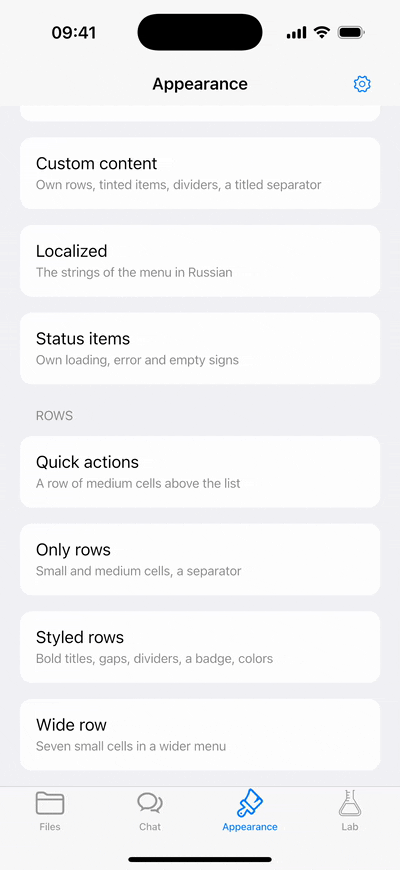

*В светлой теме: подсветка идёт за пальцем от ячейки к ячейке и дальше по списку.*

Drag-to-select работает по ячейкам так же, как по другим пунктам, и отпускание выбирает ячейку
под пальцем. В подменю горизонтальное ведение, начатое на ряду, выбирает его ячейки, а не
возвращает назад; с `enableSwipeBack: true` оно возвращает, как на других пунктах. Вне ряда
и на пункте «Назад» свайп назад работает всегда.

`children` принимает `SmartContextMenuRowEntry` — пункты всех видов и `SmartContextMenuRowFlex`,
но не ряд, так что ряд нельзя вложить в ряд. Помощник, который возвращает ячейку, объявляйте
с конкретным типом пункта, например `SmartContextMenuSimpleItem` или
`SmartContextMenuAsyncSubmenuItem`, а не `SmartContextMenuItem`, а заранее собранному списку
ячеек укажите тип: `<SmartContextMenuRowEntry>[...]`.

Ячейки должны быть достаточно широкими для пальца, см.
[Рекомендации по дизайну](#рекомендации-по-дизайну).

### Открытие из кода

Кнопка внутри виджета открывает меню через `SmartContextMenu.of(context)`. Он возвращает
контроллер ближайшего меню вокруг `context`, так что кнопке ничего настраивать не нужно:

```dart
SmartContextMenu(
  items: items,
  child: Row(
    children: [
      const Expanded(child: Text('Report.pdf')),
      Builder(
        builder: (context) => CupertinoButton(
          onPressed: () => SmartContextMenu.of(context).open(),
          child: const Icon(CupertinoIcons.ellipsis_circle),
        ),
      ),
    ],
  ),
)
```

`Builder` даёт кнопке `context` внутри меню. Кнопка в отдельном виджете, например в строке
списка, берёт `context` этого виджета. Пункты открытого меню лежат не внутри виджета,
поэтому из них `of` меню не найдёт. `SmartContextMenu.maybeOf(context)` возвращает `null`,
если меню выше нет.

Чтобы открыть меню снаружи виджета, например двойным тапом рядом с сообщением, создайте
`SmartContextMenuController()` и передайте его в меню:

```dart
final controller = SmartContextMenuController();

SmartContextMenu(
  controller: controller,
  items: items,
  child: child,
);

GestureDetector(
  onDoubleTap: controller.open,
  child: background,
);
```

Чтобы меню открывалось только из кода, поставьте режим `manual`: долгое нажатие и правый
клик тогда остаются виджету. Меню открывается через `SmartContextMenu.of` из виджета или
через свой контроллер, так что без них оно не откроется вовсе.

`SmartContextMenu.of` возвращает контроллер, переданный в меню, или собственный контроллер
меню. Контроллер уведомляет слушателей, когда меню открывается и закрывается, см. `isOpen`.
`open()` завершается, когда меню закрылось, так что `await controller.open()` дождётся
закрытия. Созданный вами контроллер не забудьте освободить через `dispose`, когда он больше
не нужен; свой контроллер меню освобождает само.

### Контент над виджетом

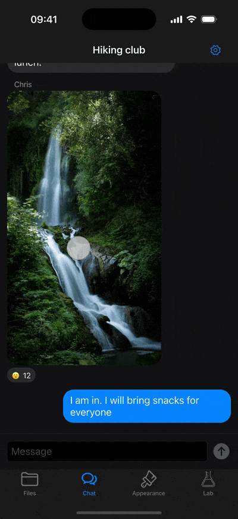

*В тёмной теме: панель реакций над сообщением; тап по реакции закрывает меню. [Код в
примере](https://github.com/BinaryRift/smart_context_menu/blob/v1.0.2/example/lib/pages/chat/ui/chat_page.dart#L216-L241).*

Чтобы показать свой контент над виджетом, пока меню открыто, передайте `headerSliversBuilder`.
Он возвращает список слайверов: они плавно появляются и исчезают вместе с меню и двигаются
вместе с виджетом, когда его тянут или когда меню растягивается. Builder получает
`SmartContextMenuHeaderDetails`:

- `alignment` — как виджет и меню выровнены по горизонтали. У слайверов тот же горизонтальный
  отступ, что у виджета, поэтому `Align(alignment: header.alignment)` прижимает контент
  к краю виджета.
- `animation` идёт от 0 до 1, пока слайверы появляются, и обратно, пока исчезают, —
  по ней можно анимировать свой контент вместе с меню.
- `close()` закрывает меню. Он завершается на трёх четвертях анимации закрытия, как у пункта,
  чтобы результат действия был виден, пока меню закрывается.

Тап по вашим виджетам в слайверах не закрывает меню, а тап по пустому месту рядом —
закрывает, как и тап в любом месте вне меню.

```dart
SmartContextMenu(
  headerSliversBuilder: (context, header) => [
    SliverToBoxAdapter(
      child: Align(
        alignment: header.alignment,
        child: ReactionsBar(
          onSelected: (reaction) async {
            await header.close();
            react(message, reaction);
          },
        ),
      ),
    ),
    const SliverToBoxAdapter(child: SizedBox(height: 8)),
  ],
  items: items,
  child: MessageBubble(message),
)
```

Например, чтобы панель вырастала от края виджета, оберните её в переход на `header.animation`.
Используйте `drive`, а не `CurvedAnimation`: builder вызывается при каждой перестройке,
и созданную в нём `CurvedAnimation` никто не освободит.

```dart
ScaleTransition(
  scale: header.animation.drive(CurveTween(curve: Curves.easeOutBack)),
  // Grows from the bottom edge, next to the widget.
  alignment: Alignment(header.alignment.x, 1),
  child: ReactionsBar(onSelected: react),
)
```

Плавное появление накладывается поверх вашей анимации; чтобы анимировать слайверы
только по-своему, задайте `fadeHeaderSlivers: false`.

Слайверы — прямые потомки скролла меню, поэтому `PinnedHeaderSliver` остаётся вверху,
прямо под статус-баром, пока высокий виджет и меню прокручиваются под ним. При этом он их
перекрывает, так что делайте его небольшим:

```dart
headerSliversBuilder: (context, header) => [
  PinnedHeaderSliver(
    child: Align(
      alignment: header.alignment,
      child: ReactionsBar(onSelected: react),
    ),
  ),
],
```

Если при открытии меню контент прокручивается, слайверы ждут, пока виджет почти встанет
на место, чтобы он по пути не перекрыл закреплённый слайвер.

Чтобы слайверы появлялись позже, задайте `headerSliversDelay`. Задержка считается от начала
открытия, которое длится 300 миллисекунд: при задержке короче слайверы начнут появляться,
пока виджет ещё едет на место, при задержке длиннее — уже после.

```dart
SmartContextMenu(
  headerSliversBuilder: (context, header) => [reactionsBar],
  // The bar appears a moment after the menu.
  headerSliversDelay: const Duration(milliseconds: 150),
  items: items,
  child: MessageBubble(message),
)
```

### Hero


*В светлой теме: двойной тап рядом с фото открывает меню из кода, а тап по превью открывает
фото с его собственным `Hero`. [Код в примере](https://github.com/BinaryRift/smart_context_menu/blob/v1.0.2/example/lib/pages/chat/ui/chat_page.dart#L149-L214).*

У виджета может быть свой `Hero`, например у фото в чате, которое открывается на весь экран.
Меню тоже анимирует превью через `Hero`, но не оборачивает в него ваш виджет: оно добавляет
свой `Hero` рядом и только пока меню открыто. Поэтому `Hero` внутри `Hero` не получается,
а ваш виджет, пока меню открыто, остаётся на своём месте — скрытым и с сохранённым состоянием.

Открывайте страницу из `onPreviewTap`: он вызывается, когда меню закрылось и превью вернулось
на место, поэтому ваш `Hero` полетит с места виджета, как после обычного тапа по нему:

```dart
SmartContextMenu(
  items: items,
  onPreviewTap: () => openPhoto(photo),
  child: GestureDetector(
    onTap: () => openPhoto(photo),
    child: Hero(
      tag: photo.id,
      child: Image.network(photo.url),
    ),
  ),
)
```

Здесь `openPhoto` открывает страницу с `Hero` с тем же тегом.

### Настройки

Общие настройки меню собраны в `SmartContextMenuConfig`. У всех полей есть значения
по умолчанию, так что задавайте только то, что нужно:

```dart
const menuConfig = SmartContextMenuConfig(
  menuWidth: 220,
  enableHaptics: false,
  style: menuStyle,
);
```

| Поле | Что задаёт | По умолчанию |
| --- | --- | --- |
| `activationMode` | Открывать меню долгим нажатием или правым кликом либо только из кода, см. [Открытие из кода](#открытие-из-кода). | `longPress` |
| `enableHaptics` | Haptics при открытии меню долгим нажатием, подсветке и тапе по пункту, тапе по превью, открытии и закрытии подменю. | `true` |
| `barrierDismissible` | Закрывать ли меню по тапу вне меню, виджета и [контента над ним](#контент-над-виджетом). С `false` меню закрывается только пунктом, превью, контентом над виджетом или контроллером. | `true` |
| `enableSwipeBack` | Возврат из подменю свайпом вправо при LTR или влево при RTL, см. [Подменю](#подменю). | `true` |
| `menuWidth` | Ширина меню. На экране уже меню оно сужается. | 250 |
| `menuHeightFactor` | Максимальная высота меню как доля высоты экрана, см. [Позиционирование](#позиционирование). | 0.6 |
| `screenPadding` | Отступ от краёв экрана поверх safe area. | 16 |
| `menuGap` | Расстояние между виджетом и меню. | 12 |
| `moveBackDown` | Возвращать виджет вниз, когда меню становится короче. | `false` |
| `labels` | Тексты, которые меню показывает само, см. [Локализация](#локализация). | английские |
| `style` | Внешний вид меню, см. [Внешний вид](#внешний-вид). | |

#### Тема и конфиг

Меню берёт конфиг из первого, что найдёт:

1. свой `config`;
2. ближайшая `SmartContextMenuTheme` выше по дереву;
3. значения по умолчанию, `const SmartContextMenuConfig()`.

И тема, и `config` необязательны — выбирайте, как удобнее.

**Всё приложение.** Задайте конфиг один раз темой в `builder` приложения, и меню
`config` уже не понадобится:

```dart
MaterialApp(
  builder: (context, child) => SmartContextMenuTheme(
    config: menuConfig,
    child: child!,
  ),
  home: const HomePage(),
);

SmartContextMenu(
  items: items,
  child: child,
);
```

**Часть приложения.** Оберните экран, список или любое поддерево своей темой.
Срабатывает ближайшая тема, и она полностью заменяет внешнюю, поэтому, чтобы сохранить
внешние настройки, начинайте с неё:

```dart
SmartContextMenuTheme(
  config: SmartContextMenuTheme.of(context).copyWith(enableSwipeBack: false),
  child: const ChatScreen(),
)
```

**Одно меню.** Передайте меню `config`. Для этого меню он полностью заменяет тему:

```dart
SmartContextMenu(
  config: const SmartContextMenuConfig(menuWidth: 220),
  items: items,
  child: child,
)
```

Чтобы поменять пару настроек, а остальное взять из темы, начните с неё и вызовите `copyWith`.
У `SmartContextMenuStyle` он тоже есть:

```dart
final theme = SmartContextMenuTheme.of(context);

SmartContextMenu(
  config: theme.copyWith(
    activationMode: SmartContextMenuActivationMode.manual,
    style: theme.style.copyWith(menuBlur: SmartContextMenuBlur.small),
  ),
  controller: controller,
  items: items,
  child: child,
)
```

`SmartContextMenuTheme.of(context)` читает тему выше `context`. Если тема создаётся в том же
методе `build`, оберните меню в `Builder`, иначе вы получите внешнюю тему.

#### Локализация

Некоторые тексты меню показывает само: пункт «Назад», подпись повтора и тексты загрузки,
ошибки и пустого состояния, если у них нет своего `title`. Переопределить их можно через
`SmartContextMenuLabels`, например в конфиге [темы](#тема-и-конфиг), чтобы перевести
сразу все меню:

```dart
SmartContextMenuConfig(
  labels: SmartContextMenuLabels(
    back: l10n.back,
    retry: l10n.retry,
    loading: l10n.loading,
    error: l10n.couldNotLoad,
    empty: l10n.noItems,
    rowLoading: l10n.loadingShort,
    rowError: l10n.error,
    rowRetry: l10n.retryShort,
    rowEmpty: l10n.noItems,
  ),
)
```

Ячейки [ряда](#ряд) узкие, поэтому у загрузки, ошибки и пустого состояния в них свои короткие
подписи: `rowLoading`, `rowError`, `rowRetry` и `rowEmpty`.

#### Приложения на `cupertino_ui`

С Flutter 3.50 `flutter/cupertino.dart` устарел, на смену ему пришёл пакет
[`cupertino_ui`](https://pub.dev/packages/cupertino_ui). До 2.0.0 меню использует
`flutter/cupertino.dart` и не видит тему и локализации `CupertinoApp` из `cupertino_ui`: оно
следует системной теме, а подпись барьера для экранного диктора — на английском. Поставьте
`CupertinoUiCompatibilityBridge` из `cupertino_ui` в `builder` приложения. Меню открывается поверх
всего приложения, поэтому мост вокруг одного экрана или виджета его тему не меняет.

```dart
CupertinoApp(
  theme: const CupertinoThemeData(brightness: Brightness.dark),
  builder: (context, child) => CupertinoUiCompatibilityBridge(child: child!),
  home: const HomePage(),
)
```

Меню резолвит только `CupertinoDynamicColor` из `flutter/cupertino.dart`, например свои значения
по умолчанию. `CupertinoDynamicColor` из `cupertino_ui` в стиле остаётся в светлом цвете, поэтому
резолвите его в `builder`, где тема приложения уже известна:

```dart
builder: (context, child) => CupertinoUiCompatibilityBridge(
  child: SmartContextMenuTheme(
    config: SmartContextMenuConfig(
      style: SmartContextMenuStyle(
        menuColor: CupertinoDynamicColor.resolve(brandMenuColor, context),
      ),
    ),
    child: child!,
  ),
),
```

Мост помечен устаревшим как временный инструмент миграции, поэтому анализатор сообщает о его
использовании. В версии 2.0.0 пакет переходит на `cupertino_ui`, и мост станет не нужен.

### Внешний вид

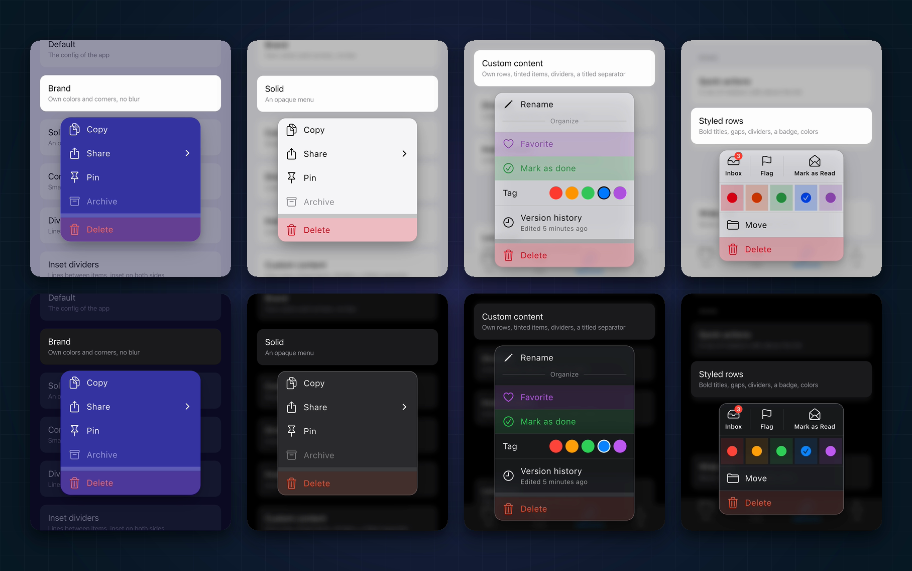

*Четыре стиля из примера в светлой и тёмной темах: фирменные цвета и только затемнение за меню,
непрозрачное меню, пункты со своим контентом и ряды в своём стиле с бейджем и выбором цвета.*

Внешний вид меню задаёт `SmartContextMenuStyle` — поле `style` в конфиге.
У пункта «Назад», пунктов загрузки, ошибки и пустого состояния и у рядов в нём свои части:
[`backButtonStyle`](#стиль-пункта-назад), [`statusStyle`](#стиль-состояний) и
[`rowStyle`](#стиль-рядов). У всех полей есть значения по умолчанию:

```dart
const menuStyle = SmartContextMenuStyle(
  menuBlur: SmartContextMenuBlur.small,
  backgroundBlur: SmartContextMenuBlur(10),
  borderRadius: BorderRadius.all(Radius.circular(20)),
  menuShadows: [BoxShadow(color: Color(0x33000000), blurRadius: 20)],
);
```

`menuShadows` заменяет стандартные тени под меню; чтобы убрать тени, передайте пустой список.

`menuDecoration` заменяет стандартный фон и рамку меню. Закреплённый пункт «Назад» не наследует
её: по умолчанию он использует `menuColor` и `borderRadius` из `backButtonStyle`. Поле
`decoration` там же задаёт ему отдельный фон. Форма декорации обрезает и размытие пункта
«Назад»; прозрачная декорация позволяет видеть градиент меню и размытые прокручиваемые пункты:

```dart
const style = SmartContextMenuStyle(
  menuDecoration: BoxDecoration(
    borderRadius: BorderRadius.all(Radius.circular(16)),
    gradient: LinearGradient(
      begin: Alignment.topCenter,
      end: Alignment.bottomCenter,
      colors: [Color(0xFF3634A3), Color(0xFF18165F)],
    ),
  ),
  backButtonStyle: SmartContextMenuBackButtonStyle(
    decoration: BoxDecoration(
      color: Color(0x00000000),
      borderRadius: BorderRadius.vertical(top: Radius.circular(16)),
    ),
  ),
);
```

Пункт «Назад» не копирует градиент, а показывает меню за собой. Если прокручиваемые пункты
проступают слишком сильно, задайте декорации полупрозрачный цвет. Её радиус определяет обрезку;
`borderRadius` из `backButtonStyle` действует только без `decoration`.

#### Стиль пунктов

Ещё `SmartContextMenuStyle` задаёт текст, цвета, значки и отступы пунктов, так что меню
можно подогнать под тему приложения:

```dart
const style = SmartContextMenuStyle(
  titleStyle: TextStyle(
    fontFamily: 'Montserrat',
    fontSize: 17,
    color: Color(0xFFFFFFFF),
  ),
  disabledForegroundColor: Color(0x99FFFFFF),
  destructiveColor: Color(0xFFFF453A),
  highlightColor: Color(0x1FFFFFFF),
  dividerColor: Color(0x999E9E9E),
  submenuIcon: Icons.arrow_forward_ios,
  itemPadding: EdgeInsets.symmetric(horizontal: 16, vertical: 10),
  itemChildrenGap: 10,
);
```

Цвет из `titleStyle` используется для активных пунктов, кроме destructive; неактивные
и destructive пункты берут `disabledForegroundColor` и `destructiveColor`. Нажатый пункт
подсвечивается полупрозрачным цветом текста или `highlightColor`, если он задан.
Ещё стиль задаёт число строк текста; у пункта «Назад» и пунктов загрузки, ошибки и пустого
состояния свои [стиль пункта «Назад»](#стиль-пункта-назад) и [стиль состояний](#стиль-состояний).
Все поля — в документации
[`SmartContextMenuStyle`](https://pub.dev/documentation/smart_context_menu/latest/smart_context_menu/SmartContextMenuStyle-class.html).

**Настройки пункта важнее стиля.** Стиль задаёт вид всех пунктов, а пункт может поменять его
только для себя:

```dart
// The style: padding and text of all items.
const style = SmartContextMenuStyle(
  itemPadding: EdgeInsets.symmetric(horizontal: 16, vertical: 10),
  titleStyle: TextStyle(fontSize: 17),
);

// This item uses its own padding and text style instead.
SmartContextMenuItem.simple(
  title: 'Open in new window',
  padding: const EdgeInsets.symmetric(horizontal: 16, vertical: 16),
  titleStyle: const TextStyle(fontSize: 15, fontWeight: FontWeight.w600),
  onTap: () => openInNewWindow(),
)
```

То же с `childrenGap` и `itemChildrenGap`.

Чтобы покрасить отдельный пункт, задайте ему `tintColor`. Он окрасится так же, как destructive:
текст и значки — в этот цвет, фон — в его полупрозрачный оттенок. У неактивного пункта
с `tintColor` остаётся только приглушённый цвет текста и значков. `tintColor` важнее
`destructiveColor` и цвета из `titleStyle`.

```dart
SmartContextMenuItem.simple(
  title: 'Approve',
  leading: const Icon(CupertinoIcons.checkmark),
  tintColor: CupertinoColors.systemGreen,
  onTap: () => approve(),
)
```

Цветовые поля можно задавать как `CupertinoDynamicColor` — тогда они подстраиваются
под светлую и тёмную тему. Обычный `Color` в обеих темах одинаковый. Стандартные значения
лежат в `SmartContextMenuDefaults`.

#### Линии между пунктами

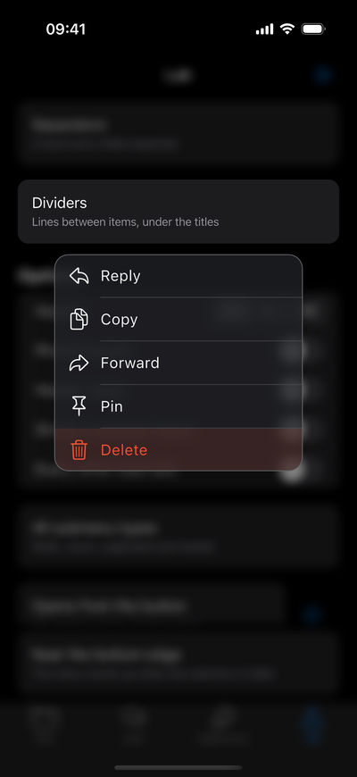

*В тёмной теме: линии между пунктами с `dividerIndent: 52`, чтобы они начинались под текстом,
как в примере ниже.*

Тонкие линии между пунктами (dividers), как в iOS. По умолчанию они выключены; чтобы линия
была между каждыми двумя пунктами, задайте в стиле `dividersBetweenItems: true`. Рядом
с разделителем линия не рисуется, так что группы по-прежнему отделяют только разделители.
Вид линий тоже задаёт стиль: `dividerColor`, `dividerThickness` и отступы слева и справа —
`dividerIndent` и `dividerEndIndent`.

```dart
const style = SmartContextMenuStyle(
  dividersBetweenItems: true,
  dividerThickness: 1,
  // Lines up with the title after a leading icon.
  dividerIndent: 52,
);
```

Чтобы поделить пункты на группы, используйте [разделитель](#разделитель).

#### Стиль пункта «Назад»

`SmartContextMenuBackButtonStyle`, поле `backButtonStyle` стиля, задаёт вид пункта «Назад»,
закреплённого вверху подменю:

| Поле | Что делает | По умолчанию |
| --- | --- | --- |
| `decoration` | Фон пункта «Назад». Его форма обрезает и размытие. | `null`: `menuColor` и `borderRadius` |
| `blur` | Размытие пунктов подменю, которые прокручиваются под «Назад»; `null` выключает его. | `SmartContextMenuBlur.strong` |
| `borderRadius` | Углы стандартного фона; с `decoration` не действует. | 16 px сверху |
| `foregroundColor` | Цвет текста и иконки. | `null`: цвета меню |
| `titleStyle` | Стиль текста поверх `titleStyle` меню. | полужирный |
| `icon` | Иконка перед текстом. Стандартная смотрит в другую сторону при письме справа налево. | `CupertinoIcons.chevron_back` |

Отступы, подсветка нажатия и размер иконки берутся из стиля меню, а под пунктом «Назад» всегда
есть линия.

```dart
const style = SmartContextMenuStyle(
  backButtonStyle: SmartContextMenuBackButtonStyle(
    foregroundColor: Color(0xFF0A84FF),
    icon: Icons.arrow_back_ios_new,
  ),
);
```

До 1.1.0 эти поля были в самом стиле: `backButtonBlur`, `backButtonColor`, `backIcon` и другие.
Старые имена работают до 2.0.0 и помечены как устаревшие; передавайте либо `backButtonStyle`,
либо старые имена, но не всё вместе.

#### Стиль состояний

`SmartContextMenuStatusStyle`, поле `statusStyle` стиля, задаёт вид пунктов
[загрузки](#загрузка), [ошибки](#ошибка) и [пустого состояния](#пустое-состояние), а также
индикатора подменю или страницы, которые загружаются:

| Поле | Что делает | По умолчанию |
| --- | --- | --- |
| `titleAlign` | Выравнивание текста между `leading` и `trailing`. | `TextAlign.center` |
| `errorIcon` | Иконка после текста пункта ошибки. | `CupertinoIcons.exclamationmark_triangle` |
| `retryIcon` | Иконка пункта ошибки, который повторяет загрузку. | `CupertinoIcons.refresh` |
| `emptyIcon` | Иконка после текста пункта пустого состояния. | `CupertinoIcons.tray` |
| `loadingIndicator` | Индикатор пунктов загрузки и загружающегося подменю или страницы, в своём размере. | `null`: `CupertinoActivityIndicator` |
| `loaderVerticalPadding` | Отступ сверху и снизу от индикатора загружающегося подменю или страницы. | `12` |

Свой `trailing` пункта заменяет его иконку или индикатор. Подберите `loadingIndicator` под
высоту строки. Меню Status items в примере ставит текст в начало строки, а индикатор и иконки
берёт другие ([код в
примере](https://github.com/BinaryRift/smart_context_menu/blob/v1.1.0/example/lib/pages/appearance/ui/appearance_styles.dart#L64-L78)):

```dart
const style = SmartContextMenuStyle(
  statusStyle: SmartContextMenuStatusStyle(
    loadingIndicator: SizedBox.square(
      dimension: 18,
      child: CircularProgressIndicator(
        strokeWidth: 2,
        color: CupertinoColors.systemOrange,
      ),
    ),
    errorIcon: CupertinoIcons.wifi_exclamationmark,
    retryIcon: CupertinoIcons.arrow_clockwise,
    emptyIcon: CupertinoIcons.tray,
    titleAlign: TextAlign.start,
  ),
);
```

До 1.1.0 эти поля были в самом стиле, а `titleAlign` назывался `statusTitleAlign`. Старые имена
работают до 2.0.0 и помечены как устаревшие; передавайте либо `statusStyle`, либо старые имена,
но не всё вместе.

#### Стиль рядов

`SmartContextMenuRowStyle`, поле `rowStyle` стиля, задаёт вид всех [рядов](#ряд):

| Поле | Что делает | По умолчанию |
| --- | --- | --- |
| `padding` | Отступ вокруг ячеек ряда. | `EdgeInsets.zero` |
| `childrenGap` | Промежуток между ячейками; он не принадлежит ни одной ячейке. | `0` |
| `smallItemPadding` | Отступы маленьких ячеек. Нажимается и подсвечивается вся ячейка. | 4 по горизонтали, 14 по вертикали |
| `mediumItemPadding` | Отступы средних ячеек. | 4 по горизонтали, 10 по вертикали |
| `itemChildrenGap` | Промежуток между `leading` и `title` средних ячеек. | `4` |
| `titleStyle` | Стиль подписей ячеек, накладывается на стиль текста пункта или меню. | 12 px |
| `dividerIndent` | Отступ над вертикальными линиями между ячейками. | `0` |
| `dividerEndIndent` | Отступ под вертикальными линиями. | `0` |

Свои `padding` и `childrenGap` ряда, а также `padding` и `childrenGap` пункта в ячейке важнее
стиля. Цвета, значки, `titleMaxLines`, разделители и линии рядов берутся из стиля меню. Меню
Styled rows из примера задаёт подписи пожирнее, промежутки между ячейками и линии, которые
не доходят до краёв ([код в примере](https://github.com/BinaryRift/smart_context_menu/blob/v1.1.0/example/lib/pages/appearance/ui/appearance_styles.dart#L82-L87)):

```dart
const style = SmartContextMenuStyle(
  dividersBetweenItems: true,
  rowStyle: SmartContextMenuRowStyle(
    // Replaces the default, so it sets the size too.
    titleStyle: TextStyle(fontSize: 12, fontWeight: FontWeight.w600),
    childrenGap: 4,
    dividerIndent: 12,
    dividerEndIndent: 12,
  ),
);
```

#### Свой контент в пункте

`customBuilder` заменяет содержимое пункта. Отступы и подсветка при нажатии остаются,
тапы работают как обычно. Интерактивные виджеты внутри, например кнопки, обрабатывают
тапы сами: пункт по ним не срабатывает. Builder получает состояние пункта, в том числе
`foregroundColor` — цвет текста и значков для текущего состояния и темы. `isPressed`
и `isHovered` отличают нажатие от наведения курсора, и контент может отвечать
на каждое по-своему.

```dart
SmartContextMenuItem.simple(
  onTap: () => reply(),
  customBuilder: (context, state) => Row(
    children: [
      Icon(CupertinoIcons.reply, color: state.foregroundColor),
      const SizedBox(width: 12),
      Text('Reply', style: TextStyle(color: state.foregroundColor)),
    ],
  ),
)
```

В [ряду](#ряд) `state.rowSize` — размер ячейки, а в списке — `null`, так что один builder
подходит для обоих мест. Ячейка сохраняет свои отступы и подсветку, но по центру в ней стоит
только встроенное содержимое: своё выравнивайте сами. В маленькой ячейке ещё и подпишите его
через `Semantics` — встроенное содержимое подписано `title`. Например, значок с бейджем, как
Inbox в меню Styled rows из примера ([код в
примере](https://github.com/BinaryRift/smart_context_menu/blob/v1.1.0/example/lib/pages/appearance/domain/appearance_items.dart#L251-L313)):

```dart
SmartContextMenuItem.simple(
  title: 'Inbox',
  onTap: () => openInbox(),
  customBuilder: (context, state) {
    final color = state.foregroundColor;
    final icon = Stack(
      clipBehavior: Clip.none,
      children: [
        Icon(CupertinoIcons.tray, color: color),
        const PositionedDirectional(
          top: -6,
          start: 14,
          child: CountBadge(count: 3),
        ),
      ],
    );
    return switch (state.rowSize) {
      null => Row(
        children: [
          icon,
          const SizedBox(width: 12),
          Text('Inbox', style: TextStyle(color: color)),
        ],
      ),
      SmartContextMenuRowSize.small => Align(
        alignment: Alignment.topCenter,
        heightFactor: 1,
        child: Semantics(label: 'Inbox', child: icon),
      ),
      SmartContextMenuRowSize.medium => Align(
        alignment: Alignment.topCenter,
        heightFactor: 1,
        child: Column(
          mainAxisSize: MainAxisSize.min,
          children: [
            icon,
            const SizedBox(height: 4),
            Text('Inbox', style: TextStyle(fontSize: 12, color: color)),
          ],
        ),
      ),
    };
  },
)
```

### Рекомендации по дизайну

Значения по умолчанию повторяют меню iOS, например ширину меню 250. Кое-что остаётся
за вами:

- **Ячейки, в которые легко попасть.** Apple Human Interface Guidelines требуют области
  касания не меньше 44 × 44 pt, Material Design — 48 × 48. [Ряд](#ряд) делит ширину меню
  между ячейками, поэтому при ширине по умолчанию ставьте до пяти ячеек, по 50 pt каждая.
  Для большего числа расширьте меню через `menuWidth`: меню Wide row из примера вмещает семь
  ячеек по 48 в 336. На экране уже меню вместе с его `screenPadding` меню сужается, поэтому
  проверьте его на самом узком телефоне, который поддерживаете. Мышью и в узкую ячейку
  попасть легко.
- **Подпись у каждой ячейки.** Дайте каждой ячейке `title` и `leading`: маленькая ячейка
  показывает только значок, а её `title` читает диктор. Маленькие ячейки оставьте для значков,
  понятных без подписи, например для форматирования текста, а для остального берите средние.
- **Самые частые действия — первыми.** Ряд в начале меню держит их под рукой, а остальные
  действия остаются в списке ниже.

## Анимации

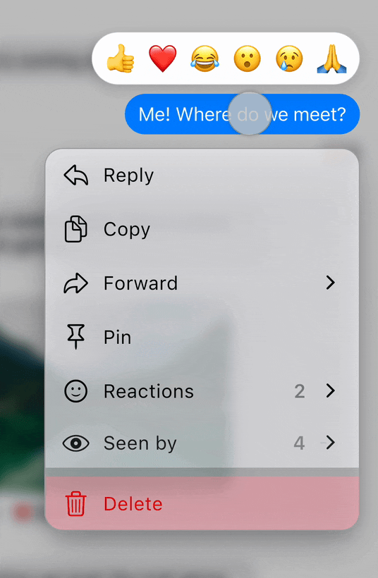

*В светлой теме, крупным планом: палец скользит по пунктам и за края меню, меню тянется
к нему, а сообщение и панель реакций плывут следом. [Код в
примере](https://github.com/BinaryRift/smart_context_menu/blob/v1.0.2/example/lib/pages/chat/ui/chat_page.dart#L149-L214).*

Меню и превью двигаются как одно целое. Ничего не появляется, не меняет размер
и не сдвигается без анимации, а пока палец на меню, оба отзываются на каждое его движение.

- **Подъём.** По долгому нажатию фон размывается и темнеет, превью приподнимается над ним,
  а меню плавно вырастает; при закрытии всё проигрывается обратно.
- **Liquid-эффект.** Проведите пальцем по пунктам — меню тянется к нему, как жидкость,
  а превью и [контент над виджетом](#контент-над-виджетом) плывут следом. Отпустите —
  и всё мягко встаёт на место. С мышью эффект работает, пока зажата кнопка.
- **Плавная высота.** Подменю, загрузка, ошибки и пункты на `Listenable` меняют высоту меню,
  и она всегда меняется плавно, без рывков.
- **Превью уступает место.** Если меню выросло и уходит за низ экрана, превью и меню вместе
  плавно поднимаются ровно настолько, насколько нужно; с `moveBackDown` они опускаются
  обратно, когда меню становится короче (см. [Позиционирование](#позиционирование)).
- **Подменю слоями.** Подменю выезжает поверх меню, а меню отъезжает на половину ширины
  и гаснет; пункт «Назад» проигрывает это в обратную сторону.
- **Свайп назад.** Потяните подменю вправо — оно идёт за пальцем и открывает под собой
  родительское меню. Высота меню перетекает от подменю к родительскому меню с каждым движением
  пальца, поэтому в конце нет рывка. Отпустите дальше середины или смахните — свайп плавно
  завершится с того места, где остановился; отпустите рано — подменю вернётся на место.

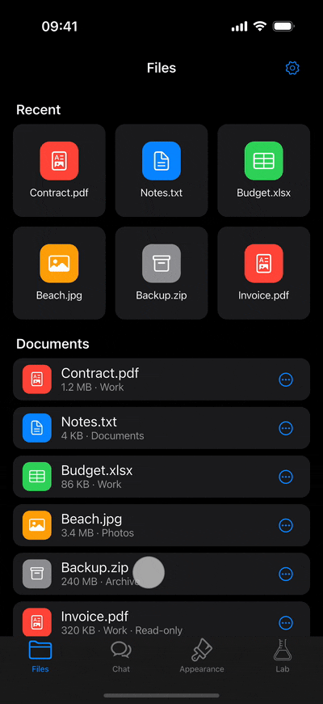

*В тёмной теме: Backup.zip внизу экрана, поэтому он вместе с меню плавно поднимается ровно
настолько, чтобы меню поместилось; Share и пункт «Назад» плавно меняют высоту меню. [Код в
примере](https://github.com/BinaryRift/smart_context_menu/blob/v1.0.2/example/lib/pages/files/ui/files_page.dart#L152-L169).*

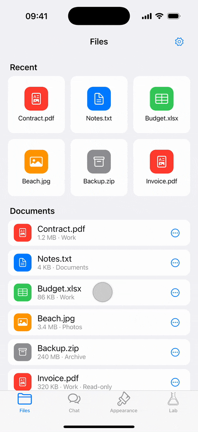

*В светлой теме: медленный свайп вправо из Messages тянет подменю за пальцем, а высота меню
перетекает к Share; после короткого свайпа Messages возвращается на место, а длинный
завершается сам. [Код в примере](https://github.com/BinaryRift/smart_context_menu/blob/v1.0.2/example/lib/pages/files/ui/files_page.dart#L197-L235).*

## В планах

В следующих версиях:

- Полная проработка доступности с VoiceOver и TalkBack: открытие меню, все виды пунктов, ряды
  и подменю, озвучивание загрузки и ошибок.
- `SmartContextMenuItem.listenableSubmenu`: подменю, которое обновляется из состояния
  приложения прямо в открытом виде — например, список тех, кто лайкнул пост, пополняется
  по мере новых лайков.

`listenableSubmenu` — новый вид пункта, поэтому в `switch` по пунктам оставляйте ветку `_`, см.
[Виды пунктов](#виды-пунктов).

## Дополнительно

**[Попробовать демо в браузере →](https://thenothingworks.dev/demo/smart-context-menu/)** — все возможности приложения-примера, собранного для web.

Что изменилось в каждой версии — в [CHANGELOG](CHANGELOG.md), все классы и настройки —
в [документации API](https://pub.dev/documentation/smart_context_menu/latest/).

Нашли баг или есть идея? Создайте issue на
[GitHub](https://github.com/BinaryRift/smart_context_menu/issues).

❤️ Если пакет вам пригодился, поставьте 👍 лайк на pub.dev и ⭐ звезду на GitHub — так его проще найти другим:

[](https://pub.dev/packages/smart_context_menu)
[](https://github.com/BinaryRift/smart_context_menu)

Лицензия — [MIT](LICENSE).

Сделано в [The NothingWorks](https://thenothingworks.dev).
