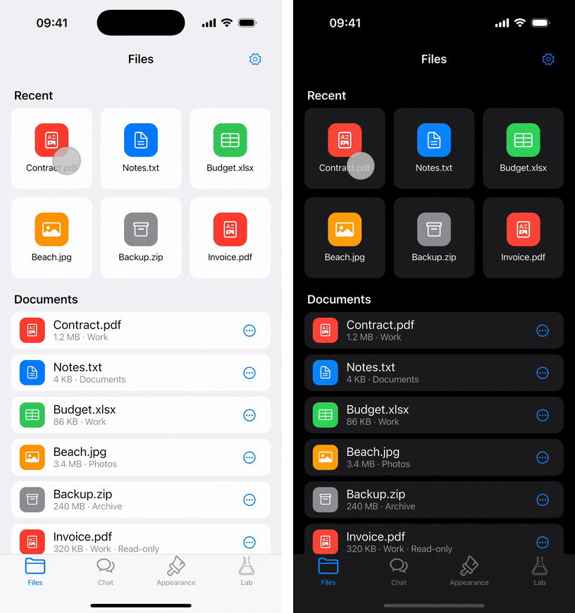
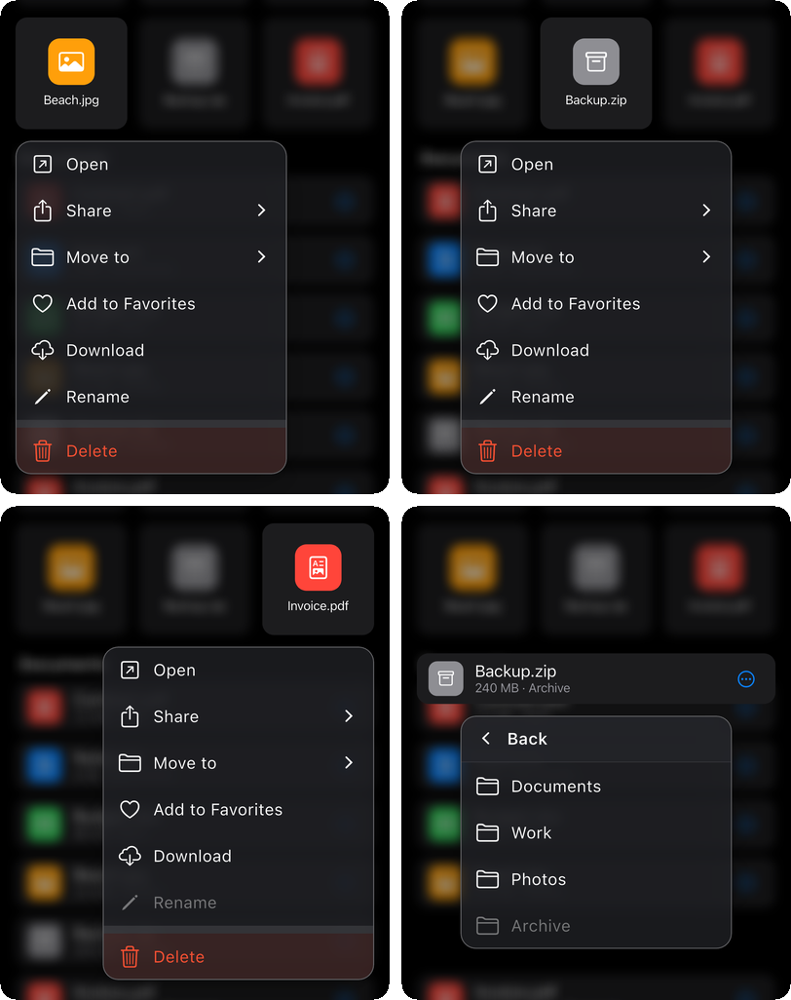
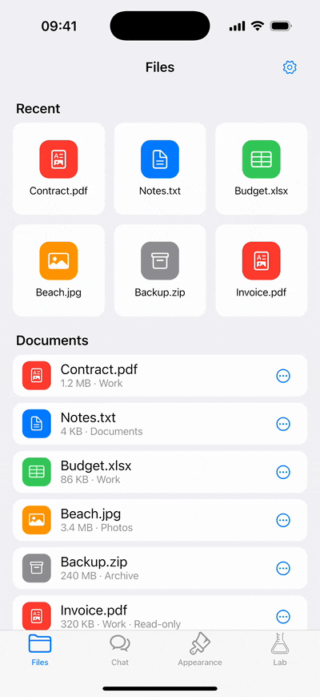
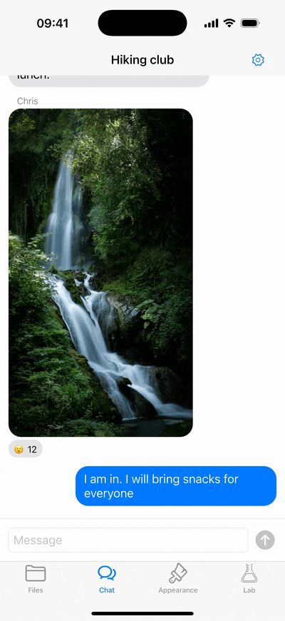
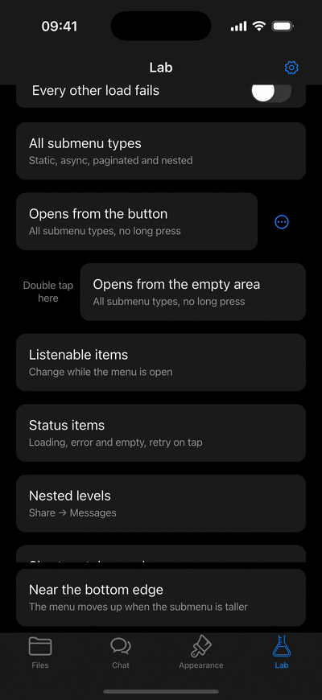
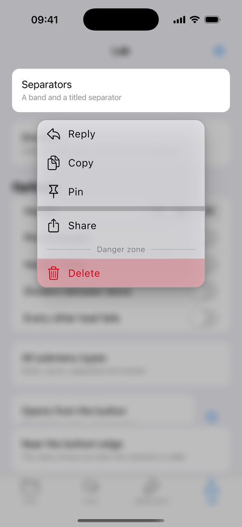
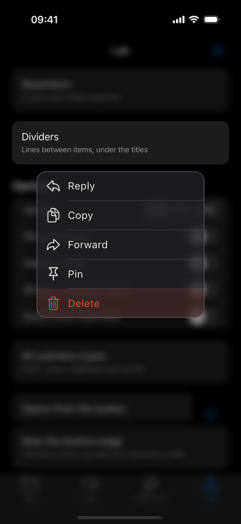
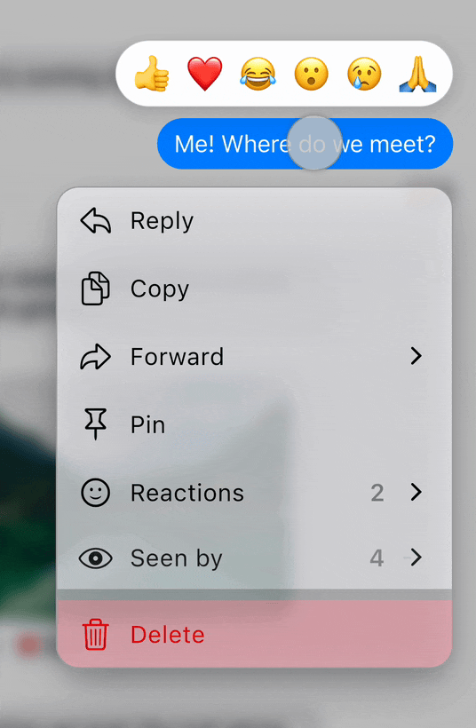
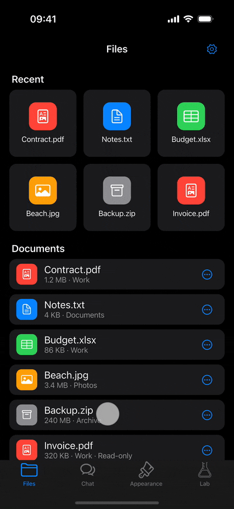
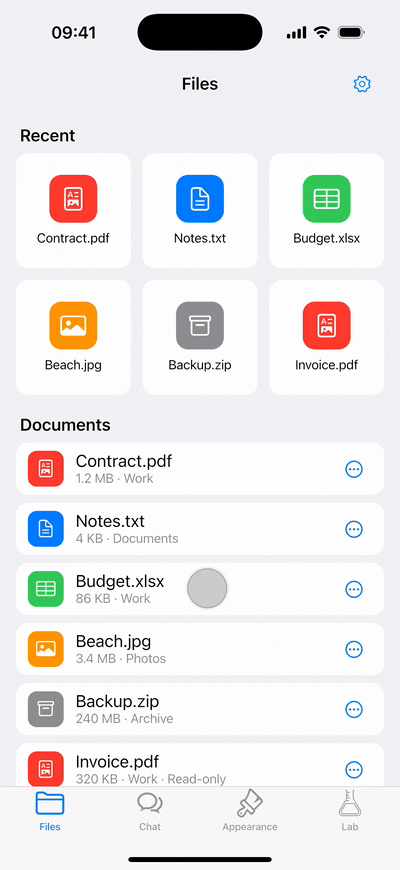

# smart_context_menu

[English](README.md) | **Русский**

[](https://pub.dev/packages/smart_context_menu)
[](https://pub.dev/packages/smart_context_menu/score)
[](https://pub.dev/packages/smart_context_menu/score)
[](https://github.com/BinaryRift/smart_context_menu/actions/workflows/ci.yml)
[](LICENSE)
[](https://thenothingworks.dev/demo/smart-context-menu/)

Контекстное меню в стиле iOS для Flutter, которое настраивается целиком: умное позиционирование,
плавные анимации, drag-to-select, вложенные подменю с асинхронной загрузкой и пагинацией
и свой контент над виджетом.



<br>

**[Попробовать демо в браузере →](https://thenothingworks.dev/demo/smart-context-menu/)** **[Посмотреть 56 секундный обзор →](https://www.youtube.com/shorts/l2BbYMxLQy0?feature=share)**

## Возможности

**Открытие**

- **Превью**: нажатый виджет приподнимается над размытым фоном, а тап по нему выполняет
  основное действие виджета, например открывает сообщение.
- **Из кода**: меню открывается и закрывается через `SmartContextMenuController`, например
  по кнопке «⋯». Долгое нажатие при этом можно отключить.
- **Drag-to-select**: после долгого нажатия отпустите палец, затем проведите им по пунктам
  и отпустите на нужном.
- **Совместимость с `Hero`**: фото, которое открывается на весь экран, сохраняет свой `Hero`
  и после тапа по превью летит со своего места.

**Позиционирование**

- **Виджет не прыгает**: если меню помещается, виджет остаётся на месте, а если нет —
  сдвигается ровно настолько, насколько нужно. Очень высокие виджеты прокручиваются вместе
  с меню.
- **Длинные меню** прокручиваются внутри и не выходят за заданную долю экрана.

**Анимации**

- **Живое меню**: пока палец скользит по пунктам, меню тянется к нему, как жидкость,
  а превью плывёт следом; после отпускания всё мягко встаёт на место.
- **Без рывков**: меню плавно меняет высоту, когда открывается подменю или загружаются
  пункты, а если перестаёт помещаться, превью и меню вместе поднимаются, освобождая место.
- **Свайп назад** тянет подменю прямо за пальцем, а меню плавно подстраивает высоту
  под открывающееся родительское меню.

Все эффекты — в разделе [Анимации](#анимации).

**Пункты**

- **Обычные действия**: со значками, destructive и своим цветом, неактивные, с разделителями
  и линиями между пунктами.
- **Свои пункты**: в пункт можно положить любой виджет, даже со своими кнопками; подсветка
  и тапы при этом работают.
- **Подменю**: обычные, с асинхронной загрузкой и с пагинацией, с пунктом «Назад»
  и свайпом назад.
- **Асинхронные пункты** с загрузкой, ошибкой, пустым состоянием и повтором после ошибки —
  в едином стиле для всего меню.
- **Ленивая отрисовка**: пункты строятся, только когда попадают на экран, и асинхронные
  пункты начинают загрузку тоже только тогда, поэтому даже длинные меню не тормозят.
- **Пункты на `Listenable`**, которые обновляются из состояния приложения прямо в открытом
  меню: переключатели, счётчики, уже запущенные действия.
- **Контент над виджетом** (header slivers), например панель реакций: появляется вместе
  с меню и при желании закрепляется сверху.

**Внешний вид**

- **Светлая и тёмная темы** из коробки; цвета-`CupertinoDynamicColor` сами подстраиваются
  под тему приложения (см. [Стиль пунктов](#стиль-пунктов)).
- **Гибкая настройка**: размеры, цвета, текст, значки, размытие, тени и подписи — один раз
  для всего приложения через тему или отдельно для каждого меню.

В [приложении-примере](example/) все возможности собраны в файловый менеджер, чат, галерею
стилей и «лабораторию» с пограничными случаями.

## Содержание

- [Почему не `CupertinoContextMenu`?](#почему-не-cupertinocontextmenu)
- [Начало работы](#начало-работы)
- [Использование](#использование)
  - [Позиционирование](#позиционирование)
  - [Виды пунктов](#виды-пунктов)
    - [Подменю](#подменю)
    - [Подменю с асинхронной загрузкой](#подменю-с-асинхронной-загрузкой)
    - [Подменю с пагинацией](#подменю-с-пагинацией)
    - [Асинхронный пункт](#асинхронный-пункт)
    - [Пункт на Listenable](#пункт-на-listenable)
    - [Загрузка](#загрузка)
    - [Ошибка](#ошибка)
    - [Пустое состояние](#пустое-состояние)
    - [Разделитель](#разделитель)
  - [Открытие из кода](#открытие-из-кода)
  - [Контент над виджетом](#контент-над-виджетом)
  - [Hero](#hero)
  - [Настройки](#настройки)
    - [Тема и конфиг](#тема-и-конфиг)
    - [Локализация](#локализация)
  - [Внешний вид](#внешний-вид)
    - [Стиль пунктов](#стиль-пунктов)
    - [Линии между пунктами](#линии-между-пунктами)
    - [Свой контент в пункте](#свой-контент-в-пункте)
- [Анимации](#анимации)
- [В планах](#в-планах)
- [Дополнительно](#дополнительно)

## Почему не `CupertinoContextMenu`?

`CupertinoContextMenu` из Flutter умеет открывать список действий по долгому нажатию.
Этот пакет работает так же, но добавляет то, чего обычно не хватает в реальных приложениях:

- подменю, в том числе с асинхронной загрузкой и пагинацией;
- drag-to-select по пунктам;
- меню и превью, которые двигаются как одно целое: liquid-эффект под пальцем, плавная смена
  высоты и превью, которое поднимается, освобождая место для меню;
- свой контент над виджетом, например панель реакций;
- открытие и закрытие из кода;
- полный контроль над внешним видом: общая тема для всех меню и стиль для цветов, текста,
  размытия, теней и содержимого пунктов;
- полный контроль над поведением: ширина и высота меню, отступы до виджета и краёв экрана,
  haptics, закрытие по тапу снаружи и свайп назад.

## Начало работы

Нужен Flutter 3.32 или новее (Dart 3.8). Пакет работает на всех платформах, включая [web](https://thenothingworks.dev/demo/smart-context-menu/).
На desktop и в web меню открывается долгим нажатием мыши или из кода, например по кнопке
(см. [Открытие из кода](#открытие-из-кода)); haptics там ничего не делают.

```sh
flutter pub add smart_context_menu
```

Или добавьте зависимость в `pubspec.yaml`:

```yaml
dependencies:
  smart_context_menu: ^1.0.0
```

```dart
import 'package:smart_context_menu/smart_context_menu.dart';
```

В debug-сборке первые открытия меню и переходы могут подтормаживать, пока код компилируется;
в release всё плавно сразу. Симулятор iOS запускает только debug, поэтому плавность лучше
смотреть на устройстве или в release-сборке на macOS.

## Использование

Оберните виджет в `SmartContextMenu` и передайте пункты. Меню открывается долгим нажатием.

```dart
SmartContextMenu(
  items: [
    SmartContextMenuItem.simple(
      title: 'Copy',
      leading: const Icon(CupertinoIcons.doc_on_doc),
      onTap: () => copy(),
    ),
    SmartContextMenuItem.simple(
      title: 'Delete',
      leading: const Icon(CupertinoIcons.delete),
      isDestructive: true,
      onTap: () => delete(),
    ),
  ],
  child: const MessageBubble(),
)
```

Меню перехватывает у виджета только долгое нажатие: тапы, перетаскивания и остальные жесты
работают как раньше.

Превью над открытым меню — это снимок виджета, поэтому его кнопки там не нажимаются.
Чтобы по тапу на превью выполнялось основное действие виджета, например открывалось
сообщение, передайте `onPreviewTap`. Сначала меню закроется, а `onPreviewTap` вызовется,
когда превью вернётся на место:

```dart
SmartContextMenu(
  onPreviewTap: () => openMessage(message),
  items: items,
  child: MessageBubble(message),
)
```

Параметры `SmartContextMenu`:

| Параметр | Зачем нужен |
| --- | --- |
| `child` | Виджет, по долгому нажатию на который открывается меню; он же показывается в превью. |
| `items` | Пункты меню, см. [Виды пунктов](#виды-пунктов). |
| `config` | Настройки этого меню, см. [Настройки](#настройки). |
| `controller` | Открывает и закрывает меню из кода, см. [Открытие из кода](#открытие-из-кода). |
| `onPreviewTap` | Основное действие виджета по тапу на превью; вызывается после закрытия меню. |
| `headerSliversBuilder` | Строит контент над виджетом, см. [Контент над виджетом](#контент-над-виджетом). |
| `fadeHeaderSlivers` | Плавно ли контент над виджетом появляется и исчезает вместе с меню, по умолчанию `true`. |
| `headerSliversDelay` | Задержка появления контента над виджетом, по умолчанию без задержки. |

### Позиционирование



*В тёмной теме: меню выравнивается по левому краю виджета, по центру или по правому краю, а
виджет у нижнего края экрана поднимается ровно настолько, чтобы влезло меню, — здесь подменю.*

Меню открывается прямо под нажатым виджетом, а сам виджет остаётся на месте. Он поднимается,
только если вместе с меню не помещается ниже, и ровно настолько, насколько нужно.
По горизонтали меню выравнивается по левому или правому краю виджета либо по центру —
смотря где виджет на экране. Если у края виджета меню не помещается, оно сдвигается к
середине экрана, а на экране уже меню — сужается. [Контент над виджетом](#контент-над-виджетом)
показывается прямо над ним; если места не хватает, виджет и меню сдвигаются вниз. Если всё
вместе не помещается на экран, приоритет у виджета и меню, а контент над ними уезжает вверх.

- **Меню стало короче.** Например, после возврата из подменю меню остаётся на месте,
  то есть под пальцем: родительское меню начинается там, где был пункт «Назад». Чтобы виджет
  в таких случаях возвращался вниз, задайте `moveBackDown: true` в `SmartContextMenuConfig`;
  ниже своего исходного места он не опустится.
- **Высокие виджеты.** Если виджет с меню не помещаются на экран даже после сдвига,
  их можно прокручивать вместе, так что до любой части виджета и меню можно добраться.
- **Длинные меню.** Меню не бывает выше доли экрана из `SmartContextMenuConfig.menuHeightFactor`
  (по умолчанию 60%); остальные пункты прокручиваются внутри и строятся, только когда
  попадают на экран.

`screenPadding` в `SmartContextMenuConfig` задаёт отступ от краёв экрана поверх safe area,
то есть статус-бара или выреза в горизонтальной ориентации. `menuGap` — расстояние между
виджетом и меню.

Положение виджета и его снимок фиксируются в момент открытия. Если размер экрана меняется
при открытом меню, например при повороте устройства или изменении размера окна, меню
закрывается без действия — так же ведёт себя системное меню в iOS.

### Виды пунктов

Каждый вид пункта создаётся своим методом:

| Метод | Что делает |
| --- | --- |
| `SmartContextMenuItem.simple` | Вызывает `onTap`. |
| `SmartContextMenuItem.submenu` | Открывает подменю с `children`. |
| `SmartContextMenuItem.asyncSubmenu` | Открывает подменю и загружает его пункты. |
| `SmartContextMenuItem.pagingSubmenu` | Открывает подменю и загружает пункты постранично. |
| `SmartContextMenuItem.async` | Показывает заглушку и заменяет её загруженным пунктом. |
| `SmartContextMenuItem.listenable` | Обновляется по `Listenable`, пока меню открыто. |
| `SmartContextMenuItem.loading` | Показывает загрузку асинхронного пункта или подменю либо пункта на `Listenable`. |
| `SmartContextMenuItem.error` | Показывает ошибку загрузки; если это `error` асинхронного пункта или подменю, тап повторяет загрузку. |
| `SmartContextMenuItem.empty` | Показывает, что в подменю нет пунктов. |
| `SmartContextMenuItem.separator` | Отделяет группы пунктов. |

Асинхронные пункты и подменю загружают данные сами: меню вызывает загрузчик, показывает
загрузку и ошибку и хранит результат, пока не закроется. Пункт на `Listenable`, наоборот,
показывает состояние, которое хранит и обновляет ваше приложение, и перестраивается при
каждом его изменении.

Каждый метод возвращает свой подтип `SmartContextMenuItem`, например `SmartContextMenuSimpleItem`,
так что по пункту можно сделать `switch` и читать поля конкретного типа. В минорных версиях
могут появляться новые виды пунктов, поэтому в `switch` по пунктам оставляйте ветку `_`.

Общие настройки обычных пунктов и подменю:

| Поле | Что делает |
| --- | --- |
| `title` | Текст пункта, не больше `titleMaxLines` строк из стиля. |
| `leading` | Виджет перед текстом, обычно значок. |
| `trailing` | Виджет после текста; у подменю — перед стрелкой. |
| `isDestructive` | Красит пункт в `destructiveColor` из стиля. |
| `tintColor` | Красит пункт в свой цвет, см. [Стиль пунктов](#стиль-пунктов). |
| `isDisabled` | Делает пункт неактивным: он приглушён и не нажимается. |
| `titleStyle`, `padding`, `childrenGap` | Переопределяют стиль для этого пункта, см. [Стиль пунктов](#стиль-пунктов). |
| `customBuilder` | Заменяет содержимое пункта, см. [Свой контент в пункте](#свой-контент-в-пункте). |
| `closeOnTap` | Только у обычных пунктов: закрывать ли меню по тапу, по умолчанию `true`. |

Значки в `leading` и `trailing` берут цвет текста, если у них нет своего, а текст там — его
стиль и цвет, как у счётчика перед стрелкой.

С `closeOnTap: false` меню после `onTap` остаётся открытым — например, для переключателя.
Обычный пункт без `onTap` просто закрывает меню, а если вдобавок `closeOnTap: false`, он
вообще ничего не делает: не подсвечивается и не нажимается. Так удобно делать, например,
строку со своими кнопками в `customBuilder`.

У каждого пункта есть `id`; если его не задать, он сгенерируется. По `id` загруженные подменю
и пункты кешируются до закрытия меню, поэтому свои `id` должны быть уникальными во всём меню
вместе с подменю. Ошибки не кешируются: пункт загрузится заново, когда снова появится,
например после возврата из подменю, а подменю — когда его снова откроют.

#### Подменю


*В тёмной теме: Share — подменю, а Messages внутри него подгружается при открытии. Вернуться
можно пунктом «Назад» или свайпом вправо. [Код в
примере](https://github.com/BinaryRift/smart_context_menu/blob/v1.0.0/example/lib/pages/files/ui/files_page.dart#L171-L208).*

```dart
SmartContextMenuItem.submenu(
  title: 'Share',
  leading: const Icon(CupertinoIcons.share),
  children: [
    SmartContextMenuItem.simple(title: 'Copy link', onTap: () => copyLink(file)),
    SmartContextMenuItem.asyncSubmenu(
      title: 'Messages',
      asyncChildren: () => loadContacts(file),
    ),
  ],
)
```

Вернуться в родительское меню можно пунктом «Назад» вверху подменю или свайпом вправо.
Подменю едет за пальцем и возвращается на место, если свайп короткий.
Чтобы отключить свайп, задайте `enableSwipeBack: false` в `SmartContextMenuConfig`.

#### Подменю с асинхронной загрузкой



*В светлой теме: Move to загружает папки при открытии; Work — папка этого файла, поэтому она
неактивна. [Код в примере](https://github.com/BinaryRift/smart_context_menu/blob/v1.0.0/example/lib/pages/files/ui/files_page.dart#L210-L228).*

Пункты загружаются при открытии подменю и кешируются до закрытия меню. Во время загрузки
посередине подменю крутится индикатор; чтобы вместо него была строка с текстом, передайте
[пункт загрузки](#загрузка) в `loading`. Если загрузка упала или заняла дольше `timeout`
(по умолчанию 10 секунд), подменю показывает [ошибку](#ошибка), которая по тапу повторяет
загрузку; свою можно передать в `error`. Если пунктов нет, показывается
[пустое состояние](#пустое-состояние); своё можно передать в `empty`.

```dart
SmartContextMenuItem.asyncSubmenu(
  title: 'Move to',
  leading: const Icon(CupertinoIcons.folder),
  asyncChildren: () async {
    final folders = await repository.folders();
    return [
      for (final folder in folders)
        SmartContextMenuItem.simple(
          title: folder.name,
          isDisabled: folder == file.folder,
          onTap: () => move(file, folder),
        ),
    ];
  },
)
```

#### Подменю с пагинацией


*В светлой теме: Reactions загружает первую страницу людей при открытии, а следующую — когда
список докрутили до конца. [Код в примере](https://github.com/BinaryRift/smart_context_menu/blob/v1.0.0/example/lib/pages/chat/ui/chat_page.dart#L246-L275).*

Первая страница загружается с `initialMetadata`. Последний пункт каждой страницы — обычный
пункт или разделитель — несёт в `pagingMetadata` метаданные следующей страницы, и она
загружается, когда пользователь докрутит до конца. На последней странице оставьте `null`.
Пока страница грузится, после загруженных пунктов показывается `loading`, как в подменю
с асинхронной загрузкой. Если страница не загрузилась или загрузка заняла дольше `timeout`
(по умолчанию 10 секунд), после загруженных пунктов показывается `error`, и тап загружает
страницу заново. Если пустая первая страница, подменю показывает `empty`, а пустая следующая
просто заканчивает список.

```dart
SmartContextMenuItem.pagingSubmenu(
  title: 'Reactions',
  initialMetadata: const SmartContextMenuPagingMetadata(limit: 20),
  asyncPagingChildren: (metadata) async {
    final page = await api.reactions(message.id, metadata.page, metadata.limit);
    return [
      for (final (index, reaction) in page.items.indexed)
        SmartContextMenuItem.simple(
          title: reaction.person.name,
          trailing: Text(reaction.emoji),
          pagingMetadata: index == page.items.length - 1 && page.hasMore
              ? metadata.copyWith(page: metadata.page + 1)
              : null,
        ),
    ];
  },
)
```

Для API с курсорами у `SmartContextMenuPagingMetadata` есть `nextCursor`, а для своих
параметров — `extra`.

#### Асинхронный пункт



*В светлой теме: Seen by — асинхронный пункт, загрузчик которого возвращает обычное подменю. В
отличие от подменю с асинхронной загрузкой, он грузится сразу при открытии меню, ещё до тапа,
поэтому счётчик виден сразу; после возврата загруженный пункт остаётся. [Код в
примере](https://github.com/BinaryRift/smart_context_menu/blob/v1.0.0/example/lib/pages/chat/ui/chat_page.dart#L277-L301).*

Заглушка начинает загрузку, как только появляется на экране. Пока идёт загрузка, она
показывает `loading` — по умолчанию `SmartContextMenuItem.loading` со стандартной подписью.
Если загрузка упала или заняла дольше `timeout` (по умолчанию 10 секунд), показывается
`error` — `SmartContextMenuItem.error`, и тап загружает пункт заново, см. [Ошибка](#ошибка).

Загрузчик возвращает пункт, который выполняет действие или открывает подменю, либо
`loading`, `error` или `empty` — например, `SmartContextMenuItem.empty`, если показывать
нечего. Если вернуть обычное подменю, как в Seen by, данные загрузятся вместе с меню,
а подробности откроются по тапу:

```dart
SmartContextMenuItem.async(
  loading: SmartContextMenuItem.loading(title: 'Seen by'),
  asyncItem: () async {
    final readers = await api.readers(message.id);
    // A regular submenu, loaded as the menu opens.
    return SmartContextMenuItem.submenu(
      title: 'Seen by',
      trailing: Text('${readers.length}'),
      children: [
        for (final reader in readers)
          SmartContextMenuItem.simple(title: reader.name),
      ],
    );
  },
)
```

Загрузчик может вернуть и обычный пункт, например после проверки прав:

```dart
SmartContextMenuItem.async(
  loading: SmartContextMenuItem.loading(title: 'Checking access'),
  error: SmartContextMenuItem.error(title: 'Could not check access'),
  asyncItem: () async {
    final canEdit = await permissions.canEdit();
    return SmartContextMenuItem.simple(
      title: 'Edit',
      isDisabled: !canEdit,
      onTap: () => edit(),
    );
  },
)
```

#### Пункт на Listenable


*В тёмной теме: после тапа Download показывает прогресс прямо в открытом меню, а когда загрузка
заканчивается, превращается в Remove Download. [Код в
примере](https://github.com/BinaryRift/smart_context_menu/blob/v1.0.0/example/lib/pages/files/ui/files_page.dart#L252-L280).*

Подходит, когда состояние пункта хранится в приложении и может поменяться, пока меню
открыто: переключатель, после которого меню не закрывается, счётчик или уже запущенное
действие. Builder вызывается заново при каждом уведомлении `listenable` и возвращает пункт,
который нужно показать. Пока что-то грузится, возвращайте `SmartContextMenuItem.loading`:
он показывает текст с индикатором, как асинхронный пункт, и не нажимается.

```dart
SmartContextMenuItem.listenable(
  listenable: downloads,
  builder: () => switch (downloads.stateOf(file)) {
    DownloadState.running => SmartContextMenuItem.loading(
      title: 'Downloading ${downloads.percentOf(file)}%',
    ),
    DownloadState.done => SmartContextMenuItem.simple(
      title: 'Remove Download',
      isDestructive: true,
      closeOnTap: false,
      onTap: () => downloads.remove(file),
    ),
    DownloadState.none => SmartContextMenuItem.simple(
      title: 'Download',
      closeOnTap: false,
      onTap: () => downloads.start(file),
    ),
  },
)
```

В отличие от асинхронного пункта, состоянием владеет приложение: пункт не загружается один
раз, а перестраивается при каждом уведомлении. Builder возвращает `SmartContextMenuItem.simple`
(у него работают `onTap` и `closeOnTap`) или `loading`, `error`, `empty`, которые не нажимаются.
Чтобы из пункта можно было повторить упавшую загрузку в вашем приложении, верните обычный пункт:

```dart
SmartContextMenuItem.listenable(
  listenable: views,
  builder: () => switch (views.state) {
    ViewsState.loading => SmartContextMenuItem.loading(title: 'Views'),
    ViewsState.failed => SmartContextMenuItem.simple(
      title: 'Try again',
      trailing: const Icon(SmartContextMenuDefaults.retryIcon),
      closeOnTap: false,
      onTap: views.reload,
    ),
    ViewsState.loaded => SmartContextMenuItem.simple(title: 'Views: ${views.count}'),
  },
)
```

Меню не вызывает `dispose` у `listenable`.

Подойдёт любой `Listenable`: `ChangeNotifier`, `ValueNotifier`, несколько штук через
`Listenable.merge` или контроллер стейт-менеджера, который реализует `Listenable`, например
`GetxController` (он уведомляет при вызове `update()` без id). А вот `Obx` или `BlocBuilder`
здесь не помогут: пункт — это данные, а не виджет, и его builder вызывается вне них. Чтобы
пункт обновлялся по `Stream`, например из Bloc или GetX `Rx`, оберните поток в `ChangeNotifier`:

```dart
final class StreamListenable extends ChangeNotifier {
  StreamListenable(Stream<Object?> stream) {
    _subscription = stream.listen((_) => notifyListeners());
  }

  late final StreamSubscription<Object?> _subscription;

  @override
  void dispose() {
    _subscription.cancel();
    super.dispose();
  }
}
```

Создавайте такой адаптер рядом с состоянием, которое он слушает, и там же вызывайте `dispose`.

#### Загрузка

Пункт `loading` показывает `title` (по умолчанию стандартную подпись загрузки) с `leading`
и индикатором и не нажимается. `trailing` заменяет индикатор, а `child` — всё содержимое;
текст и значки в нём берут цвет пункта. Если это `loading` асинхронного пункта или подменю
либо его вернул пункт на `Listenable`, меню заменит его, когда загрузка закончится. В любом
другом месте он остаётся до закрытия меню.

Пункты загрузки, ошибки и пустого состояния выглядят одинаково: текст посередине, после
него знак состояния, а `leading` свободен под ваш значок. Они не нажимаются и не приглушаются.
Их выравнивание, значки и индикатор для всех меню задаёт [стиль](#стиль-пунктов).

| Пункт | Текст | После текста |
| --- | --- | --- |
| `loading` | подпись загрузки | индикатор |
| `error` | подпись ошибки | значок ошибки |
| `error` асинхронного пункта или подменю | подпись повтора | значок повтора |
| `empty` | подпись пустого списка | значок пустого списка |

Свои `title`, `leading` и `trailing` заменяют стандартные, а `child` — всю строку.

По умолчанию подменю во время загрузки показывает индикатор посередине, а переданный пункт
`loading` показывается строкой. Чтобы показать свой индикатор по центру, передайте его в `child`:

```dart
SmartContextMenuItem.asyncSubmenu(
  title: 'Recent files',
  loading: SmartContextMenuItem.loading(
    child: const Center(child: CircularProgressIndicator()),
  ),
  asyncChildren: () => loadRecentFiles(),
)
```

Пункт на `Listenable` может показывать свою загрузку на каждом шаге работы:

```dart
SmartContextMenuItem.listenable(
  listenable: sync,
  builder: () => switch (sync.state) {
    SyncState.checking => SmartContextMenuItem.loading(title: 'Checking'),
    SyncState.syncing => SmartContextMenuItem.loading(title: 'Syncing'),
    SyncState.idle => SmartContextMenuItem.simple(title: 'Sync now', onTap: sync.start),
  },
)
```

#### Ошибка



*В тёмной теме: Shared files не загрузился, и тап по строке загружает его заново; в Archive
пусто. [Код в примере](https://github.com/BinaryRift/smart_context_menu/blob/v1.0.0/example/lib/pages/lab/domain/lab_items.dart#L130-L185).*

Пункт `error` показывает, что загрузка не удалась: `title` (по умолчанию стандартная подпись
ошибки) со значком ошибки. Если это `error` асинхронного пункта или подменю, тап повторяет
загрузку, а вместо подписи и значка ошибки показываются подпись и значок повтора — если
у пункта нет своих `title` и `trailing`. В остальных местах, например в builder пункта
на `Listenable`, он не нажимается.

Кнопка в `child` обрабатывает свой тап сама, а тап по остальной строке повторяет загрузку:

```dart
SmartContextMenuItem.asyncSubmenu(
  title: 'Shared files',
  error: SmartContextMenuItem.error(
    child: Row(
      children: [
        const Expanded(child: Text('Could not load files')),
        CupertinoButton(onPressed: showDetails, child: const Text('Details')),
        // The child replaces the whole row, so add the retry icon yourself.
        const Icon(SmartContextMenuDefaults.retryIcon),
      ],
    ),
  ),
  asyncChildren: () => loadSharedFiles(),
)
```

Пункт ошибки показывается, когда загрузчик бросает исключение. Если ошибку можно обработать,
например нет прав доступа, перехватите её и верните пункт сами: `error`, который не нажимается,
или обычный пункт со своим действием.

#### Пустое состояние

GIF в разделе [Ошибка](#ошибка) заканчивается подменю Archive, в котором нет пунктов.

Подменю с асинхронной загрузкой или пагинацией без пунктов показывает пункт `empty`: `title`
(по умолчанию стандартная подпись) со значком пустого списка. Чтобы показать свой, передайте
его в `empty` и верните из загрузчика пустой список. Подменю с пагинацией показывает его,
только если пустая первая страница, а обычное подменю без `children` — стандартный.
Пункт на `Listenable` тоже может его вернуть.

```dart
SmartContextMenuItem.asyncSubmenu(
  title: 'Archive',
  // Without it, the submenu shows the empty label, "No items".
  empty: SmartContextMenuItem.empty(title: 'Archive is empty'),
  asyncChildren: () => loadArchive(),
)
```

#### Разделитель



*В светлой теме: полоса отделяет Pin от Share, а разделитель со своим `child` подписывает
последнюю группу.*

Разделитель делит пункты на группы. У него нет действий и подсветки, и drag-to-select
его пропускает. По умолчанию это полоса, которую задают `separatorHeight` и `separatorColor`
в стиле; `child` заменяет её, например, на заголовок секции.

Разделители в начале и в конце меню не показываются, а несколько разделителей подряд
схлопываются в один. Поэтому, если пункты зависят от пользователя или контента, ничего
дополнительно проверять не нужно:

```dart
[
  if (canReply)
    SmartContextMenuItem.simple(title: 'Reply', onTap: () => reply()),
  SmartContextMenuItem.simple(title: 'Copy', onTap: () => copy()),
  if (isAdmin) SmartContextMenuItem.simple(title: 'Pin', onTap: () => pin()),
  SmartContextMenuItem.separator(),
  // Without Delete, the separator above is not shown.
  if (canDelete)
    SmartContextMenuItem.simple(
      title: 'Delete',
      isDestructive: true,
      onTap: () => delete(),
    ),
]
```

Чтобы вместо полосы была тонкая линия, задайте маленький `separatorHeight`, а в
`separatorColor` — цвет `dividerColor`. Линии между всеми пунктами описаны в разделе
[Линии между пунктами](#линии-между-пунктами).

### Открытие из кода

Создайте `SmartContextMenuController()` и передайте его в меню, чтобы открывать и
закрывать меню из кода.
Чтобы меню открывалось только из кода, поставьте режим `manual`. В этом режиме контроллер
обязателен: без него в debug-сборке сработает assert.

```dart
final controller = SmartContextMenuController();

SmartContextMenu(
  controller: controller,
  config: const SmartContextMenuConfig(
    activationMode: SmartContextMenuActivationMode.manual,
  ),
  items: items,
  child: child,
);

IconButton(
  icon: const Icon(CupertinoIcons.ellipsis),
  onPressed: controller.open,
);
```

Контроллер уведомляет слушателей, когда меню открывается и закрывается, см. `isOpen`.
`open()` завершается, когда меню закрылось, так что `await controller.open()` дождётся
закрытия. Не забудьте вызвать `dispose` у контроллера, когда он больше не нужен.

### Контент над виджетом


*В тёмной теме: панель реакций над сообщением; тап по реакции закрывает меню. [Код в
примере](https://github.com/BinaryRift/smart_context_menu/blob/v1.0.0/example/lib/pages/chat/ui/chat_page.dart#L176-L200).*

Чтобы показать свой контент над виджетом, пока меню открыто, передайте `headerSliversBuilder`.
Он возвращает список слайверов: они плавно появляются и исчезают вместе с меню и двигаются
вместе с виджетом, когда его тянут или когда меню растягивается. Builder получает
`SmartContextMenuHeaderDetails`:

- `alignment` — как виджет и меню выровнены по горизонтали. У слайверов тот же горизонтальный
  отступ, что у виджета, поэтому `Align(alignment: header.alignment)` прижимает контент
  к краю виджета.
- `animation` идёт от 0 до 1, пока слайверы появляются, и обратно, пока исчезают, —
  по ней можно анимировать свой контент вместе с меню.
- `close()` закрывает меню. Он завершается на трёх четвертях анимации закрытия, как у пункта,
  чтобы результат действия был виден, пока меню закрывается.

Тап по вашим виджетам в слайверах не закрывает меню, а тап по пустому месту рядом —
закрывает, как и тап в любом месте вне меню.

```dart
SmartContextMenu(
  headerSliversBuilder: (context, header) => [
    SliverToBoxAdapter(
      child: Align(
        alignment: header.alignment,
        child: ReactionsBar(
          onSelected: (reaction) async {
            await header.close();
            react(message, reaction);
          },
        ),
      ),
    ),
    const SliverToBoxAdapter(child: SizedBox(height: 8)),
  ],
  items: items,
  child: MessageBubble(message),
)
```

Например, чтобы панель вырастала от края виджета, оберните её в переход на `header.animation`.
Используйте `drive`, а не `CurvedAnimation`: builder вызывается при каждой перестройке,
и созданную в нём `CurvedAnimation` никто не освободит.

```dart
ScaleTransition(
  scale: header.animation.drive(CurveTween(curve: Curves.easeOutBack)),
  // Grows from the bottom edge, next to the widget.
  alignment: Alignment(header.alignment.x, 1),
  child: ReactionsBar(onSelected: react),
)
```

Плавное появление накладывается поверх вашей анимации; чтобы анимировать слайверы
только по-своему, задайте `fadeHeaderSlivers: false`.

Слайверы — прямые потомки скролла меню, поэтому `PinnedHeaderSliver` остаётся вверху,
прямо под статус-баром, пока высокий виджет и меню прокручиваются под ним. При этом он их
перекрывает, так что делайте его небольшим:

```dart
headerSliversBuilder: (context, header) => [
  PinnedHeaderSliver(
    child: Align(
      alignment: header.alignment,
      child: ReactionsBar(onSelected: react),
    ),
  ),
],
```

Если при открытии меню контент прокручивается, слайверы ждут, пока виджет почти встанет
на место, чтобы он по пути не перекрыл закреплённый слайвер.

Чтобы слайверы появлялись позже, задайте `headerSliversDelay`. Задержка считается от начала
открытия, которое длится 300 миллисекунд: при задержке короче слайверы начнут появляться,
пока виджет ещё едет на место, при задержке длиннее — уже после.

```dart
SmartContextMenu(
  headerSliversBuilder: (context, header) => [reactionsBar],
  // The bar appears a moment after the menu.
  headerSliversDelay: const Duration(milliseconds: 150),
  items: items,
  child: MessageBubble(message),
)
```

### Hero


*В светлой теме: двойной тап рядом с фото открывает меню из кода, а тап по превью открывает
фото с его собственным `Hero`. [Код в примере](https://github.com/BinaryRift/smart_context_menu/blob/v1.0.0/example/lib/pages/chat/ui/chat_page.dart#L156-L168).*

У виджета может быть свой `Hero`, например у фото в чате, которое открывается на весь экран.
Меню тоже анимирует превью через `Hero`, но не оборачивает в него ваш виджет: оно добавляет
свой `Hero` рядом и только пока меню открыто. Поэтому `Hero` внутри `Hero` не получается,
а ваш виджет, пока меню открыто, остаётся на своём месте — скрытым и с сохранённым состоянием.

Открывайте страницу из `onPreviewTap`: он вызывается, когда меню закрылось и превью вернулось
на место, поэтому ваш `Hero` полетит с места виджета, как после обычного тапа по нему:

```dart
SmartContextMenu(
  items: items,
  onPreviewTap: () => openPhoto(photo),
  child: GestureDetector(
    onTap: () => openPhoto(photo),
    child: Hero(
      tag: photo.id,
      child: Image.network(photo.url),
    ),
  ),
)
```

Здесь `openPhoto` открывает страницу с `Hero` с тем же тегом.

### Настройки

Общие настройки меню собраны в `SmartContextMenuConfig`. У всех полей есть значения
по умолчанию, так что задавайте только то, что нужно:

```dart
const menuConfig = SmartContextMenuConfig(
  menuWidth: 220,
  enableHaptics: false,
  style: menuStyle,
);
```

| Поле | Что задаёт | По умолчанию |
| --- | --- | --- |
| `activationMode` | Открывать меню долгим нажатием или только из кода, см. [Открытие из кода](#открытие-из-кода). | `longPress` |
| `enableHaptics` | Haptics при открытии меню долгим нажатием, подсветке и тапе по пункту, тапе по превью, открытии и закрытии подменю. | `true` |
| `barrierDismissible` | Закрывать ли меню по тапу вне меню, виджета и [контента над ним](#контент-над-виджетом). С `false` меню закрывается только пунктом, превью, контентом над виджетом или контроллером. | `true` |
| `enableSwipeBack` | Возврат из подменю свайпом вправо, см. [Подменю](#подменю). | `true` |
| `menuWidth` | Ширина меню. На экране уже меню оно сужается. | 250 |
| `menuHeightFactor` | Максимальная высота меню как доля высоты экрана, см. [Позиционирование](#позиционирование). | 0.6 |
| `screenPadding` | Отступ от краёв экрана поверх safe area. | 16 |
| `menuGap` | Расстояние между виджетом и меню. | 12 |
| `moveBackDown` | Возвращать виджет вниз, когда меню становится короче. | `false` |
| `labels` | Тексты, которые меню показывает само, см. [Локализация](#локализация). | английские |
| `style` | Внешний вид меню, см. [Внешний вид](#внешний-вид). | |

#### Тема и конфиг

Меню берёт конфиг из первого, что найдёт:

1. свой `config`;
2. ближайшая `SmartContextMenuTheme` выше по дереву;
3. значения по умолчанию, `const SmartContextMenuConfig()`.

И тема, и `config` необязательны — выбирайте, как удобнее.

**Всё приложение.** Задайте конфиг один раз темой в `builder` приложения, и меню
`config` уже не понадобится:

```dart
MaterialApp(
  builder: (context, child) => SmartContextMenuTheme(
    config: menuConfig,
    child: child!,
  ),
  home: const HomePage(),
);

SmartContextMenu(
  items: items,
  child: child,
);
```

**Часть приложения.** Оберните экран, список или любое поддерево своей темой.
Срабатывает ближайшая тема, и она полностью заменяет внешнюю, поэтому, чтобы сохранить
внешние настройки, начинайте с неё:

```dart
SmartContextMenuTheme(
  config: SmartContextMenuTheme.of(context).copyWith(enableSwipeBack: false),
  child: const ChatScreen(),
)
```

**Одно меню.** Передайте меню `config`. Для этого меню он полностью заменяет тему:

```dart
SmartContextMenu(
  config: const SmartContextMenuConfig(menuWidth: 220),
  items: items,
  child: child,
)
```

Чтобы поменять пару настроек, а остальное взять из темы, начните с неё и вызовите `copyWith`.
У `SmartContextMenuStyle` он тоже есть:

```dart
final theme = SmartContextMenuTheme.of(context);

SmartContextMenu(
  config: theme.copyWith(
    activationMode: SmartContextMenuActivationMode.manual,
    style: theme.style.copyWith(menuBlur: SmartContextMenuBlur.small),
  ),
  controller: controller,
  items: items,
  child: child,
)
```

`SmartContextMenuTheme.of(context)` читает тему выше `context`. Если тема создаётся в том же
методе `build`, оберните меню в `Builder`, иначе вы получите внешнюю тему.

#### Локализация

Некоторые тексты меню показывает само: пункт «Назад», подпись повтора и тексты загрузки,
ошибки и пустого состояния, если у них нет своего `title`. Переопределить их можно через
`SmartContextMenuLabels`, например в конфиге [темы](#тема-и-конфиг), чтобы перевести
сразу все меню:

```dart
SmartContextMenuConfig(
  labels: SmartContextMenuLabels(
    back: l10n.back,
    retry: l10n.retry,
    loading: l10n.loading,
    error: l10n.couldNotLoad,
    empty: l10n.noItems,
  ),
)
```

### Внешний вид


*Три стиля из примера в светлой и тёмной темах: фирменные цвета и только затемнение за меню,
непрозрачное меню и пункты со своим контентом.*

Внешний вид меню задаёт `SmartContextMenuStyle` — поле `style` в конфиге.
У его полей тоже есть значения по умолчанию:

```dart
const menuStyle = SmartContextMenuStyle(
  menuBlur: SmartContextMenuBlur.small,
  backgroundBlur: SmartContextMenuBlur(10),
  borderRadius: BorderRadius.all(Radius.circular(20)),
  menuShadows: [BoxShadow(color: Color(0x33000000), blurRadius: 20)],
);
```

`menuShadows` заменяет стандартные тени под меню; чтобы убрать тени, передайте пустой список.

#### Стиль пунктов

Ещё `SmartContextMenuStyle` задаёт текст, цвета, значки и отступы пунктов, так что меню
можно подогнать под тему приложения:

```dart
const style = SmartContextMenuStyle(
  titleStyle: TextStyle(
    fontFamily: 'Montserrat',
    fontSize: 17,
    color: Color(0xFFFFFFFF),
  ),
  disabledForegroundColor: Color(0x99FFFFFF),
  destructiveColor: Color(0xFFFF453A),
  highlightColor: Color(0x1FFFFFFF),
  dividerColor: Color(0x999E9E9E),
  backButtonColor: Color(0xFF0A84FF),
  submenuIcon: Icons.arrow_forward_ios,
  backIcon: Icons.arrow_back_ios_new,
  itemPadding: EdgeInsets.symmetric(horizontal: 16, vertical: 10),
  itemChildrenGap: 10,
);
```

Цвет из `titleStyle` используется для активных пунктов, кроме destructive; неактивные
и destructive пункты берут `disabledForegroundColor` и `destructiveColor`. Нажатый пункт
подсвечивается полупрозрачным цветом текста или `highlightColor`, если он задан.
Ещё стиль задаёт пункт «Назад» в подменю, число строк текста, а также значки, выравнивание
и индикатор у пунктов загрузки, ошибки и пустого состояния. `loadingIndicator` показывается
в своём размере, так что подберите его под высоту строки. Все поля — в документации
[`SmartContextMenuStyle`](https://pub.dev/documentation/smart_context_menu/latest/smart_context_menu/SmartContextMenuStyle-class.html).

**Настройки пункта важнее стиля.** Стиль задаёт вид всех пунктов, а пункт может поменять его
только для себя:

```dart
// The style: padding and text of all items.
const style = SmartContextMenuStyle(
  itemPadding: EdgeInsets.symmetric(horizontal: 16, vertical: 10),
  titleStyle: TextStyle(fontSize: 17),
);

// This item uses its own padding and text style instead.
SmartContextMenuItem.simple(
  title: 'Open in new window',
  padding: const EdgeInsets.symmetric(horizontal: 16, vertical: 16),
  titleStyle: const TextStyle(fontSize: 15, fontWeight: FontWeight.w600),
  onTap: () => openInNewWindow(),
)
```

То же с `childrenGap` и `itemChildrenGap`.

Чтобы покрасить отдельный пункт, задайте ему `tintColor`. Он окрасится так же, как destructive:
текст и значки — в этот цвет, фон — в его полупрозрачный оттенок. У неактивного пункта
с `tintColor` остаётся только приглушённый цвет текста и значков. `tintColor` важнее
`destructiveColor` и цвета из `titleStyle`.

```dart
SmartContextMenuItem.simple(
  title: 'Approve',
  leading: const Icon(CupertinoIcons.checkmark),
  tintColor: CupertinoColors.systemGreen,
  onTap: () => approve(),
)
```

Цвета можно задавать как `CupertinoDynamicColor` — тогда они подстраиваются под светлую
и тёмную тему. Обычный `Color` в обеих темах одинаковый. Стандартные значения лежат
в `SmartContextMenuDefaults`.

#### Линии между пунктами



*В тёмной теме: линии между пунктами с `dividerIndent: 52`, чтобы они начинались под текстом,
как в примере ниже.*

Тонкие линии между пунктами (dividers), как в iOS. По умолчанию они выключены; чтобы линия
была между каждыми двумя пунктами, задайте в стиле `dividersBetweenItems: true`. Рядом
с разделителем линия не рисуется, так что группы по-прежнему отделяют только разделители.
Вид линий тоже задаёт стиль: `dividerColor`, `dividerThickness` и отступы слева и справа —
`dividerIndent` и `dividerEndIndent`.

```dart
const style = SmartContextMenuStyle(
  dividersBetweenItems: true,
  dividerThickness: 1,
  // Lines up with the title after a leading icon.
  dividerIndent: 52,
);
```

Чтобы поделить пункты на группы, используйте [разделитель](#разделитель).

#### Свой контент в пункте

`customBuilder` заменяет содержимое пункта. Отступы и подсветка при нажатии остаются,
тапы работают как обычно. Интерактивные виджеты внутри, например кнопки, обрабатывают
тапы сами: пункт по ним не срабатывает. Builder получает состояние пункта, в том числе
`foregroundColor` — цвет текста и значков для текущего состояния и темы.

```dart
SmartContextMenuItem.simple(
  onTap: () => reply(),
  customBuilder: (context, state) => Row(
    children: [
      Icon(CupertinoIcons.reply, color: state.foregroundColor),
      const SizedBox(width: 12),
      Text('Reply', style: TextStyle(color: state.foregroundColor)),
    ],
  ),
)
```

## Анимации



*В светлой теме, крупным планом: палец скользит по пунктам и за края меню, меню тянется
к нему, а сообщение и панель реакций плывут следом. [Код в
примере](https://github.com/BinaryRift/smart_context_menu/blob/v1.0.0/example/lib/pages/chat/ui/chat_page.dart#L156-L168).*

Меню и превью двигаются как одно целое. Ничего не появляется, не меняет размер
и не сдвигается без анимации, а пока палец на меню, оба отзываются на каждое его движение.

- **Подъём.** По долгому нажатию фон размывается и темнеет, превью приподнимается над ним,
  а меню плавно вырастает; при закрытии всё проигрывается обратно.
- **Liquid-эффект.** Проведите пальцем по пунктам — меню тянется к нему, как жидкость,
  а превью и [контент над виджетом](#контент-над-виджетом) плывут следом. Отпустите —
  и всё мягко встаёт на место. С мышью эффект работает, пока зажата кнопка.
- **Плавная высота.** Подменю, загрузка, ошибки и пункты на `Listenable` меняют высоту меню,
  и она всегда меняется плавно, без рывков.
- **Превью уступает место.** Если меню выросло и уходит за низ экрана, превью и меню вместе
  плавно поднимаются ровно настолько, насколько нужно; с `moveBackDown` они опускаются
  обратно, когда меню становится короче (см. [Позиционирование](#позиционирование)).
- **Подменю слоями.** Подменю выезжает поверх меню, а меню отъезжает на половину ширины
  и гаснет; пункт «Назад» проигрывает это в обратную сторону.
- **Свайп назад.** Потяните подменю вправо — оно идёт за пальцем и открывает под собой
  родительское меню. Высота меню перетекает от подменю к родительскому меню с каждым движением
  пальца, поэтому в конце нет рывка. Отпустите дальше середины или смахните — свайп плавно
  завершится с того места, где остановился; отпустите рано — подменю вернётся на место.



*В тёмной теме: Backup.zip внизу экрана, поэтому он вместе с меню плавно поднимается ровно
настолько, чтобы меню поместилось; Share и пункт «Назад» плавно меняют высоту меню. [Код в
примере](https://github.com/BinaryRift/smart_context_menu/blob/v1.0.0/example/lib/pages/files/ui/files_page.dart#L136-L142).*



*В светлой теме: медленный свайп вправо из Messages тянет подменю за пальцем, а высота меню
перетекает к Share; после короткого свайпа Messages возвращается на место, а длинный
завершается сам. [Код в примере](https://github.com/BinaryRift/smart_context_menu/blob/v1.0.0/example/lib/pages/files/ui/files_page.dart#L171-L208).*

## В планах

В следующей минорной версии:

- `SmartContextMenuItem.listenableSubmenu`: подменю, которое обновляется из состояния
  приложения прямо в открытом виде — например, список тех, кто лайкнул пост, пополняется
  по мере новых лайков.
- `SmartContextMenuItem.row`: несколько действий значками в одну строку, как в компактных
  меню iOS.

Это новые виды пунктов, поэтому в `switch` по пунктам оставляйте ветку `_`, см.
[Виды пунктов](#виды-пунктов).

## Дополнительно

**[Попробовать демо в браузере →](https://thenothingworks.dev/demo/smart-context-menu/)** — все возможности приложения-примера, собранного для web.

Что изменилось в каждой версии — в [CHANGELOG](CHANGELOG.md), все классы и настройки —
в [документации API](https://pub.dev/documentation/smart_context_menu/latest/).

Нашли баг или есть идея? Создайте issue на
[GitHub](https://github.com/BinaryRift/smart_context_menu/issues).

❤️ Если пакет вам пригодился, поставьте 👍 лайк на pub.dev и ⭐ звезду на GitHub — так его проще найти другим:

[](https://pub.dev/packages/smart_context_menu)
[](https://github.com/BinaryRift/smart_context_menu)

Лицензия — [MIT](LICENSE).

Сделано в [The NothingWorks](https://thenothingworks.dev).
